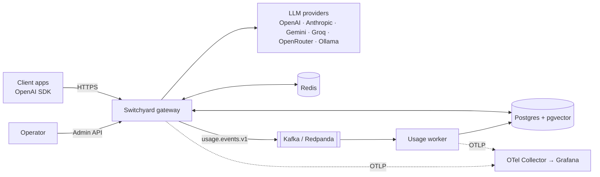
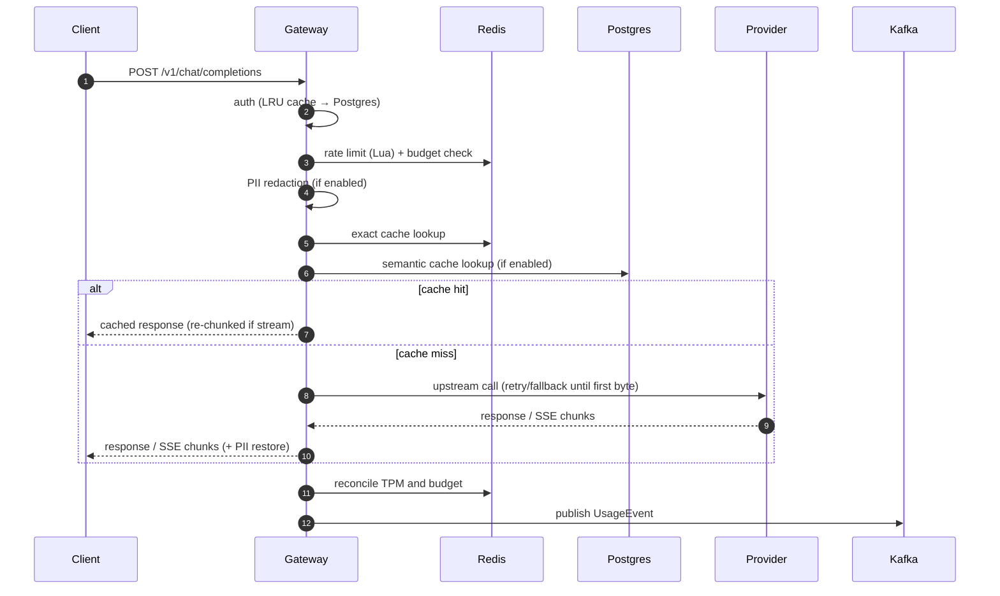

# Architecture

Switchyard is a stateless HTTP gateway backed by Redis (hot state), Postgres (durable state and vectors) and Kafka (usage events). Decisions behind each choice are recorded in [ADRs](adr).

## Context



## Processes

| Process | Entry point | Responsibility |
|---|---|---|
| Gateway | `src/server.ts` | Public `/v1/*` API, Admin API, health endpoints |
| Usage worker | `src/worker.ts` | Consume usage events, idempotent insert, daily aggregates, DLQ |

Both are stateless and can run several instances.

## Request pipeline



Each stage is a small module with its own span (`switchyard.auth`, `switchyard.ratelimit`, …), so traces show exactly where time goes.

## Code layout

```
src/
├─ server.ts / worker.ts / app.ts
├─ config/      Zod schema, loader, hot reload
├─ core/        canonical types, errors, ports (interfaces), no infra imports
├─ modules/     auth · ratelimit · budget · pii · cache · routing · providers · proxy · usage · admin
└─ infra/       db (Drizzle) · redis · kafka · telemetry · logger
```

Dependency rule: `modules → core ← infra`. `core` never imports `modules` or `infra`. The Fastify app is built by `buildApp(deps)` so tests inject fakes.

## Data model

| Table | Purpose |
|---|---|
| `teams` | Tenant, monthly budget, soft limit percentage |
| `api_keys` | Hashed virtual keys, allowed models, limits, PII mode, cache opt-in, status |
| `usage_events` | One row per request (metadata only, ADR-0010), id = UUIDv7 |
| `usage_daily` | Aggregates per day/team/key/model |
| `semantic_cache_entries` | Embedding `vector(768)` + response, scoped by team/model/params (ADR-0009), HNSW index |

## Failure behaviour

| Dependency down | Behaviour |
|---|---|
| Provider | Retry with backoff, then next candidate; circuit breaker opens after repeated failures |
| Redis | Rate limits fail open, hard budgets fail closed (configurable), exact cache skipped |
| Postgres | Auth served from LRU cache for known keys; new keys fail with 503; semantic cache skipped |
| Kafka | Events buffered in memory up to a bound, then dropped and counted |

## Related documents
- [Spec backlog](specs/README.md)
- [Threat model](threat-model.md)
- [Benchmarks](benchmarks.md)
