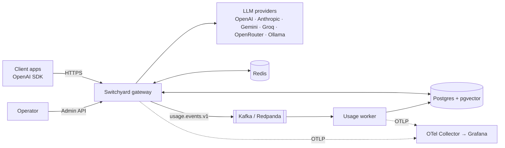
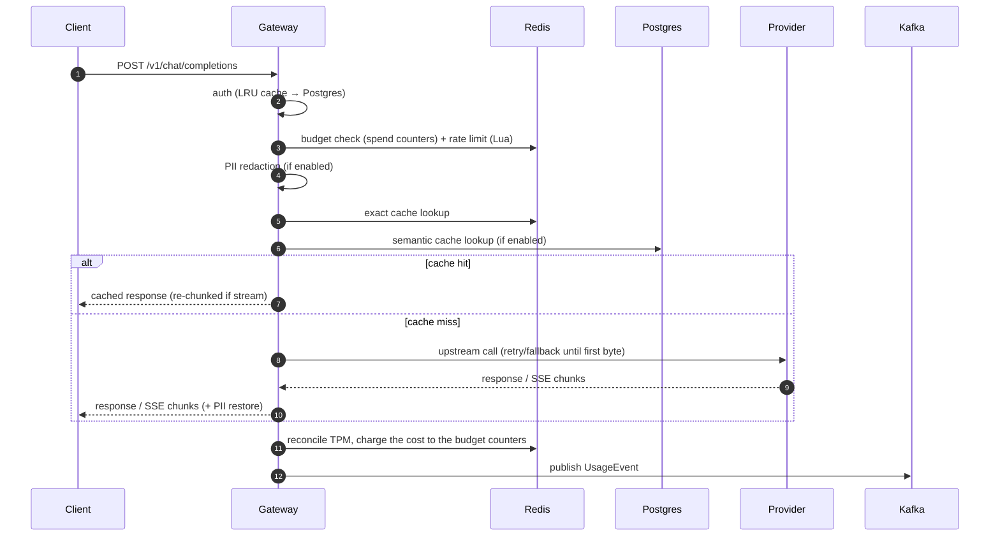

# Architecture

Switchyard is a stateless HTTP gateway backed by Redis (hot state), Postgres (durable state and vectors) and Kafka (usage events). Decisions behind each choice are recorded in [ADRs](adr).

## Context



## Processes

| Process | Entry point | Responsibility |
|---|---|---|
| Gateway | `src/server.ts` | Public `/v1/*` API, Admin API, health endpoints |
| Usage worker | `src/worker.ts` (wired in `src/usage-worker.ts`) | Consume usage events, idempotent insert, daily aggregates, DLQ |

Both are stateless and can run several instances.

## Request pipeline



Each stage is a small module with its own span (`switchyard.auth`, `switchyard.ratelimit`, …), so traces show exactly where time goes.

### Request outcome hook

Every request admitted by the rate limiter gets an **outcome tracker** (`src/modules/usage/outcome.ts`, spec 006). The proxy routes end it exactly once (success, upstream error, mid-stream failure, client disconnect, policy rejection), and it hands one `UsageEvent` v1 to the configured `OutcomeRecorder` (`AppDeps.usageRecorder`). Later features add data to the tracker (`set({ attempts, cacheStatus, piiDetections, … })`) instead of adding completion paths. Spec 007 prices the event inside the hook (`costUsd`, also returned as `x-switchyard-cost-usd` on non-streaming responses) and fans it out to the budget charger, which adds the cost to the Redis spend counters, and to the usage publisher. The gateway's recorder is the usage publisher: it validates the event and appends it to a bounded in-memory buffer that is flushed to Kafka in the background.

`POST /v1/messages` (Anthropic Messages API, spec 014) runs the **same pipeline**: the route converts the Anthropic body into the canonical request first, carrying Anthropic-only data (thinking blocks, `cache_control`, documents) in an opaque extension that only the `anthropic` adapter reads (ADR-0016). Same-family requests are re-emitted natively; cross-family requests are translated. Responses are converted back by the route, and errors take the shape of the route the client called.

### Routing and config snapshots

Every `/v1` request reads the live config once, at its start (`request.snapshot`: config + provider registry, `src/modules/config/runtime.ts`), so a hot reload (ADR-0018) only affects new requests. Chat, embeddings and messages all go through one attempt loop (`src/modules/proxy/attempts.ts`, spec 008): candidates allowed for the key, ordered by the alias strategy, tried with retries, full-jitter backoff and per-candidate circuit breakers (`src/modules/routing/`) until the first byte. Each attempt is a `switchyard.upstream` span; the request is admitted, reconciled and recorded once.

## Code layout

```
src/
├─ server.ts / worker.ts / app.ts
├─ config/      Zod schema, loader (the live snapshot and reload triggers are in modules/config)
├─ core/        canonical types, errors, ports (interfaces), no infra imports
├─ modules/     auth · ratelimit · budget · pii · cache · routing · providers · anthropic · proxy · usage · admin · config
└─ infra/       db (Drizzle) · redis · kafka · telemetry · logger
```

Dependency rule: `modules → core ← infra`. `core` never imports `modules` or `infra`. The Fastify app is built by `buildApp(deps)` so tests inject fakes.

## Data model

| Table | Purpose |
|---|---|
| `teams` | Tenant, monthly budget, soft limit percentage |
| `api_keys` | Hashed virtual keys, allowed models, limits, PII mode, cache opt-in, status |
| `usage_events` | One row per request (metadata only, ADR-0010), id = UUIDv7 |
| `usage_daily` | Aggregates per day/team/key/model |
| `semantic_cache_entries` | Embedding `vector(768)` + response, scoped by team/model/params (ADR-0009), HNSW index |

## Failure behaviour

| Dependency down | Behaviour |
|---|---|
| Redis | Rate limits fail open, budgeted keys fail closed (`budgets.onRedisError`, configurable), exact cache skipped; counters lost on restart are rebuilt from Postgres by the worker's reconciliation |
| Provider | Before the first byte: next candidate, full-jitter backoff when a candidate repeats, up to `retry.maxAttempts` attempts within `server.timeouts.totalMs`; per-candidate circuit breaker (per instance) skips a failing candidate for `openMs`, then probes it; `503 no_healthy_upstream` when all are open. After the first byte: SSE error event, never retried (ADR-0008) |
| Postgres | Auth served from LRU cache for known keys; new keys fail with 503; semantic cache skipped; the usage worker retries the batch with backoff, without committing offsets or writing to the DLQ |
| Kafka | Gateway keeps serving; events buffered in memory up to a bound, then dropped and counted; `/readyz` unaffected |

## Related documents
- [Spec backlog](specs/README.md)
- [Threat model](threat-model.md)
- [Benchmarks](benchmarks.md)
