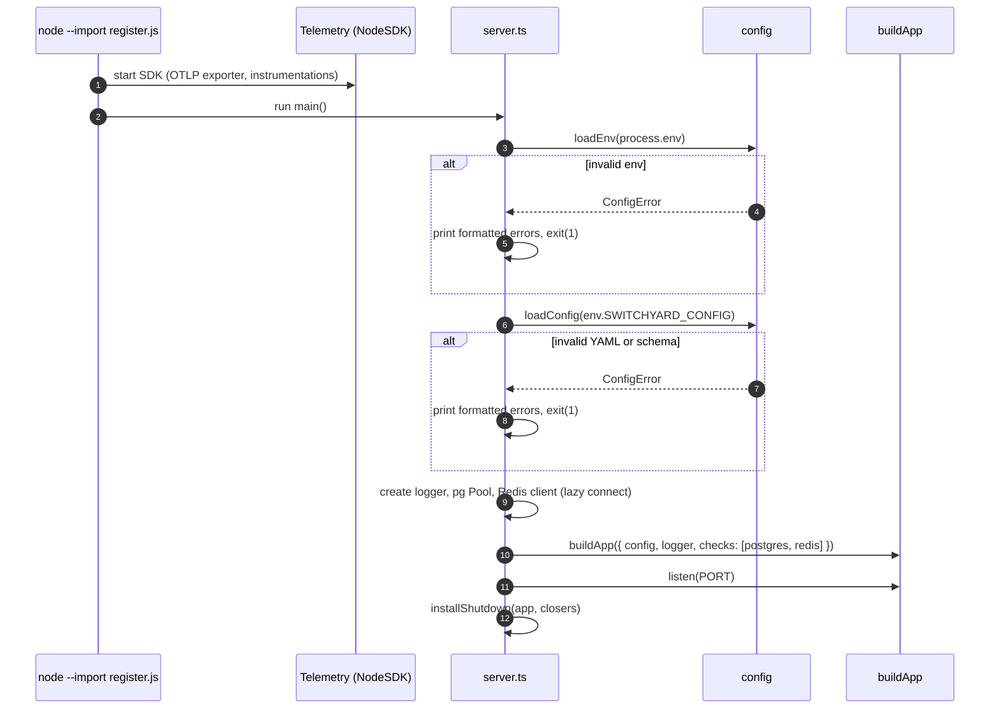
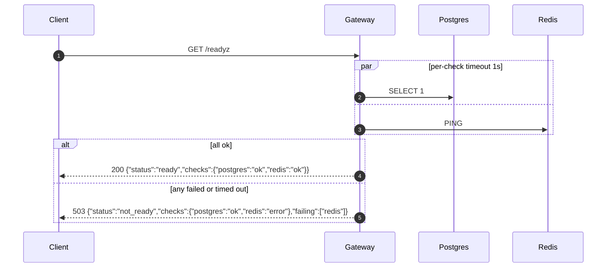

# Design 001: Project bootstrap

- **Status:** Approved (2026-10-09)
- **Spec:** [spec.md](spec.md)
- **Related ADRs:** [0002](../../adr/0002-node-typescript-fastify.md), [0011](../../adr/0011-opentelemetry.md), [0013](../../adr/0013-toolchain.md) (new, Proposed)

## 1. Overview
Spec 001 delivers a skeleton with no product features: a Fastify app with health endpoints, validated configuration, correlated logs and traces, graceful shutdown, a local Docker Compose stack and CI. Every later spec builds on these pieces, so the design favours small, injectable units that are easy to fake in tests.

## 2. Components and files

Respects the dependency rule `modules → core ← infra` from `CLAUDE.md`.

| Path | Layer | Responsibility |
|---|---|---|
| `src/server.ts` | entry | Load config, init telemetry, build app, listen, install shutdown handlers |
| `src/app.ts` | entry | `buildApp(deps): FastifyInstance`, registers plugins and routes; no I/O at import time |
| `src/config/env.ts` | config | Zod schema for environment variables; `loadEnv(process.env)` |
| `src/config/schema.ts` | config | Zod schema for `switchyard.yaml` (all top-level sections, see §4.3) |
| `src/config/load.ts` | config | Read YAML file, parse with `yaml`, validate, return typed `AppConfig` or throw `ConfigError` |
| `src/config/errors.ts` | config | `ConfigError` with a list of `{ path, message }`; `formatConfigError()` for humans |
| `src/core/health.ts` | core | Port `DependencyCheck { name: string; check(signal): Promise<void> }` and `ReadinessResult` type |
| `src/modules/health/routes.ts` | modules | `GET /healthz`, `GET /readyz` using injected `DependencyCheck[]` |
| `src/modules/health/readiness.ts` | modules | Run checks in parallel with a per-check timeout, aggregate result |
| `src/infra/db/postgres.ts` | infra | `pg` Pool factory + `DependencyCheck` (`SELECT 1`) |
| `src/infra/redis/client.ts` | infra | `ioredis` factory + `DependencyCheck` (`PING`) |
| `src/infra/telemetry/register.ts` | infra | OTel `NodeSDK` start, loaded with `node --import` before the app |
| `src/infra/telemetry/tracing.ts` | infra | Helpers: `getTraceContext()` for log correlation |
| `src/infra/logger.ts` | infra | pino factory: JSON, `mixin` adds `trace_id`/`span_id`, redacts `authorization`/`x-api-key` |
| `src/lifecycle/shutdown.ts` | entry | `installShutdown({ app, closers, timeoutMs })`: SIGTERM/SIGINT handling |
| `test/unit/**` | test | Config, readiness aggregation, routes via `app.inject()`, logger/trace correlation, shutdown |
| `test/integration/**` | test | Real Postgres + Redis via Testcontainers for `/readyz` |
| `Dockerfile` | build | Multi-stage, `node:24-bookworm-slim`, non-root user |
| `docker-compose.yml` | dev | Stack from AC-1/AC-2/AC-3 |
| `.github/workflows/ci.yml` | CI | `verify` job + `integration` job + `compose-smoke` job |
| `package.json`, `tsconfig.json`, `biome.json`, `vitest.config.ts` | tooling | See ADR-0013 |

Worker (`src/worker.ts`) and `pnpm dev:worker` are **not** part of 001; they arrive with spec 006.

## 3. Main flows

### 3.1 Startup


### 3.2 Readiness


### 3.3 Shutdown (AC-9)
1. On first SIGTERM/SIGINT: log `shutdown.start`, call `app.close()` (Fastify stops accepting connections and waits for in-flight requests).
2. Then run closers in order: Redis `quit()`, pg `end()`, OTel `sdk.shutdown()` (flushes spans).
3. A `setTimeout(timeoutMs = 9000).unref()` forces `process.exit(1)` if anything hangs, staying under the 10 s budget.
4. A second signal during shutdown exits immediately.

## 4. Public contracts

### 4.1 HTTP
| Method | Path | 200 response | Error response |
|---|---|---|---|
| GET | `/healthz` | `{"status":"ok"}` | n/a (liveness only; no dependency checks) |
| GET | `/readyz` | `{"status":"ready","checks":{...}}` | 503 `{"status":"not_ready","checks":{...},"failing":[...]}` |

Unknown routes return 404 in the OpenAI error shape: `{"error":{"message":"Route GET /x not found","type":"invalid_request_error","code":"not_found"}}`. Health endpoints use route log level `warn`, so routine probes produce no request log lines (errors still do); they still produce spans.

### 4.2 Environment variables (`src/config/env.ts`)
| Var | Required | Default | Notes |
|---|---|---|---|
| `PORT` | no | `8080` | int 1–65535 |
| `HOST` | no | `0.0.0.0` | |
| `LOG_LEVEL` | no | `info` | pino levels |
| `SWITCHYARD_CONFIG` | no | `config/switchyard.yaml` | path to YAML |
| `DATABASE_URL` | **yes** | | `postgres://` URL |
| `REDIS_URL` | **yes** | | `redis://` URL |
| `OTEL_EXPORTER_OTLP_ENDPOINT` | no | | read by the OTel SDK itself |
| `OTEL_SERVICE_NAME` | no | `switchyard-gateway` | |
| `SHUTDOWN_TIMEOUT_MS` | no | `9000` | must be < 10000 |

`ADMIN_TOKEN`, `KEY_PEPPER`, `KAFKA_BROKERS` and provider keys stay optional here; specs 004/006/002 make them required where they are used.

### 4.3 Config file (`src/config/schema.ts`)
The schema covers every top-level section of `config/switchyard.example.yaml` (`server`, `providers`, `aliases`, `retry`, `circuitBreaker`, `cache`, `pricingFile`) so the example file is validated from day one. Rules enforced in 001:
- Unknown top-level keys are rejected (`.strict()`), so typos fail at boot.
- `providers.*.type` ∈ `openai-compatible | anthropic | mock`; exactly one of `baseUrl` / `baseUrlEnv` for `openai-compatible`.
- `aliases.*.candidates` are `provider/model` strings whose provider exists in `providers`.
- Numeric timeouts and thresholds are positive; `similarityThreshold` ∈ (0, 1].
Later specs tighten their own sections; they must not loosen these rules.

Error output example (stderr, exit code 1):
```
Invalid configuration in config/switchyard.yaml:
  - aliases.fast.candidates[1]: unknown provider "grok" (known: ollama, groq, gemini, claude, mock)
  - cache.semantic.similarityThreshold: must be ≤ 1
```

### 4.4 Docker Compose (`docker-compose.yml`)
| Service | Image | Ports (host) | Limits / notes |
|---|---|---|---|
| `gateway` | built from `Dockerfile` | 8080 | `init: true`; config bind-mounted read-only (`./config:/app/config:ro`); depends on healthy `postgres`, `redis` |
| `postgres` | `pgvector/pgvector:pg17` | 5432 | named volume `pg-data`; healthcheck `pg_isready` |
| `redis` | `redis:7-alpine` (Valkey-compatible, ADR-0006) | 6379 | named volume `redis-data`; `--appendonly no`; healthcheck `redis-cli ping` |
| `redpanda` | `redpandadata/redpanda` (pinned tag) | 19092 | `redpanda start --mode dev-container --smp 1 --memory 1G --overprovisioned`; named volume `redpanda-data`; healthcheck `rpk cluster health` |
| `lgtm` | `grafana/otel-lgtm` (pinned tag) | 3000, 4317, 4318 | named volume `lgtm-data` |
| `ollama` | `ollama/ollama` | 11434 | `profiles: [ollama]`; named volume `ollama-data` |

All image tags are pinned to exact versions at implementation time (no `latest`). The gateway reaches native Ollama through `host.docker.internal` (`extra_hosts: host.docker.internal:host-gateway` for Linux).

### 4.5 Dockerfile
Multi-stage on `node:24-bookworm-slim`: `deps` (pnpm install with frozen lockfile) → `build` (tsc) → `runtime` (prod deps + `dist`, `USER node`, `CMD ["node","--import","./dist/infra/telemetry/register.js","dist/server.js"]`). Node is PID 1 under `init: true`, so SIGTERM from `docker stop` reaches the shutdown handler. **Debian instead of Alpine** because the Kafka client (ADR-0007) ships glibc prebuilds; Alpine/musl would force a native build in spec 006.

### 4.6 CI (`.github/workflows/ci.yml`)
| Job | Runs on | Steps | AC |
|---|---|---|---|
| `verify` | ubuntu-latest | checkout · setup Node 24 · corepack pnpm · install (frozen) · `pnpm verify` | AC-8 |
| `integration` | ubuntu-latest | `pnpm test:int` (Testcontainers) | AC-5 |
| `compose-smoke` | ubuntu-latest | `docker compose up -d --wait` · curl `/healthz` and `/readyz` · start gateway with a broken config and assert non-zero exit · `docker stats --no-stream` check under 4 GB · `docker compose down -v` | AC-1, AC-3, AC-4, AC-6 |

Triggers: `pull_request` and `push` to `main`. `concurrency` cancels superseded runs.

## 5. Data model / migrations
None in 001. Postgres is only checked for connectivity. The `vector` extension and the first tables arrive with spec 004 via `drizzle-kit` migrations (ADR-0005).

## 6. Observability
| Signal | Name | Source |
|---|---|---|
| Span | one server span per request (`GET /readyz`, …) with `http.route`, `http.response.status_code` | `@fastify/otel` plugin registered in `buildApp` |
| Span | `switchyard.readyz.check` per dependency, attribute `switchyard.dependency` and status | manual, in `readiness.ts` |
| Metric | `http.server.request.duration` (histogram) | HTTP instrumentation (semantic conventions) |
| Metric | `switchyard_readiness_check_failures_total{dependency}` | manual counter |
| Log | every request: `req.method`, `req.url`, `res.statusCode`, `responseTime`, `trace_id`, `span_id` | pino `mixin` reading the active span |

**Why `@fastify/otel` instead of only the monkey-patching instrumentation:** it is a Fastify plugin, so spans exist inside `app.inject()` tests without a preload hook, which makes AC-7 testable in Vitest. HTTP/pg/ioredis auto-instrumentation still runs via `register.ts` in real processes.

If the OTLP endpoint is unreachable the exporter drops data and logs a single warning; it never crashes the process. Unit tests set `OTEL_SDK_DISABLED=true` and use an `InMemorySpanExporter` where spans are asserted.

## 7. Failure modes
| Situation | Behaviour |
|---|---|
| Missing/invalid env var or config | Formatted error to stderr, exit code 1, nothing listens (AC-6) |
| Postgres or Redis down at boot | Process starts anyway (clients connect lazily); `/healthz` 200, `/readyz` 503 listing the dependency |
| Dependency hangs | Per-check timeout (1 s) → reported as `timeout`, `/readyz` 503; total `/readyz` latency bounded |
| OTLP collector down | Telemetry dropped, warning logged once, requests unaffected |
| Hung in-flight request on SIGTERM | Forced exit after `SHUTDOWN_TIMEOUT_MS` (9 s) |
| Port already in use | Fastify `listen` error logged, exit code 1 |

## 8. AC → component → test

| AC | Component(s) | Test |
|---|---|---|
| AC-1 | `docker-compose.yml`, `Dockerfile` | CI `compose-smoke`: `docker compose up -d --wait` succeeds |
| AC-2 | compose `ollama` profile, config `baseUrlEnv` | `test/unit/config/load.test.ts` resolves host Ollama URL; `docker compose --profile ollama config` lists `ollama` (CI smoke) |
| AC-3 | compose limits for Redpanda | CI `compose-smoke`: sums `docker stats` memory, asserts < 4 GB |
| AC-4 | `modules/health/routes.ts` | `test/unit/health/routes.test.ts` › `GET /healthz returns ok` |
| AC-5 | `readiness.ts`, infra checks | unit: `readiness.test.ts` (fakes: ok, fail, timeout); integration: `test/integration/readyz.int.test.ts` (Testcontainers, then stop Redis → 503 lists `redis`) |
| AC-6 | `config/env.ts`, `config/load.ts`, `server.ts` | unit: `env.test.ts`, `load.test.ts` (invalid YAML, unknown key, unknown provider); `test/unit/server/boot.test.ts` spawns the built server with a bad config and asserts exit code ≠ 0 and readable stderr |
| AC-7 | `logger.ts`, `@fastify/otel`, `tracing.ts` | `test/unit/telemetry/correlation.test.ts`: in-memory exporter + captured pino stream; the request's span `traceId` equals the log line `trace_id` |
| AC-8 | `.github/workflows/ci.yml` | Verified on the first PR after the GitHub remote exists |
| AC-9 | `lifecycle/shutdown.ts` | unit: `shutdown.test.ts` with fake app/closers and fake timers (order of closers, forced exit at timeout); Linux-only process test `shutdown.process.test.ts` sends real SIGTERM (skipped on `win32`, runs in CI) |
| AC-10 | repo files | `test/unit/repo/files.test.ts` asserts the files exist and `.gitattributes` contains `eol=lf` |

## 9. Options considered (non-trivial choices)

| Choice | Options | Pick | ADR |
|---|---|---|---|
| Toolchain (module system, build, dev runner, test, lint) | ESM + `tsc` + `tsx` + Vitest + Biome · CJS + `tsup` + Jest + ESLint/Prettier · Node 24 native type stripping without build | ESM + `tsc` + `tsx` + Vitest + Biome | [0013](../../adr/0013-toolchain.md) (Proposed) |
| Request tracing in tests | `@fastify/otel` plugin · only `instrumentation-http` via preload · manual spans in hooks | `@fastify/otel` + auto-instrumentation in real processes | covered by 0011 |
| YAML parser | `yaml` · `js-yaml` | `yaml` (maintained, good error positions) | no |
| Postgres driver for health check | `pg` · `postgres` (porsager) | `pg` (what Drizzle's `node-postgres` driver uses in 004, OTel instrumentation available) | covered by 0005 |
| Base image | `node:24-alpine` · `node:24-bookworm-slim` · distroless | `bookworm-slim` (glibc for Kafka client prebuilds) | no, noted in §4.5 |
| Shutdown helper | hand-written · `close-with-grace` | hand-written (≈ 40 lines, fully tested, no dependency) | no |

## 10. Risks
| Risk | Mitigation |
|---|---|
| Real SIGTERM can't be tested on Windows (Node emulates signals as a hard kill) | Logic tested with fakes everywhere; real-signal test runs on Linux CI only |
| Docker Desktop RAM settings lower than the stack needs | Document minimum (6 GB to the WSL2 VM) in README; `compose-smoke` measures it |
| OTel ESM auto-instrumentation needs `--import` hook ordering | `register.ts` is the first import via `node --import`; covered by a boot smoke check that a span reaches LGTM (manual check in README dev section, not an AC) |
| Pinned image tags go stale | Dependabot `docker` and `github-actions` ecosystems enabled in this spec |
| `grafana/otel-lgtm` is a dev image, not for production | Used only locally/CI; deploy (spec 013) decides production telemetry |

## 11. Out of scope (from spec)
`/v1/*` routes, auth, Kafka producer/consumer, migrations, worker process.
