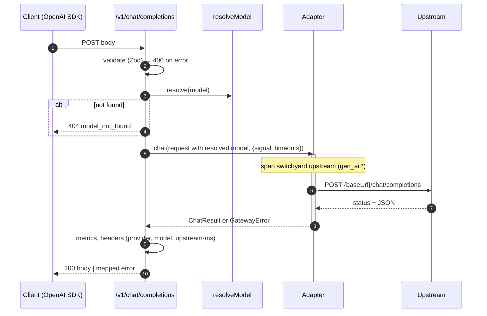

# Design 002: Chat proxy (non-streaming)

- **Status:** Approved (2026-10-10, via `/ship` after spec approval)
- **Spec:** [spec.md](spec.md)
- **Related ADRs:** [0002](../../adr/0002-node-typescript-fastify.md) (undici), [0003](../../adr/0003-openai-compatible-api.md), [0004](../../adr/0004-canonical-format-and-adapters.md), [0010](../../adr/0010-no-prompt-persistence.md), [0011](../../adr/0011-opentelemetry.md)

## 1. Overview
Adds the first product path: `POST /v1/chat/completions` (non-streaming) and `GET /v1/models`. A request is validated, its `model` is resolved to a provider + model, the matching adapter calls the upstream with timeouts, and the response is returned in OpenAI format with Switchyard headers, a `switchyard.upstream` span and metrics. Spec-level open questions are resolved as proposed: `x-switchyard-upstream-ms` **is** exposed; pass-through for non-OpenAI providers is decided in spec 014.

## 2. Components and files

| Path | Layer | Responsibility |
|---|---|---|
| `src/core/chat.ts` | core | Canonical types: `ChatRequest` (validated fields + pass-through rest), `ChatCompletion` (OpenAI response shape, loose), `Usage` |
| `src/core/provider.ts` | core | Port `ChatProvider { name; system; chat(req, ctx): Promise<ChatResult> }`; `ChatResult { body, usage?, responseModel?, upstreamMs }`; `CallContext { signal, timeouts }` |
| `src/core/errors.ts` | core | Extend with `GatewayError(status, type, code, message)` and helpers `invalidRequest`, `modelNotFound`, `upstreamError`, `upstreamTimeout`, `providerNotImplemented`, `providerNotConfigured` |
| `src/modules/providers/openai-compatible.ts` | modules | HTTP adapter via an injected `HttpClient` port; maps upstream status/errors to `GatewayError` |
| `src/modules/providers/mock.ts` | modules | Deterministic adapter (§4.4) |
| `src/modules/providers/not-implemented.ts` | modules | `anthropic` placeholder → 501 |
| `src/modules/providers/registry.ts` | modules | `createProviderRegistry(config, env, deps)` → `Map<name, ChatProvider>`; resolves API keys from env |
| `src/modules/routing/resolve.ts` | modules | Pure `resolveModel(model, config)` → `{ provider, model, alias? }` or `undefined` |
| `src/modules/routing/models.ts` | modules | Pure `listModels(config)` for `/v1/models` |
| `src/modules/proxy/schema.ts` | modules | Zod schema for the chat body (`looseObject`, unknown fields kept) |
| `src/modules/proxy/routes.ts` | modules | Fastify routes, headers, span + metrics around the upstream call |
| `src/modules/proxy/telemetry.ts` | modules | Span helper and meters (`switchyard_requests_total`, `switchyard_upstream_duration_seconds`) |
| `src/infra/http/undici-client.ts` | infra | `HttpClient` implementation on an undici `Agent` with connect/headers/body timeouts |
| `src/app.ts` | entry | New deps (§3), global error handler mapping to OpenAI error shape, `genReqId`, `x-switchyard-request-id` header on every response |
| `src/server.ts` | entry | Build registry from loaded config and `process.env` |
| `test/contract/*.contract.test.ts` | test | Official `openai` SDK against the gateway (mock always; Ollama if reachable) |
| `vitest.config.ts`, `package.json` | tooling | `contract` project, `test:contract`, coverage thresholds in `verify` |
| `docker-compose.yml` | dev | Bind published ports to `127.0.0.1` (unauthenticated API until spec 004) |

## 3. App dependencies
```ts
interface AppDeps {
  logger: FastifyBaseLogger;
  checks: DependencyCheck[];
  config: LoadedConfig;                 // aliases, providers, server.timeouts
  providers: ReadonlyMap<string, ChatProvider>;
  bodyLimitBytes?: number;
  readinessTimeoutMs?: number;
}
```
`server.ts` builds `providers` with `createProviderRegistry(config, process.env, { http: createUndiciClient(config.server.timeouts) })`. Tests inject a registry with the mock adapter or a fake `HttpClient`.

## 4. Contracts

### 4.1 `POST /v1/chat/completions`
Request validation (Zod `looseObject`, unknown keys preserved for pass-through):
- `model`: non-empty string (required)
- `messages`: non-empty array of objects with string `role` (required; content is not inspected)
- `stream`: optional boolean; `true` → 400 `stream_not_supported`

Model resolution (`resolveModel`), in order:
1. `model` equals an alias name → the alias's **first** candidate (`provider/model`).
2. `model` = `<provider>/<rest>` where `<provider>` is configured → `{ provider, model: rest }` (`rest` may contain `/`).
3. Otherwise → 404 `model_not_found`.

The upstream body is the client body with `model` replaced by the resolved model. Response: the provider's JSON body, unchanged, status 200.

Response headers (all `/v1/*` responses, including errors after resolution):

| Header | When | Value |
|---|---|---|
| `x-switchyard-request-id` | always (every route) | Fastify request id, `req_<uuid>` |
| `x-switchyard-provider` | model resolved | provider config name |
| `x-switchyard-model` | model resolved | resolved model id |
| `x-switchyard-upstream-ms` | upstream call made | integer ms of the upstream call |

### 4.2 Error mapping

| Situation | Status | `type` | `code` |
|---|---|---|---|
| Invalid JSON / schema / content type | 400 (415 kept for wrong content type) | `invalid_request_error` | `invalid_request` / `invalid_json` |
| Body over `server.bodyLimitBytes` | 413 | `invalid_request_error` | `request_too_large` |
| `stream: true` | 400 | `invalid_request_error` | `stream_not_supported` |
| Unknown model | 404 | `invalid_request_error` | `model_not_found` |
| Provider type not implemented (`anthropic`) | 501 | `server_error` | `provider_not_implemented` |
| `apiKeyEnv` set but env var empty | 503 | `server_error` | `provider_not_configured` (message names the variable, never a value) |
| Upstream 4xx | same | upstream `error.type` if present, else `invalid_request_error` | upstream `error.code` if present, else `upstream_<status>` |
| Upstream 5xx, connection refused/reset, connect timeout, invalid JSON response | 502 | `server_error` | `upstream_error` |
| Headers (TTFB) or total timeout | 504 | `server_error` | `upstream_timeout` |
| Anything unexpected | 500 | `server_error` | `internal_error` (generic message; details only in logs) |

Upstream 4xx messages are passed through (they help the client fix its request). Upstream 5xx bodies are **not** passed through (may leak provider internals).

### 4.3 `GET /v1/models`
```json
{ "object": "list", "data": [
  { "id": "fast", "object": "model", "created": 1791590000, "owned_by": "switchyard" },
  { "id": "groq/llama-3.1-8b-instant", "object": "model", "created": 1791590000, "owned_by": "groq" }
] }
```
Aliases first (config order), then distinct `provider/model` candidates in first-seen order. `created` = gateway start time (seconds).

### 4.4 Mock provider
- Response: `chat.completion` with `id: "chatcmpl-mock-<n>"`, `model` = requested model, one choice, content `"This is a mock response."`, `finish_reason: "stop"`.
- Usage: `prompt_tokens` = ceil(total characters of string `content` fields / 4), `completion_tokens` = 6, `total_tokens` = sum. Deterministic; content is never echoed.
- `latencyMs`: awaited before responding (abortable by the call signal).
- Failures: `errorRate` uses an injectable `random()` (default `Math.random`). **On demand:** a model named `error-<status>` (e.g. `mock/error-500`, `mock/error-429`) fails with that status and an OpenAI-shaped body. Model names are config-free, so tests need no extra headers or plumbing.

### 4.5 Upstream HTTP (`HttpClient` port)
```ts
interface HttpClient {
  postJson(url: string, body: unknown, opts: { headers: Record<string,string>; signal: AbortSignal }):
    Promise<{ status: number; body: unknown | undefined; rawText: string }>;
}
```
`undici-client.ts` uses one shared `Agent({ connectTimeout: connectMs, headersTimeout: ttfbMs, bodyTimeout: totalMs, keepAliveTimeout: 30s })`; the adapter adds `AbortSignal.timeout(totalMs)` combined with the request's abort signal (client disconnect). Errors are normalised to `UpstreamNetworkError` / `UpstreamTimeoutError` in infra so modules never import undici. URL = `baseUrl` + `/chat/completions`; header `authorization: Bearer <key>` only when a key is configured.

## 5. Main flow


## 6. Observability
| Signal | Name | Attributes |
|---|---|---|
| Span | `switchyard.upstream` (child of the request span), kind CLIENT | `gen_ai.operation.name=chat`, `gen_ai.system=<provider name>`, `gen_ai.request.model`, `gen_ai.response.model`, `gen_ai.usage.input_tokens`, `gen_ai.usage.output_tokens`, `switchyard.provider.type`, `http.response.status_code`; status ERROR with the gateway `code` on failure |
| Counter | `switchyard_requests_total` | `provider`, `model`, `status` (HTTP status returned to the client) |
| Histogram | `switchyard_upstream_duration_seconds` | `provider`, `model`, `outcome` (`ok`/`error`/`timeout`) |
| Log | `upstream request failed` at `warn` for 5xx/timeout | `provider`, `model`, `code`, `upstreamStatus`; never message content |

The undici instrumentation (spec 001) adds the raw HTTP client span under `switchyard.upstream`.

## 7. Failure modes
- Client disconnects mid-request → request `AbortSignal` aborts the upstream call; no response written; counted with status `499`.
- Provider returns 200 with non-JSON → 502 `upstream_error` (message: "invalid response from provider").
- Provider returns 200 without `usage` → response passed through; usage attributes omitted.
- Config hot reload is out of scope (spec 008); registry is built once at boot.

## 8. AC → component → test

| AC | Component(s) | Test |
|---|---|---|
| AC-1 | `resolve.ts`, `routes.ts`, mock | `test/unit/proxy/chat.test.ts` › alias resolves to first candidate and returns completion |
| AC-2 | `resolve.ts` | `test/unit/routing/resolve.test.ts` › provider/model with slashes; `chat.test.ts` › direct provider/model |
| AC-3 | `resolve.ts`, `routes.ts` | `chat.test.ts` › unknown model → 404 and provider not called |
| AC-4 | `schema.ts`, app error handler | `chat.test.ts` › invalid JSON, missing messages, wrong types, stream true |
| AC-5 | `openai-compatible.ts`, `registry.ts` | `test/unit/providers/openai-compatible.test.ts` (fake `HttpClient`) › passes unknown fields, sends bearer key, omits auth without key; registry › missing key → 503 |
| AC-6 | `openai-compatible.ts`, `undici-client.ts` | `openai-compatible.test.ts` › 4xx passthrough, 5xx→502, network→502, timeout→504; `test/integration/upstream-http.int.test.ts` › real undici client against a local slow/failing HTTP server (headers timeout → 504, refused → 502) |
| AC-7 | `app.ts`, `routes.ts` | `chat.test.ts` › headers on success and on error; `routes.test.ts` (health) › request id on every route |
| AC-8 | `models.ts`, `routes.ts` | `test/unit/routing/models.test.ts`; `chat.test.ts` › GET /v1/models |
| AC-9 | `telemetry.ts` | `test/unit/proxy/telemetry.test.ts` › span attributes with in-memory exporter, no content attributes; metrics via in-memory `MetricReader` |
| AC-10 | `mock.ts` | `test/unit/providers/mock.test.ts` › deterministic body/usage, latency, `error-<status>`, `errorRate` with fixed random |
| AC-11 | contract suite | `test/contract/openai-sdk.contract.test.ts` › mock (always) and Ollama (skip if unreachable) |
| AC-12 | `vitest.config.ts`, `verify` script | `pnpm verify` runs unit tests with coverage thresholds (lines ≥ 80% for `src/core/**`, `src/modules/**`) |

## 9. Options considered

| Choice | Options | Pick | ADR |
|---|---|---|---|
| Upstream HTTP client | global `fetch` · undici `Agent` + `request` · official provider SDKs | undici `Agent` (precise connect/headers/body timeouts, connection reuse; ADR-0002) behind an `HttpClient` port | covered by 0002 |
| Request validation | Fastify JSON schema · Zod | Zod (same tool as config, typed result, readable field paths) | no |
| Mock failure trigger | special header · model name `error-<status>` · config only | model name (no plumbing, works through the OpenAI SDK) | no |
| Missing API key | fail at boot · 503 at request time | 503 at request time (example config lists providers the user may not have keys for) | no |

## 10. Risks
| Risk | Mitigation |
|---|---|
| Provider "OpenAI-compatible" endpoints differ in small ways (error shapes, extra fields) | Pass bodies through untouched; parse only `usage`/`model` loosely; contract test against Ollama |
| Unauthenticated `/v1/*` until spec 004 | Compose binds ports to `127.0.0.1`; README warning |
| Coverage threshold slows the inner loop | `pnpm test` stays coverage-free; only `verify` enforces it |
