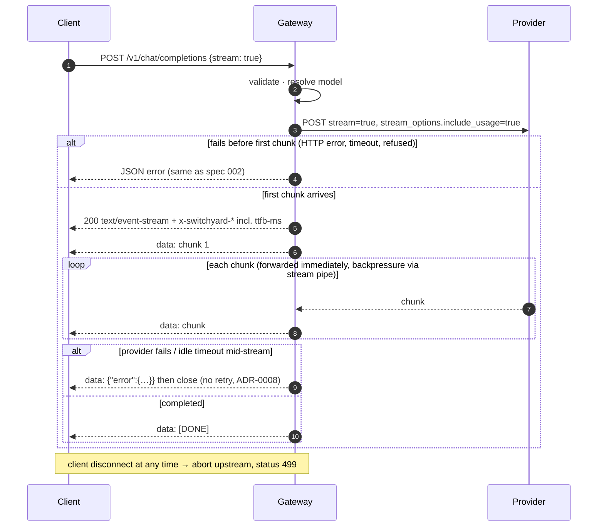

# Design 003: Streaming (SSE) and embeddings

- **Status:** Approved (2026-10-13, via `/ship` after spec approval)
- **Spec:** [spec.md](spec.md)
- **Related ADRs:** 0003, 0004, 0005, [0008](../../adr/0008-no-retry-after-first-byte.md), 0010, 0011

Spec open questions resolved as proposed: once streaming has started only the **idle** (between-chunk) timeout applies; no SSE heartbeats in this spec.

**Spec correction:** the official Node and Python SDKs request embeddings with `encoding_format: "base64"` by default. The mock therefore **does** honour `encoding_format` (float32 little-endian, base64) instead of always returning floats; real providers receive the field unchanged.

## 1. Provider port changes (`src/core/provider.ts`)

```ts
interface ChatProvider {
  readonly name: string;
  readonly type: string;
  chat(request: ChatRequest, ctx: CallContext): Promise<ChatResult>;
  /** Resolves once the stream is open; pre-first-chunk failures reject (GatewayError). */
  chatStream(request: ChatRequest, ctx: CallContext): Promise<ChatStream>;
  embeddings(request: EmbeddingsRequest, ctx: CallContext): Promise<EmbeddingsResult>;
}

/** Iterating may throw GatewayError mid-stream (ADR-0008: never retried). */
type ChatStream = AsyncIterable<ChatChunk>;   // ChatChunk = parsed `chat.completion.chunk` JSON

interface HttpClient {
  postJson(...): Promise<HttpResponse>;                       // unchanged
  postStream(url, body, { headers, signal }): Promise<HttpStreamResponse>;
}
interface HttpStreamResponse {
  status: number;
  /** For non-2xx: the full error body. */
  text(): Promise<string>;
  /** For 2xx: raw body bytes; throws UpstreamTimeoutError / UpstreamNetworkError. */
  body: AsyncIterable<Uint8Array>;
}
```

Failure placement is what makes ADR-0008 enforceable: everything up to and including the **first chunk** surfaces as a rejected promise / first `next()` failure (JSON error, retry-safe in spec 008); anything after is a mid-stream failure.

## 2. Components and files

| Path | Responsibility |
|---|---|
| `src/core/{chat,provider}.ts` | `ChatChunk`, `EmbeddingsRequest`, `EmbeddingsResult`, `ChatStream`, `HttpStreamResponse` |
| `src/modules/providers/sse.ts` | Pure SSE decoder: bytes → `data:` payloads; handles `\r\n`, partial lines, comments, `[DONE]` |
| `src/modules/providers/openai-compatible.ts` | `chatStream` (POST with `stream: true` + `stream_options.include_usage: true`), `embeddings` (POST `/embeddings`); shared error mapping |
| `src/modules/providers/mock.ts` | Streaming (configurable `chunkDelayMs`), `error-midstream`, deterministic 768-dim embeddings (float or base64) |
| `src/modules/providers/not-implemented.ts` | Failing provider rejects on all three methods |
| `src/infra/http/undici-client.ts` | `postStream`: per-request `bodyTimeout = ttfbMs` (idle), total timer cancelled at the first body byte |
| `src/modules/proxy/stream.ts` | `pipeStream()`: pulls the first chunk, builds the SSE `Readable`, usage forwarding rules, estimation, mid-stream error event, client-disconnect handling |
| `src/modules/proxy/usage.ts` | Pure helpers: extract usage from chunks, estimate tokens (chars / 4), strip usage when the client did not ask |
| `src/modules/proxy/telemetry.ts` | Adds `startUpstreamSpan()` (handle with `firstChunk()`, `succeed(usage)`, `fail(error, phase)`, `clientGone()`) and `switchyard_ttfb_seconds`; existing `tracedUpstreamCall` reuses it |
| `src/modules/proxy/routes.ts` | Branch on `stream`; new `POST /v1/embeddings` |
| `src/modules/proxy/schema.ts` | `stream_options` passthrough; embeddings body schema |
| `src/config/schema.ts` | mock `chunkDelayMs` (default 0) |
| `config/switchyard.example.yaml` | `embed` alias → `ollama/nomic-embed-text` |
| `test/contract/python/test_openai_sdk.py`, `scripts/contract-python.ts` | Python SDK contract suite driven by a Node launcher |

## 3. Streaming flow



Implementation: the route awaits `provider.chatStream()` and pulls the first chunk itself. Only then does it set headers and call `reply.send(Readable.from(generator))`; Fastify pipes it with backpressure and still runs `onSend`/`onResponse` hooks (request-id header, request span). When the client disconnects, the `Readable` is destroyed, so the generator's `finally` runs: it aborts the upstream `AbortController` and records 499.

### Usage rules (AC-7)
- Upstream body always gets `stream_options: { include_usage: true }` (merged with the client's `stream_options`).
- Client asked for usage (`stream_options.include_usage === true`) → chunks forwarded unchanged.
- Client did not ask → chunks with empty `choices` and a `usage` field are dropped; `usage` is deleted from any other chunk.
- No usage seen by the end → input = chars of string message contents / 4, output = chars of `delta.content` / 4 (rounded up); span `switchyard.usage.estimated=true`. Content is only counted, never stored.

### Timeouts
| Phase | Limit | Result |
|---|---|---|
| connect | `connectMs` | 502 JSON |
| until response headers | `ttfbMs` | 504 JSON |
| headers → first body byte | `totalMs` (total timer) and `ttfbMs` (idle) | 504 JSON |
| between chunks | `ttfbMs` (undici `bodyTimeout`) | mid-stream `upstream_timeout` event |

## 4. Embeddings

`POST /v1/embeddings` body: `model` (string), `input` (string, non-empty string array, or token arrays, passed through), other fields passed through. Same resolution, headers (`x-switchyard-upstream-ms` included), error mapping and `switchyard.upstream` span (`gen_ai.operation.name=embeddings`, `gen_ai.usage.input_tokens`). Response: provider body unchanged.

Mock embeddings: for each input string, a seeded PRNG (FNV-1a hash of the text → mulberry32) produces 768 values, L2-normalised; same text → same vector. `encoding_format: "base64"` → `Float32Array` (little-endian) bytes in base64. Usage `prompt_tokens` = ceil(chars / 4).

## 5. Observability additions
| Signal | Name | Labels / attributes |
|---|---|---|
| Histogram | `switchyard_ttfb_seconds` | `provider`, `model` |
| Span attrs | `switchyard.stream=true`, `switchyard.ttfb_ms`, `switchyard.usage.estimated` | on `switchyard.upstream` |
| Counter status | `200`, `upstream_error_midstream`, `499` for streams | `switchyard_requests_total` |

## 6. AC → test

| AC | Test |
|---|---|
| AC-1 | `test/unit/proxy/stream.test.ts` › SSE content type, events in order, `[DONE]` |
| AC-2 | `test/integration/streaming.int.test.ts` › real HTTP listener, mock with 200 ms chunk delay: first chunk received before the last is produced |
| AC-3 | `stream.test.ts` › headers incl. `x-switchyard-ttfb-ms` |
| AC-4 | `stream.test.ts` › unknown model 404, `mock/error-500` 502 JSON, pre-first-chunk timeout 504 |
| AC-5 | `stream.test.ts` › `mock/error-midstream` → error event, no `[DONE]`, status label `upstream_error_midstream`; `openai-compatible.test.ts` › idle timeout mid-stream → `upstream_timeout` |
| AC-6 | `streaming.int.test.ts` › client aborts → upstream signal aborted < 1 s, status 499 |
| AC-7 | `test/unit/proxy/usage.test.ts`; `stream.test.ts` › usage chunk only when requested; estimation flag |
| AC-8 | `test/unit/proxy/telemetry.test.ts` › stream span, ttfb histogram, no content |
| AC-9 | `test/unit/providers/mock.test.ts` › stream chunks, delay, `error-midstream` |
| AC-10 | `test/unit/proxy/embeddings.test.ts`; `openai-compatible.test.ts` › embeddings URL/body/errors |
| AC-11 | `mock.test.ts` › 768 dims, deterministic, base64 round-trip; `telemetry.test.ts` › embeddings operation name |
| AC-12 | `test/unit/config/schema.test.ts` › example config has `embed` alias |
| AC-13 | `test/contract/openai-sdk.contract.test.ts` (Node), `test/contract/python/test_openai_sdk.py` via `pnpm test:contract:py` |

Also: `test/unit/providers/sse.test.ts` for the decoder; `test/integration/upstream-http.int.test.ts` for `postStream` timeouts.

## 7. Risks
| Risk | Mitigation |
|---|---|
| Hidden buffering (compression, proxies) | No compression plugin; AC-2 test over a real socket; `x-accel-buffering: no` header |
| Upstream left running after client disconnect | Abort in generator `finally`; AC-6 test asserts the upstream signal |
| SSE framing differences between providers | Tolerant decoder (`\r\n`, comments, multi-line `data:`), contract test against Ollama |
| Python SDK in CI adds a toolchain | Separate CI job with `actions/setup-python`; local run optional |
