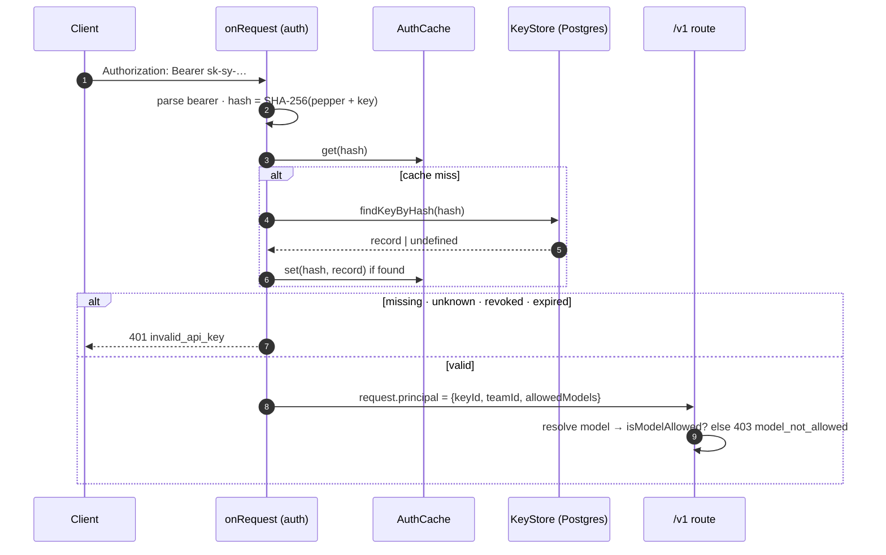

# Design 004: Virtual API keys, teams and the admin API

- **Status:** Approved (2026-10-13, via `/ship` after spec approval)
- **Spec:** [spec.md](spec.md)
- **Related ADRs:** 0005 (Postgres + Drizzle), 0010, 0011, [0014](../../adr/0014-zod-validation-openapi-docs.md) (new, Proposed)

Spec open questions resolved as proposed: `MIGRATE_ON_BOOT` defaults to `false` (Compose sets `true`); Compose ships `dev-only-…` defaults for `ADMIN_TOKEN` and `KEY_PEPPER` and the gateway logs a warning when they are in use.

## 1. Data model (Drizzle, `src/infra/db/schema.ts`)

```sql
CREATE TABLE teams (
  id          uuid PRIMARY KEY DEFAULT gen_random_uuid(),
  name        text NOT NULL UNIQUE,
  created_at  timestamptz NOT NULL DEFAULT now()
);

CREATE TYPE api_key_status AS ENUM ('active', 'revoked');

CREATE TABLE api_keys (
  id              uuid PRIMARY KEY DEFAULT gen_random_uuid(),
  team_id         uuid NOT NULL REFERENCES teams(id) ON DELETE CASCADE,
  name            text NOT NULL,
  key_hash        char(64) NOT NULL UNIQUE,      -- hex SHA-256(pepper + key)
  key_prefix      text NOT NULL,                 -- first 10 chars, for display only
  allowed_models  text[],                        -- NULL or empty = any model
  status          api_key_status NOT NULL DEFAULT 'active',
  expires_at      timestamptz,
  created_at      timestamptz NOT NULL DEFAULT now(),
  revoked_at      timestamptz
);
CREATE INDEX api_keys_team_id_idx ON api_keys(team_id);
```

Migrations are generated by `drizzle-kit generate` into `drizzle/` (committed SQL) and applied by `drizzle-orm/node-postgres/migrator`, from `pnpm db:migrate` or at boot when `MIGRATE_ON_BOOT=true`. Later specs add columns (limits, budgets) with their own migrations.

## 2. Ports and components

```ts
// src/core/auth.ts
interface Team { id: string; name: string; createdAt: Date }
interface ApiKeyRecord {
  id: string; teamId: string; name: string; prefix: string;
  allowedModels: string[] | null; status: "active" | "revoked";
  expiresAt: Date | null; createdAt: Date; revokedAt: Date | null;
}
interface Principal { keyId: string; teamId: string; allowedModels: string[] | null }

interface KeyStore {
  findKeyByHash(hash: string): Promise<ApiKeyRecord | undefined>;
  createTeam(name: string): Promise<Team>;              // throws GatewayError 409 on duplicate
  listTeams(): Promise<Team[]>;
  getTeam(id: string): Promise<Team | undefined>;
  createKey(input: NewKey): Promise<ApiKeyRecord>;
  listKeys(teamId?: string): Promise<ApiKeyRecord[]>;
  revokeKey(id: string): Promise<ApiKeyRecord | undefined>;
}
```

| Path | Responsibility |
|---|---|
| `src/core/auth.ts` | Types and `KeyStore` port |
| `src/core/errors.ts` | `invalidApiKey` (401), `modelNotAllowed` (403), `notFound` (404), `conflict` (409), `invalidAdminToken` (401) |
| `src/modules/auth/keys.ts` | `generateKey()` (32 random bytes → base62, `sk-sy-` prefix), `hashKey(pepper, key)`, `displayPrefix(key)`, `parseBearer(header)` |
| `src/modules/auth/cache.ts` | `AuthCache`: TTL (30 s) + LRU (10 000 entries) keyed by hash; `invalidateKey(keyId)` |
| `src/modules/auth/authenticate.ts` | `onRequest` hook for `/v1/*`: bearer → hash → cache/store → validity (status, expiry) → `request.principal` |
| `src/modules/auth/models.ts` | `isModelAllowed(principal, requested, resolvedRef)`; entries match exactly or as `provider/*` |
| `src/modules/admin/routes.ts` | Admin API with Zod validation; constant-time token check (SHA-256 both sides, `timingSafeEqual`) |
| `src/infra/db/{schema,client,key-store,migrate}.ts` | Drizzle schema, `drizzle(pool)`, `DrizzleKeyStore` (maps `23505` → 409), migration runner |
| `scripts/db-migrate.ts` | `pnpm db:migrate` |
| `src/app.ts` | Registers `@fastify/swagger` + `@fastify/swagger-ui`, no-op validator/serializer compilers (ADR-0014), admin routes when `ADMIN_TOKEN` is set |
| `src/config/env.ts` | `KEY_PEPPER` (required, ≥ 32 chars), `ADMIN_TOKEN` (optional, ≥ 16 chars), `MIGRATE_ON_BOOT` (default `false`) |
| `test/helpers/memory-key-store.ts` | In-memory `KeyStore` for unit and contract tests |

## 3. Request authentication flow



Only found keys are cached (unknown keys always hit the database; rate limiting in spec 005 protects it). Expiry is checked on every request, including cache hits. Revocation through the admin API calls `cache.invalidateKey(id)` on that instance; other instances converge within the 30 s TTL (AC-6).

## 4. Admin API

| Method | Path | Body / query | Response |
|---|---|---|---|
| POST | `/admin/teams` | `{ name }` (1–100 chars) | `201 { id, name, createdAt }`; `409 conflict` on duplicate |
| GET | `/admin/teams` | | `{ data: Team[] }` |
| POST | `/admin/keys` | `{ teamId (uuid), name, allowedModels?: string[], expiresAt?: ISO date in the future }` | `201 { id, key, prefix, teamId, name, allowedModels, expiresAt, createdAt }` (only time `key` is returned); `404` unknown team |
| GET | `/admin/keys` | `?teamId=` | `{ data: KeyView[] }` (no hash, no key) |
| POST | `/admin/keys/:id/revoke` | | `{ …KeyView, status: "revoked" }`; `404` unknown id; idempotent |

All admin routes: `Authorization: Bearer <ADMIN_TOKEN>`; wrong or missing → `401 invalid_admin_token`. Not registered at all when `ADMIN_TOKEN` is unset (`404` via the not-found handler). Admin responses carry `cache-control: no-store`.

## 5. Observability
- Span attributes on the request span and `switchyard.upstream`: `switchyard.team_id`, `switchyard.key_id`.
- `switchyard_requests_total` gains a `team` label (team id).
- Logs: request logs include `teamId`/`keyId`; the bearer header is already redacted (spec 001).
- Counter `switchyard_auth_failures_total{reason}` with reasons `missing`, `malformed`, `unknown`, `revoked`, `expired`.

## 6. OpenAPI
`@fastify/swagger` (OpenAPI 3.1) builds the document from route `schema` objects (summary, tags, body, params, querystring); `@fastify/swagger-ui` serves it at `/docs`. Per ADR-0014 these schemas are **documentation only**: Zod remains the single validator and response bodies are serialised with `JSON.stringify`, so provider responses are never filtered by a response schema.

## 7. AC → test

| AC | Test |
|---|---|
| AC-1 | `test/integration/db.int.test.ts` › migrations create tables, second run is a no-op |
| AC-2 | `test/unit/auth/keys.test.ts` › format, entropy length, hash, prefix; `admin.test.ts` › key returned once, never listed |
| AC-3 | `test/unit/auth/authenticate.test.ts` › valid key → principal; telemetry › team label and span attributes |
| AC-4 | `authenticate.test.ts` › missing, malformed, unknown, revoked, expired → 401, provider not called; health routes open |
| AC-5 | `test/unit/auth/models.test.ts`; `chat.test.ts`/`embeddings.test.ts` › 403; `/v1/models` filtered |
| AC-6 | `test/unit/auth/cache.test.ts` › TTL, LRU eviction, invalidateKey; `admin.test.ts` › revoked key rejected immediately |
| AC-7 | `test/unit/admin/admin.test.ts` › every route, validation 400, 404, 409, no secrets in listings; `db.int.test.ts` › Drizzle store incl. 23505 → 409 |
| AC-8 | `admin.test.ts` › wrong/missing token 401, routes absent without `ADMIN_TOKEN`, boot warning |
| AC-9 | `env.test.ts` › missing or short `KEY_PEPPER` |
| AC-10 | `test/unit/app/openapi.test.ts` › `/docs/json` lists admin and `/v1` paths; `/docs` returns HTML |
| AC-11 | Node and Python contract suites authenticate with an admin-created key; bad key → `AuthenticationError` |
| AC-12 | `scripts/compose-smoke.ts` › 401 without key, admin creates team + key, chat with key succeeds |

## 8. Risks
| Risk | Mitigation |
|---|---|
| Pepper loss makes every key unusable | Documented: back up `KEY_PEPPER` with the database; rotation is a future spec |
| Unknown-key floods hit Postgres | Indexed lookup by hash; rate limiting by client IP arrives with spec 005 |
| Default dev secrets reaching production | `dev-only-` prefix detected → warning log at boot; ports bound to `127.0.0.1` in Compose |
