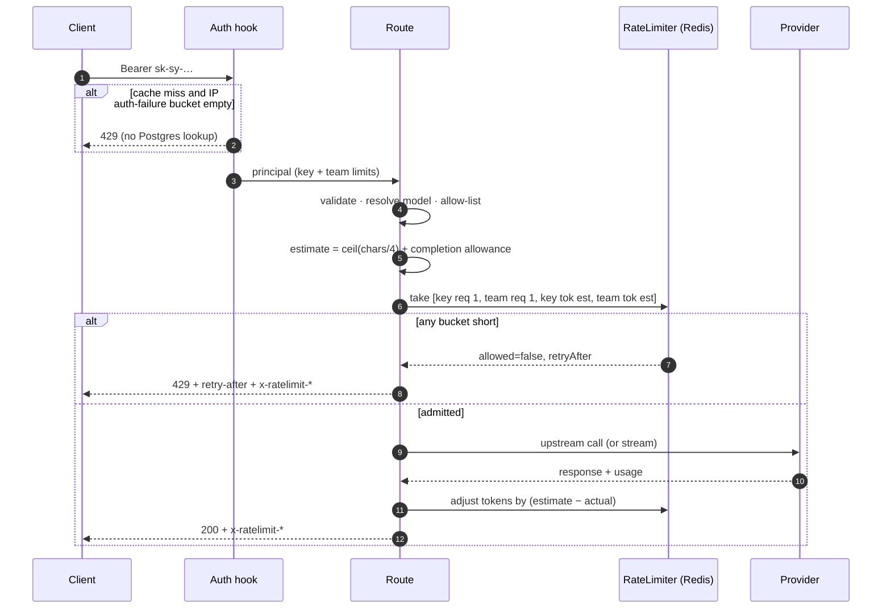

# Design 005: Rate limiting (requests and tokens per minute)

- **Status:** Approved (2026-10-13, via `/ship` after spec approval)
- **Spec:** [spec.md](spec.md)
- **Related ADRs:** [0006](../../adr/0006-redis-limits-and-counters.md) (Redis + Lua, fail-open policy), 0008, 0011

Spec open questions resolved as proposed: headers report the **most restrictive** applicable bucket; the client address is the socket address unless `server.trustProxy: true`; the example config sets `limits.defaults` to `rpm: 60`, `tpm: 100000`.

**Spec clarification (AC-11):** an address that exhausted its auth-failure bucket is refused (429) for every key **that is not already in the auth cache**, because telling a valid uncached key from an unknown one needs the database lookup the limit exists to avoid. Keys already validated (cached) keep working. Recorded in the verification notes.

## 1. Data and configuration

Migration `0001_rate_limits`: nullable `rpm integer` and `tpm integer` on `teams` and `api_keys` (`CHECK (rpm > 0)`, `CHECK (tpm > 0)`).

```yaml
server:
  trustProxy: false                  # true only behind a trusted reverse proxy (X-Forwarded-For)
limits:
  defaults: { rpm: 60, tpm: 100000 } # for keys without their own limits; omit for unlimited
  completionReserveTokens: 512       # reserved when the request sets no max_tokens
  onRedisError: open                 # open | closed
  authFailuresPerMinutePerIp: 30
```

The schema keeps every field optional with these defaults (except `defaults`, which is empty = unlimited, so existing configs behave as before).

## 2. Ports and types

```ts
// src/core/auth.ts (extended)
interface Limits { rpm: number | null; tpm: number | null }
interface ApiKeyRecord { …; rpm: number | null; tpm: number | null }
interface Team { …; rpm: number | null; tpm: number | null }
interface AuthRecord { key: ApiKeyRecord; team: Team }          // what auth caches
interface Principal { keyId; teamId; allowedModels; keyLimits: Limits; teamLimits: Limits }
interface KeyStore {
  findKeyByHash(hash): Promise<AuthRecord | undefined>;          // key joined with its team
  updateKeyLimits(id, patch: Partial<Limits>): Promise<ApiKeyRecord | undefined>;
  updateTeamLimits(id, patch: Partial<Limits>): Promise<Team | undefined>;
  …
}

// src/core/ratelimit.ts
interface BucketSpec { key: string; capacity: number; cost: number }   // capacity per minute
interface BucketState { key: string; capacity: number; remaining: number; resetMs: number }
interface TakeResult { allowed: boolean; buckets: BucketState[]; retryAfterMs: number }
interface RateLimiter {
  /** All-or-nothing debit of every bucket (one atomic operation). */
  take(buckets: BucketSpec[]): Promise<TakeResult>;
  /** Refund (positive) or charge (negative) units; buckets may go below zero. */
  adjust(adjustments: { key: string; capacity: number; delta: number }[]): Promise<void>;
  /** Remaining units without debiting (used before auth lookups). */
  peek(key: string, capacity: number): Promise<number>;
}
```

`AuthCache` gains `invalidateTeam(teamId)` so a team-limit change applies immediately on the instance that handled the PATCH.

## 3. Token bucket in Lua (`src/infra/redis/scripts/take.lua`)

Each bucket is a Redis hash `{ tokens, ts }` at `sy:rl:{scope}:{id}:{req|tok}` (scopes `key`, `team`, `ip`). The script:

1. reads the server clock with `TIME` (no clock skew between gateway instances);
2. refills every bucket: `tokens = min(capacity, tokens + elapsed_ms × capacity / 60000)` (a missing bucket starts full);
3. if **every** bucket has `tokens ≥ cost`, debits all of them; otherwise debits none;
4. writes back `{tokens, ts}` with `PEXPIRE` of 2 minutes (idle buckets vanish; a missing bucket is a full one);
5. returns, per bucket, the remaining units and the time to refill to capacity, plus the wait until the first failing bucket could cover its cost (`retryAfterMs`).

`adjust.lua` refills the same way, then applies `tokens = min(capacity, tokens + delta)` (no floor: a negative balance delays later requests). `peek` is `take` with cost 0. Scripts are loaded with `ioredis.defineCommand` (EVALSHA with automatic EVAL fallback). All keys of one call target one Redis (no cluster slot constraints in this release).

A pure TypeScript `MemoryRateLimiter` implements the same arithmetic for unit tests; integration tests run the Lua against real Redis and compare behaviours.

## 4. Request flow



### Components
| Path | Responsibility |
|---|---|
| `src/modules/ratelimit/estimate.ts` | `estimateTokens(kind, body, reserve)`: chat = ceil(chars of string message contents / 4) + `max_completion_tokens` ?? `max_tokens` ?? reserve; embeddings = ceil(input chars / 4) |
| `src/modules/ratelimit/plan.ts` | `buildPlan(principal, limits config, estimate)`: effective key limits (own → defaults), team limits (own only), bucket specs; detects `estimate > capacity` (→ 400 `request_too_large_for_limit`) |
| `src/modules/ratelimit/headers.ts` | most-restrictive selection per kind; OpenAI duration format (`450ms`, `1s`, `6m0s`); `retry-after` seconds (≥ 1) |
| `src/modules/ratelimit/admission.ts` | `admit()` → `Admission { headers, reconcile(actualTokens | undefined) }`; fail-open/closed; metrics and span attributes |
| `src/modules/auth/authenticate.ts` | IP auth-failure bucket: `peek` before an uncached lookup, `take` on each failure |
| `src/infra/redis/rate-limiter.ts` | `RedisRateLimiter` with the Lua scripts |
| `src/modules/proxy/{routes,stream}.ts` | call `admit()` after routing; `reconcile()` on success, failure, stream end, mid-stream failure, client disconnect |
| `src/modules/admin/routes.ts` | `rpm`/`tpm` on create; `PATCH /admin/keys/:id`, `PATCH /admin/teams/:id` |
| `src/infra/db/*` | migration, `findKeyByHash` join, limit updates |

### Reconciliation rules
| Outcome | Request unit | Token reservation |
|---|---|---|
| Success with provider usage | kept | refund `estimate − (input + output)` (negative = charge) |
| Success without usage (stream) | kept | reconcile against the spec 003 estimate |
| Failure before any output (4xx/5xx/timeout before first chunk) | kept | refunded in full |
| Mid-stream failure or client disconnect | kept | reconcile against input + characters streamed so far / 4 |

## 5. Headers (AC-7)
For each kind (`requests`, `tokens`) among the buckets that apply, pick the one with the **lowest remaining**; report its `capacity` as `limit`, `floor(remaining)` (min 0) as `remaining`, and its time-to-full as `reset`. A kind with no applicable bucket gets no headers. On `429`: `retry-after = ceil(retryAfterMs / 1000)`, at least 1.

Error bodies: `429` → `{"error":{"message":"Rate limit reached for requests (key): limit 60/min","type":"requests"|"tokens","code":"rate_limit_exceeded"}}`; the message names the scope but never a key.

## 6. Failure policy (AC-10)
Any limiter error (Redis down, script error, timeout of 200 ms per call) → `open`: admit, no `x-ratelimit-*` headers, `switchyard_ratelimit_fail_open_total` +1, warning at most once per minute; `closed`: `503 rate_limiter_unavailable`. Reconciliation errors are logged and ignored (never fail a response that already succeeded).

## 7. Observability
- `switchyard_ratelimit_rejections_total{scope, kind}` (`scope`: key, team, ip; `kind`: requests, tokens).
- `switchyard_ratelimit_fail_open_total`.
- Request span: `switchyard.ratelimit.reserved_tokens`, `switchyard.ratelimit.actual_tokens`, and on rejection `switchyard.ratelimit.scope` / `.kind`.

## 8. AC → test
| AC | Test |
|---|---|
| AC-1 | `db.int.test.ts` › migration adds columns; `schema.test.ts` › `limits` config |
| AC-2 | `admin.test.ts` › create with limits, PATCH key/team, `null` clears, immediate effect on the same instance |
| AC-3, AC-4 | `test/unit/ratelimit/admission.test.ts` (MemoryRateLimiter, fake clock); route tests › 429 without provider call |
| AC-5 | `estimate.test.ts`, `plan.test.ts` › allowances and oversized requests (400) |
| AC-6 | `admission.test.ts` › refund/charge; `stream.test.ts` › reconcile on end, mid-stream failure, disconnect |
| AC-7 | `headers.test.ts`; route tests › headers on 200 and 429, omitted when unlimited |
| AC-8 | Node and Python contract suites › `RateLimitError` |
| AC-9 | `test/integration/ratelimit.int.test.ts` › two app instances, one Redis, 50 concurrent requests at `rpm: 10` → 10 admitted |
| AC-10 | `ratelimit.int.test.ts` › Redis stopped: open admits + metric, closed → 503 |
| AC-11 | `authenticate.test.ts` › 30 failures then 429 without store lookups; cached valid key still works |
| AC-12 | `telemetry.test.ts` › rejection counter labels and span attributes |
| AC-13 | `ratelimit.int.test.ts` › Lua: atomic multi-bucket, refill, adjust, parity with `MemoryRateLimiter` |
| AC-14 | `scripts/compose-smoke.ts` › 200, 200, 429 with headers |

## 9. Risks
| Risk | Mitigation |
|---|---|
| Token estimates far from reality (images, tool schemas) | Reconciliation corrects the balance; estimates only decide admission |
| Redis latency on the hot path | One script call per request; 200 ms limiter timeout then the failure policy |
| Hot buckets for a very busy team | Single-key hashes are cheap; sharding is out of scope |
| Clock skew between instances | Lua uses Redis `TIME` |
