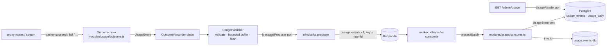
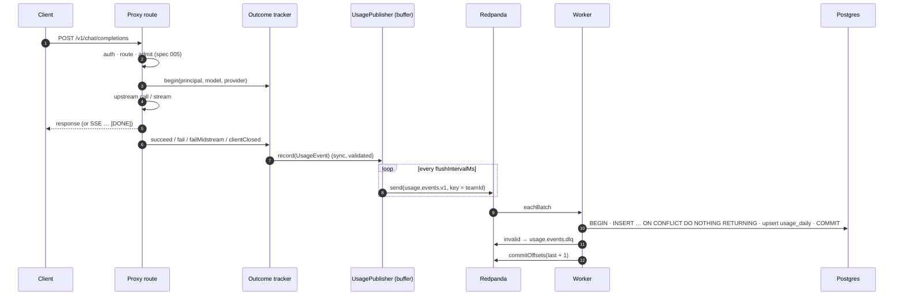

# Design 006: Usage event pipeline

- **Status:** Approved (2026-10-13, via `/ship` after spec approval)
- **Spec:** [spec.md](spec.md)
- **Related ADRs:** [0007](../../adr/0007-kafka-usage-events.md) (Kafka + idempotent worker), 0008, 0010, 0011, 0014

Spec open questions resolved as proposed, except where noted in §10:
- **gateway-side failure after admission** → `upstream_error` with the real `errorCode`; `rejected` is only for deliberate policy refusals;
- **non-streaming `client_closed`** → `status: 499`; streams whose headers were sent keep `200`;
- **`occurredAt`** → the end of the request (when the outcome is known);
- **strict schema** → kept strict; deploy the worker before the gateway when a field is added;
- **DLQ replay command** → not shipped; README documents re-publishing with `rpk`;
- **`/readyz` and Kafka** → Kafka is left out of `/readyz` (the proposal's fallback, see §10);
- **`groupBy=provider`** → answered from `usage_events` (the proposal's alternative, see §10).

## 1. Overview



## 2. Configuration

```yaml
usage:                        # spec 006
  enabled: true               # false: events are built and validated, never published
  topic: usage.events.v1
  dlqTopic: usage.events.dlq
  bufferSize: 10000           # events held in memory while Kafka is slow or down
  flushIntervalMs: 200
```

- `usage` is a `strictObject` with these defaults, `prefault({})` so existing configs keep working.
- Env `KAFKA_BROKERS`: optional in the gateway `envSchema` (comma-separated `host:port`, parsed to `string[]`). `server.ts` throws `ConfigError("environment", [{ path: "KAFKA_BROKERS", message: "is required when usage.enabled is true" }])` when it is missing and `usage.enabled` is `true` (AC-4).
- The worker has its own env loader `loadWorkerEnv()` (`DATABASE_URL`, `KAFKA_BROKERS` required, `LOG_LEVEL`, `SWITCHYARD_CONFIG`, `SHUTDOWN_TIMEOUT_MS`, `OTEL_SERVICE_NAME` default `switchyard-usage-worker`) and reads **only the `usage` section** of the YAML (`loadUsageConfig(path)`), so it never needs provider secrets or `OLLAMA_BASE_URL`.

## 3. Event schema (`src/core/usage.ts`, AC-1)

One Zod `strictObject` (`usageEventSchema`), the type `UsageEvent = z.infer<…>`:

| Field | Zod |
|---|---|
| `id` | `z.uuidv7()` |
| `schemaVersion` | `z.literal(1)` |
| `occurredAt` | `z.iso.datetime()` (UTC `Z`) |
| `requestId` | `string` (1–200) |
| `teamId`, `keyId` | `z.uuid()` |
| `operation` | `enum chat · embeddings · messages` |
| `stream`, `estimated` | `boolean` |
| `requestedModel` | `string` (1–256) |
| `provider`, `servedModel` | `string \| null` |
| `inputTokens`, `outputTokens`, `cachedInputTokens`, `attempts` | `int ≥ 0` |
| `costUsd` | `/^\d+(\.\d+)?$/` or `null` (plain decimal, no sign, no exponent) |
| `status` | `int 100–599` |
| `outcome` | `enum success · upstream_error · upstream_error_midstream · client_closed · rejected` |
| `errorCode` | `string \| null` |
| `latencyMs` | `int ≥ 0` |
| `ttfbMs` | `int ≥ 0 \| null` |
| `cacheStatus` | `enum miss · hit · semantic_hit · bypass` |
| `piiDetections` | `record<string, int ≥ 0>` |

`src/core/uuid.ts` exports a pure `uuidv7(now = Date.now(), random = randomBytes)` (RFC 9562: 48-bit ms timestamp, version 7, variant `10`). No new dependency.

Metadata only (AC-2): there is no field that can hold content; the only free-text fields are ids, model names and error codes. The strict schema also rejects any extra field, so content cannot be smuggled in by a later spec without changing this file.

## 4. Outcome hook: the contract other specs code against (AC-3)

### 4.1 Types

```ts
// src/core/usage.ts
export type UsageOperation = "chat" | "embeddings" | "messages";
export type UsageOutcome = "success" | "upstream_error" | "upstream_error_midstream" | "client_closed" | "rejected";
export type CacheStatus = "miss" | "hit" | "semantic_hit" | "bypass";

/** Receives exactly one finished, schema-shaped event per admitted request. Sync, must not throw. */
export interface OutcomeRecorder {
  record(event: UsageEvent): void;
}

// src/modules/usage/outcome.ts
export interface TokenUsage { inputTokens: number; outputTokens: number; cachedInputTokens?: number }

/** Data later specs contribute while the request runs (008 attempts, 009 cacheStatus, 010 piiDetections, …). */
export type OutcomeContribution = Partial<Pick<UsageEvent,
  "provider" | "servedModel" | "attempts" | "cacheStatus" | "piiDetections" | "cachedInputTokens" | "costUsd">>;

export interface OutcomeInit {
  requestId: string;
  principal: Principal;          // teamId, keyId
  operation: UsageOperation;     // 014 passes "messages"
  stream: boolean;
  requestedModel: string;        // what the client sent
  provider: string | null;       // resolved candidate (null if none)
  servedModel: string | null;
  elapsedMs: () => number;       // time since the request arrived (reply.elapsedTime)
}

/** One per admitted request. The first terminal call wins; later ones are ignored (exactly once). */
export interface OutcomeTracker {
  readonly done: boolean;
  set(fields: OutcomeContribution): void;
  succeed(result: { usage?: TokenUsage; estimated?: boolean; status?: number; ttfbMs?: number }): void;
  /** Failure before any response byte: status/code from the GatewayError (else 500 internal_error). */
  fail(error: unknown): void;
  /** Stream failure after the first chunk: status 200, errorCode from the SSE error event. */
  failMidstream(error: unknown, result: { usage: TokenUsage; estimated: boolean; ttfbMs?: number }): void;
  /** Client went away: status 200 when headers were sent, else 499. */
  clientClosed(result: { headersSent: boolean; usage?: TokenUsage; estimated?: boolean; ttfbMs?: number }): void;
  /** Admitted, then refused by a gateway policy before any upstream call (010 PII block). */
  reject(error: GatewayError): void;
}

export interface OutcomeHook {
  begin(request: FastifyRequest, init: OutcomeInit): OutcomeTracker;   // also sets request.outcome
}
export function createOutcomeHook(deps: { recorder: OutcomeRecorder; logger: FastifyBaseLogger; now?: () => number }): OutcomeHook;
```

`request.outcome?: OutcomeTracker` is declared on `FastifyRequest` (module augmentation in `outcome.ts`).

### 4.2 Rules
- **Where it starts:** `admit()` in `src/modules/proxy/routes.ts` calls `outcomes.begin(...)` right after rate-limit admission succeeds. Requests rejected before (400/401/403/404/429/admission 503) never get a tracker, so they never produce an event.
- **Where it ends:** the non-streaming `settle()` path and the four exits of `streamChat` (success before `[DONE]`, failure before the first chunk, mid-stream failure, client disconnect). Exactly-once is structural: the tracker ignores every terminal call after the first.
- **Defaults:** `attempts` = `1` when `provider` is set, `0` after `reject()`; `cacheStatus: "miss"`; `piiDetections: {}`; `costUsd: null`; `cachedInputTokens`: the provider-reported value or `0`; tokens `0` and `estimated: false` on `fail`/`reject`/non-streaming `client_closed`.
- **Token invariant:** the event's tokens are the same numbers the rate limiter was reconciled with (spec 005), so budget counters (007) charge what the rate limiter charged.
- **Safety net:** an `onResponse` hook in the proxy plugin closes any tracker a route forgot (`fail` with the response status and the error code captured by `onError`) and logs a warning naming the route. This keeps "no admitted request produces zero events" true even for new routes, and the warning makes the omission visible in tests.
- **Never affects the response:** the tracker builds the event (`uuidv7`, `occurredAt = now`, `latencyMs = round(elapsedMs())`) and calls `recorder.record(event)` inside `try/catch`; errors are logged (ids only) and swallowed.
- **Runs whether or not usage is enabled:** `usage.enabled: false` only changes what the publisher does with the event (§5).

### 4.3 How later specs extend it (no new completion paths)

| Spec | What it does |
|---|---|
| 007 budgets | Wraps the recorder: `withCost(pricing, next)` returns an `OutcomeRecorder` that sets `costUsd` from the final event's tokens/provider/model and forwards; a second recorder charges budget counters. Composed in `app.ts`/`server.ts` with `fanOut(...)` (exported from `modules/usage/recorders.ts`). |
| 008 routing | `tracker.set({ provider, servedModel, attempts })` after the attempt that served (or the last attempted). |
| 009 caching | `tracker.set({ cacheStatus, attempts: 0, provider, servedModel })` on hits; tokens come from the stored usage via `succeed`. |
| 010 PII | `tracker.set({ piiDetections })` after scanning; on `block`: `tracker.reject(error)` then `throw error`. |
| 014 anthropic | Its route calls `outcomes.begin(request, { operation: "messages", … })` after admission and the same terminal methods from its own stream translator; `cachedInputTokens` comes from `cache_read_input_tokens`. |

`AppDeps.usageRecorder?: OutcomeRecorder` (default: a no-op recorder) is the single injection point; `buildApp` creates the hook and passes `outcomes` to `proxyRoutes`.

## 5. Producer (`src/modules/usage/publisher.ts`, AC-4..AC-7, AC-12)

```ts
// src/core/usage.ts
export interface OutboundMessage { key: string | null; value: string | Buffer; headers?: Record<string, string> }
export interface MessageProducer {
  send(topic: string, messages: OutboundMessage[]): Promise<void>;   // resolves when delivered
  close(): Promise<void>;
}

export function createUsagePublisher(deps: {
  config: { enabled; topic; bufferSize; flushIntervalMs };
  producer?: MessageProducer;               // absent when usage.enabled is false
  logger; now?; batchSize?;                 // default 500 per send
}): OutcomeRecorder & { start(): void; flush(): Promise<void>; close(deadlineAt: number): Promise<void>; size(): number };
```

- `record(event)`: `usageEventSchema.safeParse` (AC-1); invalid → `dropped{reason="invalid"}` + log of ids and issue paths only. Disabled → return (built and validated, nothing published, no Kafka client ever created). Buffer full (`size() >= bufferSize`) → drop, `dropped{reason="buffer_full"}`, warning at most once per minute (AC-6). Else push `{ key: teamId, value: JSON }` and return synchronously (AC-5).
- `flush()` (every `flushIntervalMs`, `unref`'d timer): one batch in flight at a time; events stay in the buffer until the producer acknowledges them (so in-flight events count against `bufferSize` and the gauge), then are removed and counted in `published_total`. A failed send keeps them for the next tick (at-least-once; duplicates are absorbed by the idempotent worker). No restart is needed after the broker returns.
- `close(deadlineAt)` (AC-7): stops the timer, flushes until empty or the deadline, counts what is left in `dropped{reason="shutdown"}`, then closes the producer (bounded by the same deadline).
- Shutdown order in `server.ts`: `app.close()` (drains in-flight requests, whose events land in the buffer) → **usage publisher** (deadline = signal time + `SHUTDOWN_TIMEOUT_MS` − 1 s) → upstream HTTP → Redis → Postgres → telemetry. `installShutdown` passes `{ deadlineAt }` to each closer (additive, optional parameter).

### Kafka producer (`src/infra/kafka/producer.ts`)
`@confluentinc/kafka-javascript` (KafkaJS-compatible API, ADR-0007). Connects lazily on the first `send` and reconnects on the next send after a failed connect. librdkafka settings: `linger.ms: 5`, `message.timeout.ms` (default 10 s, injectable so tests run in seconds), `acks: -1`, `allowAutoTopicCreation: true`. Library logs go to pino at `debug` (the publisher owns the throttled warning). The client never blocks a request: only the flush loop awaits it.

## 6. Worker (AC-8..AC-10, AC-12)

```ts
// src/core/usage.ts
export interface UsageStore {
  /** One transaction: insert events (ON CONFLICT (id) DO NOTHING) and add only the inserted ones to usage_daily. */
  insertEvents(events: UsageEvent[]): Promise<{ inserted: number }>;
}

// src/modules/usage/consume.ts
export interface InboundMessage { topic: string; partition: number; offset: string; value: Buffer | null }
export async function processBatch(messages: InboundMessage[], deps: {
  store: UsageStore; producer: MessageProducer; dlqTopic: string; logger;
}): Promise<{ inserted: number; duplicate: number; dlq: number }>;
```

Per batch (confluent `eachBatch`, `js.consumer.max.batch.size` 100, `autoCommit: false`, group `switchyard-usage-worker`, `fromBeginning: true`):
1. Parse each message (`JSON.parse`, then `usageEventSchema.safeParse`); invalid ones are set aside with a reason (`invalid_json`, or `schema:<path>:<code>`, never values).
2. `store.insertEvents(valid)` (always runs a transaction, even with no valid events, so a Postgres outage is detected before anything else happens). Duplicate ids inside one batch are de-duplicated first.
3. Publish invalid messages to `usage.dlqTopic` with the **original bytes** and headers `x-switchyard-dlq-reason`, `x-switchyard-source-topic`, `-partition`, `-offset`.
4. Commit `lastOffset + 1` for the partition (`consumer.commitOffsets`).

If step 2 or 3 throws (Postgres or DLQ unavailable), the handler waits with exponential backoff (0.5 s → 30 s) and rethrows; the library seeks back to the batch's first offset and redelivers it. Nothing was committed and nothing was sent to the DLQ before the database transaction succeeded (AC-10). A worker killed at any point re-reads from the last commit; re-inserted events hit `ON CONFLICT DO NOTHING` and do not touch `usage_daily` (AC-9).

Topics: at start the worker creates `usage.topic` (3 partitions) and `usage.dlqTopic` (1 partition) with the admin client, ignoring "already exists", so a fresh `docker compose up` has both (AC-8).

Entry point `src/worker.ts`: env + usage config → logger → pg pool → Kafka consumer/producer/admin → `installShutdown` (closers: consumer, DLQ producer, Postgres, telemetry). `pnpm dev:worker` runs it with `tsx watch`; Compose runs `node --import ./dist/infra/telemetry/register.js dist/worker.js` from the gateway image.

## 7. Data (migration `0002_usage_events`)

```sql
CREATE TABLE usage_events (
  id uuid PRIMARY KEY,                       -- UUIDv7 from the gateway
  schema_version smallint NOT NULL,
  occurred_at timestamptz NOT NULL,
  request_id text NOT NULL,
  team_id uuid NOT NULL, key_id uuid NOT NULL,   -- no FK: events outlive keys and teams
  operation text NOT NULL, stream boolean NOT NULL,
  requested_model text NOT NULL, provider text, served_model text,
  input_tokens integer NOT NULL, output_tokens integer NOT NULL, cached_input_tokens integer NOT NULL,
  estimated boolean NOT NULL,
  cost_usd numeric,                          -- exact decimal, NULL = unknown
  status smallint NOT NULL, outcome text NOT NULL, error_code text,
  latency_ms integer NOT NULL, ttfb_ms integer, attempts integer NOT NULL,
  cache_status text NOT NULL, pii_detections jsonb NOT NULL,
  ingested_at timestamptz NOT NULL DEFAULT now()
);
CREATE INDEX usage_events_occurred_at_idx ON usage_events (occurred_at);
CREATE INDEX usage_events_team_occurred_at_idx ON usage_events (team_id, occurred_at);

CREATE TABLE usage_daily (
  day date NOT NULL, team_id uuid NOT NULL, key_id uuid NOT NULL, model text NOT NULL,
  requests bigint NOT NULL, input_tokens bigint NOT NULL, output_tokens bigint NOT NULL,
  cost_usd numeric NOT NULL DEFAULT 0, unknown_cost_requests bigint NOT NULL DEFAULT 0,
  PRIMARY KEY (day, team_id, key_id, model)
);
```

`usage_daily` upsert (same transaction, only rows returned by the insert): grouped by `day = (occurred_at AT TIME ZONE 'UTC')::date`, `model = provider/servedModel` when a provider was called else `requestedModel`; `ON CONFLICT … DO UPDATE SET requests = usage_daily.requests + excluded.requests, …`; `cost_usd` adds known costs only, `unknown_cost_requests` counts `costUsd: null` (AC-10). Events are insert-only: no code path updates or deletes them.

## 8. Reading usage: `GET /admin/usage` (AC-11)

```ts
// src/core/usage.ts
export type UsageGroupBy = "team" | "key" | "model" | "provider" | "day";
export interface UsageQuery { from: string; to: string; groupBy: UsageGroupBy; teamId?: string; keyId?: string }
export interface UsageTotals { requests: number; inputTokens: number; outputTokens: number; costUsd: string; unknownCostRequests: number }
export interface UsageRow extends UsageTotals { group: string | null }
export interface UsageReader { summarize(query: UsageQuery): Promise<{ data: UsageRow[]; totals: UsageTotals }> }
```

- `src/modules/usage/report.ts`: `parseUsageQuery(raw, today)` (Zod: `YYYY-MM-DD` real dates, defaults `to = today`, `from = to − 29 d`, `from ≤ to`, span ≤ 366 days, `groupBy` default `day`, uuid filters) → `400 invalid_request`; `normalizeDecimal` (`"1.500"` → `"1.5"`, `"0.000"` → `"0"`).
- `src/infra/db/usage-store.ts` (`DrizzleUsageStore` implements `UsageStore` and `UsageReader`): `team`/`key`/`model`/`day` from `usage_daily`; `provider` from `usage_events` (`GROUP BY provider`, `occurred_at` in `[from, to + 1 day)`); totals from a second query without grouping. Sorting in SQL: `day` ascending; otherwise `cost_usd DESC, requests DESC`.
- The admin route takes an optional `usageReader`; without one (unit tests that don't need it) it answers `503 usage_unavailable`. It is documented in OpenAPI (`docs.usage`).

## 9. Sequence



## 10. Open decisions (taken, reversible)
- **`groupBy=provider` reads `usage_events`.** `usage_daily.model` holds `requestedModel` for requests that reached no provider, and a requested model may itself be `provider/model`, so the prefix cannot tell "called" from "requested". `usage_events.provider` is exact; the `(team_id, occurred_at)` and `(occurred_at)` indexes keep the scan bounded. Revisit (add a `provider` column to `usage_daily`, which `waves.md` allows as an additive change) if the table grows large.
- **Kafka is not in `/readyz`.** `CheckStatus` is `ok | error | timeout` and any non-`ok` check turns readiness to `503`; adding a non-failing `degraded` state changes the readiness contract of spec 001. The producer state is visible through `switchyard_usage_buffer_events`, `switchyard_usage_events_dropped_total` and `switchyard_usage_events_published_total`.
- **Recorder chain instead of an observer list.** Cost (007) depends on the final token counts, so it is a decorator over the recorder rather than a `set()` contribution; fan-out covers multiple consumers. One injection point (`AppDeps.usageRecorder`).
- **Backoff inside `eachBatch`** (sleep then rethrow) instead of `pause()`/`resume()`: simpler, and bounded (30 s) well below the 300 s rebalance timeout.

## 11. Observability (AC-12)
| Signal | Where |
|---|---|
| `switchyard_usage_events_dropped_total{reason=buffer_full\|shutdown\|invalid}` | publisher |
| `switchyard_usage_events_published_total` | publisher |
| `switchyard_usage_buffer_events` (observable gauge) | publisher |
| `switchyard_usage_worker_events_total{result=inserted\|duplicate\|dlq}` | worker |
| span `switchyard.usage.consume` (`messaging.batch.message_count`, `switchyard.usage.inserted`, `.duplicate`, `.dlq`) | worker, one per batch |

Logs carry only ids (`eventId`, `requestId`, `teamId`, `keyId`), model, provider, outcome and counts.

## 12. Compose, Docker, CI
- `docker-compose.yml`: gateway gets `KAFKA_BROKERS: redpanda:9092` and **no** dependency on Redpanda health (it must start with Kafka down); new `usage-worker` service from the same image, `depends_on` Redpanda healthy and the gateway healthy (migrations ran).
- `pnpm-workspace.yaml`: allow the Kafka client's install script (prebuilt librdkafka binary). The Dockerfile already uses Debian (glibc) for it.
- Integration tests use `@testcontainers/redpanda` (dev dependency).

## 13. AC → component and test
| AC | Component | Test |
|---|---|---|
| AC-1 | `core/usage.ts`, `core/uuid.ts`, publisher, consume | `test/unit/usage/schema.test.ts`, `uuid.test.ts`, `publisher.test.ts` › invalid dropped, `consume.test.ts` › schema failure → DLQ |
| AC-2 | schema, publisher, worker | `test/unit/usage/routes-outcome.test.ts` › marker absent from published bytes; `test/integration/usage-pipeline.int.test.ts` › marker absent from Kafka bytes and stored row; threat model row |
| AC-3 | `modules/usage/outcome.ts`, proxy routes/stream | `outcome.test.ts` (every terminal case, exactly once, reject, defaults); `routes-outcome.test.ts` (chat/embeddings × stream/non-stream × success/error/midstream/disconnect; none on 401/404/429; disabled usage) |
| AC-4 | config schema, env, server | `schema.test.ts`, `env.test.ts`, `boot.test.ts` › missing `KAFKA_BROKERS` exits naming it |
| AC-5 | publisher | `publisher.test.ts` › record returns before send, key = team id, flush interval |
| AC-6 | publisher, server | `publisher.test.ts` › buffer full drops + metric + one warning per minute, resumes; `boot.test.ts` › starts with Kafka down; `usage-pipeline.int.test.ts` › broker down |
| AC-7 | publisher, shutdown | `publisher.test.ts` › close flushes, leftovers counted `shutdown`; `shutdown.test.ts` › closers receive the deadline |
| AC-8 | migration, `usage-store.ts`, worker | `usage-store.int.test.ts` › row + aggregate; `usage-pipeline.int.test.ts` › topics created |
| AC-9 | `usage-store.ts`, consumer | `usage-store.int.test.ts` › duplicate counted once; `usage-pipeline.int.test.ts` › redelivery, restart mid-stream |
| AC-10 | `consume.ts`, consumer | `consume.test.ts` › DLQ, Postgres down → no DLQ/commit; `usage-pipeline.int.test.ts` › malformed → DLQ, next stored |
| AC-11 | `report.ts`, admin route, `usage-store.ts` | `report.test.ts`, `admin-usage.test.ts`, `openapi.test.ts`, `usage-store.int.test.ts` › grouping and sorting |
| AC-12 | publisher, worker telemetry | `publisher.test.ts` › metrics; `consume.test.ts` › worker counter and span |
| AC-13 | all | `test/integration/usage-pipeline.int.test.ts` |
| AC-14 | Compose, smoke | `scripts/compose-smoke.ts` › request counted in `GET /admin/usage?groupBy=key` within 10 s |

## 14. Risks
| Risk | Mitigation |
|---|---|
| Native Kafka client fails to install on a platform | Prebuilt binaries for Windows x64 and Linux glibc (verified locally); fallback `@platformatic/kafka` behind the same `MessageProducer` port (ADR-0007) |
| Broker outage longer than the buffer | Dropped and counted (`buffer_full`), warning once a minute; accepted in ADR-0007 |
| Duplicate delivery (send retried after a lost ack, consumer restart) | UUIDv7 primary key + `ON CONFLICT DO NOTHING`; aggregates updated only for inserted rows in the same transaction |
| A later spec adds a field and an old worker DLQs events | Deploy the worker first; DLQ keeps original bytes for replay |
| Event content leak | Strict schema without content fields, marker tests at unit and integration level |
| Memory: one more container | Worker idles at ~60 MB; smoke keeps the 4 GiB ceiling |
