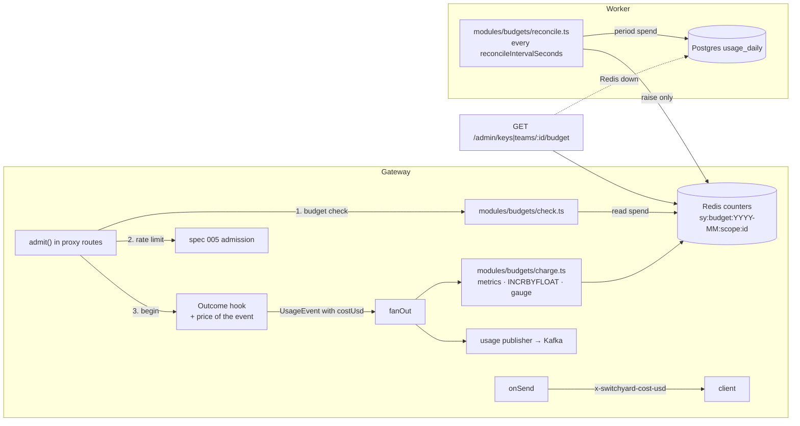
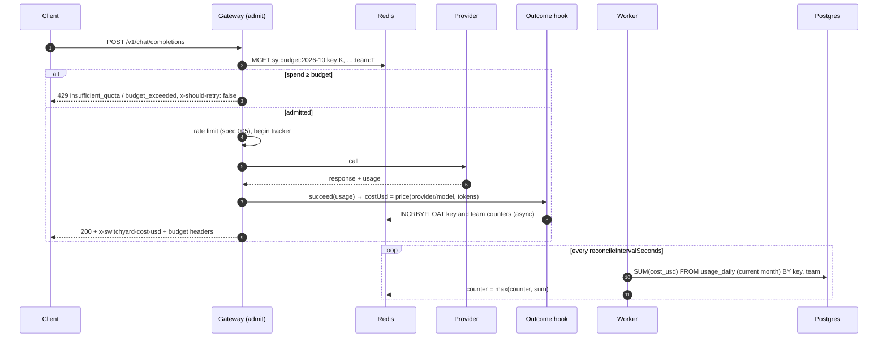

# Design 007: Cost accounting and monthly budgets

- **Status:** Approved (2026-10-13, via `/ship` after spec approval)
- **Spec:** [spec.md](spec.md)
- **Related ADRs:** [0017](../../adr/0017-budget-periods-and-cost-accounting.md) (periods, exact decimals, no reservation, raise-only reconciliation), [0006](../../adr/0006-redis-limits-and-counters.md) (Redis + Lua), [0007](../../adr/0007-kafka-usage-events.md), [0010](../../adr/0010-no-prompt-persistence.md), [0011](../../adr/0011-opentelemetry.md), [0014](../../adr/0014-zod-validation-openapi-docs.md)

Spec open questions resolved as proposed: `429` + `insufficient_quota` + `x-should-retry: false`; no cost header on streams; unknown-price models admitted and flagged; reconciliation only raises; budget check before rate limiting; a key's soft limit uses its team's percentage; headers describe the scope with the lowest remaining budget. Further choices are in §11.

## 1. Overview



## 2. Configuration

```yaml
pricingFile: config/pricing.yaml   # existing key, loaded at boot
budgets:                           # spec 007
  onRedisError: closed             # closed: 503 budget_unavailable for budgeted keys; open: admit
  reconcileIntervalSeconds: 60     # worker: raise Redis counters to the Postgres spend
```

- `budgets` is a `strictObject` with these defaults, `prefault({})`.
- The worker reads the `usage` and `budgets` sections only (`loadWorkerConfig(path)`) and now needs `REDIS_URL` (required in `workerEnvSchema`).

### `config/pricing.yaml` (AC-1)

```ts
// src/modules/pricing/load.ts
const price = z.union([z.number().nonnegative().finite(), z.literal("TODO")]);
const entry = z.strictObject({
  input: price, output: price, cachedInput: price.optional(),
  verifiedAt: z.union([z.iso.date(), z.date()]).optional(), note: z.string().optional(),
});
const file = z.strictObject({ models: z.record(z.string().min(1), entry) });
export function loadPricing(path: string): PriceTable;   // ConfigError(path, issues) when missing/invalid
```

Issues name the entry (`models.mock/*.input: …`). `server.ts` loads it in `loadSettings()`, so a bad file prints `Invalid configuration in config/pricing.yaml` and exits 1 like a bad config. Numbers are converted to exact decimals from their shortest round-trip form (`String(0.15)` = `"0.15"`, exponents such as `1e-7` expanded), so the price written in YAML is the price used.

## 3. Pricing: the shared port and the price table

```ts
// src/core/pricing.ts (shared contract with spec 008)
export interface TokenCounts { inputTokens: number; outputTokens: number; cachedInputTokens?: number }
/** Cost in USD for a served `provider/model`; undefined = unknown price (never 0). */
export interface CostEstimator { estimateUsd(modelRef: string, usage: TokenCounts): number | undefined }

// src/modules/pricing/table.ts
export class PriceTable implements CostEstimator {
  static empty(): PriceTable;                                     // every price unknown
  entryFor(modelRef: string): PriceEntry | undefined;             // AC-1 precedence
  costUsd(modelRef: string, usage: TokenCounts): string | null;   // exact, 10 dp, AC-2
  estimateUsd(modelRef: string, usage: TokenCounts): number | undefined;
}
export function unknownPriceCandidates(aliases, table): string[];   // boot warning, AC-1
```

- **Precedence:** exact key; else matching patterns (`*` = any sequence, including `/`; compiled once to an anchored regex with every other character escaped) ranked by the count of non-`*` characters, ties by file order.
- **Cost (AC-2):** `cached = min(cachedInputTokens, inputTokens)`; `(inputTokens − cached) × input + cached × (cachedInput ?? input) + outputTokens × output`, divided by 10⁶, rounded half-up to 10 decimal places. A price is *needed* only when its token count is > 0; a needed `TODO`, or no entry, gives `null`.
- **Decimals** (`src/modules/pricing/decimal.ts`): `{ units: bigint, scale: number }` with `parse` (plain strings and JS numbers incl. exponents), `add`, `sub`, `mulInt`, `compare`, `round` (half-up), `toFixed` and `normalize` (no trailing zeros, never an exponent). No new dependency.
- **AppDeps** gains `costEstimator?: PriceTable` (default `PriceTable.empty()`): the same object gives spec 008 `estimateUsd()` and the outcome hook `costUsd()`. `server.ts` passes the loaded table.
- **Boot warning (AC-1):** one `warn` log, `{ models: [...] }`, listing every distinct alias candidate whose `input` or `output` price is unknown (no entry, or `TODO`).

## 4. Cost on every event (AC-2, AC-3)

`createOutcomeHook({ recorder, logger, price? })`: when the tracker finishes and no contribution set `costUsd`, it sets
- `"0"` when `attempts === 0` or `provider === null` (no upstream call: PII block, future cache hits);
- else `price(event)` = `costEstimator.costUsd(provider/servedModel, tokens)` (string with 10 decimals, or `null`).

`OutcomeTracker` gains `readonly event: UsageEvent | undefined` (the event handed to the recorder). The proxy plugin adds an `onSend` hook: when `request.outcome?.event` exists, `stream` is `false` and `costUsd !== null`, it sets `x-switchyard-cost-usd` to the same string. Non-streaming routes end the tracker in `settle()` before the body is serialised, so the header is always in time; streams end the tracker after headers are gone, so they never carry it. The hook covers chat, embeddings and `/v1/messages`.

Cost metrics (in the charger, §6): `switchyard_cost_usd_total{provider,model}` adds `Number(costUsd)` for known costs of events that called a provider; `switchyard_cost_unknown_requests_total{provider,model}` counts `null` ones. The active span gets `switchyard.cost_usd` when the cost is known (set by the charger through `trace.getActiveSpan()`, i.e. the request span for non-streaming requests).

## 5. Budget admission (AC-5..AC-9, AC-11, AC-13)

### 5.1 Data on the principal

```ts
// src/core/auth.ts (additive)
interface Team { …; monthlyBudgetUsd: string | null; softLimitPct: number }
interface ApiKeyRecord { …; monthlyBudgetUsd: string | null }
interface Principal { …; budget?: { keyUsd: string | null; teamUsd: string | null; softLimitPct: number } }
```

`authenticate` fills `principal.budget` from the cached `AuthRecord`; admin changes invalidate the auth cache on the same instance, and the 30 s cache TTL bounds other instances (AC-4).

### 5.2 Period (`src/modules/budgets/period.ts`, AC-5)

`periodOf(ms) → { id: "2026-10", start: "2026-10-01T00:00:00.000Z", end: "2026-11-01T00:00:00.000Z", startDay, endDay, endMs }`, pure, UTC. Admission uses `now()`; charging uses the event's `occurredAt`.

### 5.3 Counters port

```ts
// src/core/budget.ts
export type BudgetScope = "key" | "team";
export interface BudgetRef { scope: BudgetScope; id: string }
export interface BudgetCounters {
  /** Current spend of each ref in the period ("0" when absent), in order. */
  read(period: string, refs: readonly BudgetRef[]): Promise<string[]>;
  /** Adds a known cost to every ref; returns the new totals. Counters expire at `expireAtMs`. */
  charge(period: string, refs: readonly BudgetRef[], amountUsd: string, expireAtMs: number): Promise<string[]>;
  /** Sets each counter to max(current, value); never lowers one (ADR-0017). */
  raise(period: string, entries: readonly { ref: BudgetRef; spentUsd: string }[], expireAtMs: number): Promise<void>;
}
```

- `src/infra/redis/budget-counters.ts`: keys `sy:budget:{period}:{scope}:{id}`; `charge` = one Lua script (`INCRBYFLOAT` + `PEXPIREAT` per key); `raise` = Lua comparing `tonumber(GET)` with the value; `read` = `MGET`. Every call has a 200 ms deadline like the rate limiter. Counters expire 7 days after the period ends (late events of the old month can still be charged to it; past periods disappear).
- `src/infra/memory/budget-counters.ts`: same semantics in a `Map` (unit tests, contract tests); default in `buildApp` when `AppDeps.budgetCounters` is absent.

### 5.4 The check (`src/modules/budgets/check.ts`)

```ts
export function createBudgetCheck(deps: { counters; config: { onRedisError }; logger; gauge; now? }): {
  check(principal: Principal): Promise<{ headers: Record<string, string> }>;  // throws 429 / 503
};
// pure core, unit-tested in isolation
export function evaluateBudgets(input: {
  scopes: { scope: BudgetScope; limitUsd: string; spentUsd: string }[];
  softLimitPct: number; resetAt: string;
}): { decision: "allow" | "soft" | "reject"; scope: BudgetScope; soft: BudgetScope[]; headers: Record<string, string> };
```

Order in `admit()` (proxy routes): **budget check → rate-limit admission → `outcomes.begin`**. A `budget_exceeded` therefore debits no bucket and emits no event (AC-6).

1. Scopes with a budget: key (`budget.keyUsd`) and team (`budget.teamUsd`). None → return `{ headers: {} }` without touching Redis (requests without budgets never depend on Redis, AC-11).
2. `counters.read(period, refs)`; failure → `onRedisError`: `closed` → `503 budget_unavailable`, decision `fail_closed`; `open` → admit with no budget headers, `switchyard_budget_fail_open_total`, a warning at most once per minute, decision `fail_open`.
3. Spend is parsed as a decimal and rounded to 10 places (the Redis float, ADR-0017). `spent ≥ limit` → reject; the key scope wins when both are exhausted. Error: `429`, `type: insufficient_quota`, `code: budget_exceeded`, message `Monthly budget exhausted for this key. It resets at 2026-11-01T00:00:00.000Z.` (scope and reset only, never amounts), headers `x-should-retry: false` + the AC-8 headers of the rejected scope. `switchyard_budget_rejections_total{scope}`.
4. Otherwise headers for the scope with the lowest remaining (`max(0, limit − spent)`, ties → key): `x-switchyard-budget-limit-usd`, `-remaining-usd` (normalized decimals), `x-switchyard-budget-reset` (period end). Scopes with `spent ≥ limit × pct / 100` add `x-switchyard-budget-warning: soft_limit_reached`, count `switchyard_budget_soft_limit_requests_total{scope}` once each, and log a warning once per `(scope, id, period)` per instance (bounded set, cleared when the period changes).
5. Span `switchyard.budget` (child of the request span) with `switchyard.budget.scope` (the rejected or header scope) and `switchyard.budget.decision` (`allow`/`soft`/`reject`/`fail_open`/`fail_closed`); no ids, no key material.
6. The check records each budgeted scope's `(limit, period)` for the ratio gauge; a scope seen without a budget is removed from it (§6).

`/v1/messages` errors keep the Anthropic shape (429 → `rate_limit_error`, `details.error_code: budget_exceeded`); the budget headers pass through unchanged.

## 6. Charging at the outcome hook (AC-10, AC-11, AC-13)

`createBudgetCharger({ counters, logger, gauge })` is an `OutcomeRecorder` composed in `buildApp` as `fanOut(charger, deps.usageRecorder ?? noopRecorder)`:
- cost metrics (§4);
- known cost > 0 → `counters.charge(periodOf(occurredAt).id, [key, team], costUsd, expiry)` without awaiting (`record` stays synchronous); failure → `switchyard_budget_charge_failures_total` + warning (ids only), repaired by reconciliation; success → gauge update for the refs the check registered: `ratio = spent / limit`;
- unknown or zero cost charges nothing.

`switchyard_budget_used_ratio{scope,id}` is an observable gauge over a bounded map (10 000 entries) of `{ period, limitUsd, ratio }`; the callback skips entries of another period (new month → the series disappears until charged again), and an entry is deleted when the check sees that scope without a budget (cleared). The worker publishes the same gauge from its reconciliation (§7) by replacing its map wholesale.

## 7. Reconciliation (worker, AC-10)

```ts
// src/core/budget.ts
export interface ScopeSpend { ref: BudgetRef; spentUsd: string; unknownCostRequests: number }
export interface BudgetStore {
  /** Known spend per key and per team from usage_daily for days in [fromDay, toDay). */
  periodSpend(fromDay: string, toDay: string): Promise<ScopeSpend[]>;
  scopeSpend(ref: BudgetRef, fromDay: string, toDay: string): Promise<{ spentUsd: string; unknownCostRequests: number }>;
  /** Keys and teams that have a monthly budget. */
  listBudgets(): Promise<{ ref: BudgetRef; limitUsd: string }[]>;
}
// src/modules/budgets/reconcile.ts
export async function reconcileOnce(deps: { store; counters; gauge; now }): Promise<{ raised: number }>;
export function startReconciler(deps & { intervalMs; logger }): { stop(): Promise<void> };
```

`reconcileOnce`: current period → `store.periodSpend` → `counters.raise` → `counters.read` for budgeted refs → gauge replaced. Runs once at start, then every interval (`unref`'d timer, one run at a time); failures are logged and retried next tick. `src/worker.ts` starts it next to the usage consumer and stops it on shutdown (then closes Redis). `src/infra/db/budget-store.ts` implements `BudgetStore` (`SUM(cost_usd)` grouped by `key_id` and by `team_id`; `numeric` arrives as text, exact).

## 8. Admin API (AC-4, AC-12)

- `POST/PATCH /admin/teams[/:id]`: `monthlyBudgetUsd`, `softLimitPct` (int 1–100); `POST/PATCH /admin/keys[/:id]`: `monthlyBudgetUsd`. A PATCH may set any one field alone.
- `monthlyBudgetUsd`: JSON number or string, converted to a plain decimal and validated as `^\d{1,8}(\.\d{1,4})?$` (≥ 0, ≤ 4 places, ≤ 99999999.9999), or `null`; else `400 invalid_request`. Stored and returned normalized (`"10"`, `"0.5"`).
- `KeyStore` gains `getKey(id)`; `createTeam(name, settings)`, `updateKeyLimits`, `updateTeamLimits` take the new fields (`KeyPatch`, new `TeamPatch`).
- `GET /admin/keys/:id/budget`, `GET /admin/teams/:id/budget` (`src/modules/budgets/status.ts`): `404` unknown id; `spentUsd` from `counters.read` (`source: "redis"`), or on failure from `store.scopeSpend` (`source: "postgres"`); `unknownCostRequests` from the store; `limitUsd`/`remainingUsd` `null` without a budget; soft/hard flags as in §5.4; key `softLimitPct` = its team's. Without a `BudgetStore` (unit tests that don't need it) the routes answer `503 usage_unavailable`. Documented in OpenAPI.

## 9. Data (migration `0004_budgets`, AC-4)

```sql
ALTER TABLE api_keys ADD COLUMN monthly_budget_usd numeric(12, 4);
ALTER TABLE teams ADD COLUMN monthly_budget_usd numeric(12, 4);
ALTER TABLE teams ADD COLUMN soft_limit_pct integer DEFAULT 80 NOT NULL;
-- checks: monthly_budget_usd >= 0 (both), soft_limit_pct BETWEEN 1 AND 100
```

Generated with `pnpm db:generate --name budgets`.

## 10. Sequence



## 11. Open decisions (taken, reversible)

| Decision | Options | Chosen |
|---|---|---|
| Where the cost is computed | `withCost` recorder decorator (006 design §4.3) / inside the hook | **Inside the hook** (`price` dep) and exposed as `tracker.event`: the `x-switchyard-cost-usd` header must be set before the response is sent, and a decorator cannot hand the value back without mutating the event |
| `costUsd` format | normalized / fixed 10 places | **Fixed 10 places** for computed costs (`"0.0000030000"`, ADR-0017's example), `"0"` when no upstream call; header = event value. Budget amounts in headers and the status route are normalized (`"9.5"`) |
| Where the cost lands in spans | `switchyard.budget` span / request span | The admission span ends before the cost exists: the **active (request) span** gets `switchyard.cost_usd`; `switchyard.budget` carries scope and decision |
| Budget headers on fail-open | stale values / omitted | **Omitted** (spend unknown), like `x-ratelimit-*` on rate-limit fail-open |
| Gauge in the gateway | query budgets per charge / remember from admission | **Remember from admission** (bounded map): the charger only sees the event |
| Counter expiry | at period end / later | **7 days after the period ends**: late events of the old month are still charged; reconciliation only touches the current period |
| Budget check on `GET /v1/models` | yes / no | **No**: it costs nothing; only `admit()` (chat, embeddings, messages) checks |
| `REDIS_URL` in the worker | optional / required | **Required**: the worker must reconcile (AC-10); Compose passes it |
| Status route without a budget store | `unknownCostRequests: 0` / 503 | **503** (`usage_unavailable`), as `GET /admin/usage` does |

## 12. Observability (AC-13)

| Signal | Where |
|---|---|
| `switchyard_cost_usd_total{provider,model}`, `switchyard_cost_unknown_requests_total{provider,model}` | charger |
| `switchyard_budget_rejections_total{scope}`, `switchyard_budget_soft_limit_requests_total{scope}`, `switchyard_budget_fail_open_total` | check |
| `switchyard_budget_charge_failures_total` | charger |
| `switchyard_budget_used_ratio{scope,id}` (observable gauge) | charger (gateway), reconciler (worker) |
| span `switchyard.budget` (`switchyard.budget.scope`, `switchyard.budget.decision`) | check |
| `switchyard.cost_usd` on the active span | charger |

Logs carry ids, scope, period and decision only.

## 13. AC → component and test

| AC | Component | Test |
|---|---|---|
| AC-1 | `pricing/load.ts`, `pricing/table.ts`, `server.ts` | `test/unit/pricing/load.test.ts`, `table.test.ts` › precedence, boot warning list; `boot.test.ts` › bad pricing file exits naming it |
| AC-2 | `pricing/decimal.ts`, `table.ts`, `usage/outcome.ts` | `decimal.test.ts`, `table.test.ts` › arithmetic, TODO, cached input; `outcome.test.ts` › cost cases |
| AC-3 | outcome hook, proxy `onSend`, charger | `test/unit/proxy/cost.test.ts` › header (chat, embeddings, messages), none on streams/unknown; metrics |
| AC-4 | migration, stores, admin routes | `test/unit/admin/admin-budgets.test.ts`; `db.int.test.ts` › columns, round trip |
| AC-5 | `budgets/period.ts` | `period.test.ts` |
| AC-6, AC-8, AC-9 | `budgets/check.ts`, proxy `admit()` | `check.test.ts`; `test/unit/proxy/budget-routes.test.ts` |
| AC-7 | check + charger | `test/integration/budgets.int.test.ts` › overshoot bound; `docs/budgets.md` |
| AC-10 | charger, Redis counters, reconciler, budget store | `charge.test.ts`, `reconcile.test.ts`, `budget-counters.int.test.ts`, `budgets.int.test.ts` › flush + reconcile |
| AC-11 | check, charger | `check.test.ts` › open/closed; `budgets.int.test.ts` › dead Redis |
| AC-12 | `budgets/status.ts`, admin routes, docs | `admin-budget-status.test.ts`, `openapi.test.ts` |
| AC-13 | telemetry | `check.test.ts` › span; `charge.test.ts` › metrics and gauge |
| AC-14 | all | the above; `openai-sdk.contract.test.ts`, `test_openai_sdk.py`; `scripts/compose-smoke.ts` |

## 14. Risks

| Risk | Mitigation |
|---|---|
| Float drift in Redis counters | Admission only; reported spend comes from `numeric` columns; reconciliation repairs downward drift (ADR-0017) |
| Overshoot with many long streams in flight | Bound documented in `docs/budgets.md`; lower the budget or cap concurrency (spec 005) |
| Redis down with `closed` blocks budgeted keys | Configurable `open`; only budgeted keys are affected |
| A double charge is never corrected | Accepted in ADR-0017: deleting the counter lets reconciliation rebuild it |
| Unknown prices bypass budgets | Boot warning, `switchyard_cost_unknown_requests_total`, `unknownCostRequests` in the status |
