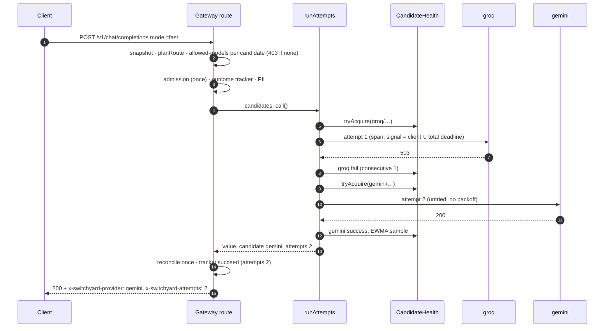

# Design 008: Routing strategies, retries, circuit breakers and config hot reload

- **Status:** Approved (2026-10-13, via `/ship` after spec approval)
- **Spec:** [spec.md](spec.md)
- **Related ADRs:** 0003, 0004 (retryable error classes), [0008](../../adr/0008-no-retry-after-first-byte.md) (no retry after first byte), 0010 (no content in telemetry), 0011 (OpenTelemetry), 0017 (cost accounting), [0018](../../adr/0018-config-hot-reload.md) (hot reload)

Spec open questions resolved as proposed: `lowest-cost` codes against the shared `CostEstimator` port of spec 007 (unknown price ⇒ after priced candidates, in config order; no estimator wired ⇒ config order); breaker and EWMA state stay in memory per instance; one EWMA per candidate for streaming and non-streaming traffic; no exploration share; an upstream `429` counts as a breaker failure; a `Retry-After` longer than `retry.maxDelayMs` is capped on a retry of the same candidate.

## 1. Overview

```mermaid
flowchart LR
  R[proxy route<br/>chat · embeddings · messages] -->|model| P[planRoute<br/>alias → candidates]
  P -->|allowed-models filter per candidate| A[admission + outcome tracker]
  A --> X[runAttempts<br/>proxy/attempts.ts]
  X -->|orderCandidates| S[select.ts<br/>priority · lowest-cost · lowest-latency]
  X -->|tryAcquire / succeed / fail| H[CandidateHealth<br/>breaker · EWMA · error window]
  X -->|backoffDelay| B[backoff.ts]
  X -->|one span per attempt| PR[ChatProvider]
  C[ConfigRuntime<br/>snapshot · reload] -->|current()| R
  W[poller · SIGHUP · POST /admin/config/reload] --> C
  C -->|retain(prev, next)| H
```

## 2. Configuration

```yaml
routing:                 # spec 008
  ewmaAlpha: 0.3         # 0 < alpha ≤ 1, weight of the newest latency sample
  hotReload: true        # poll the config file every 2 s (ADR-0018)
retry:                   # existing stub, now used
  maxAttempts: 3         # attempts in total across all candidates
  baseDelayMs: 200
  maxDelayMs: 2000
circuitBreaker:          # existing stub, now used
  failureThreshold: 5
  openMs: 30000
server:
  timeouts: { connectMs: 5000, ttfbMs: 30000, totalMs: 120000 }   # totalMs: whole request, all attempts
aliases:
  fast: { strategy: priority, candidates: [...] }   # strategy is now honoured
```

`routing` is a `strictObject` with `prefault({})`. The example config gains a `resilient` alias (`[mock/error-503, mock/smoke]`) for the Compose smoke test (AC-16).

## 3. Contracts

### 3.1 Shared with spec 007 (`src/core/pricing.ts`, identical in both branches)

```ts
export interface TokenCounts { inputTokens: number; outputTokens: number; cachedInputTokens?: number }
/** Cost in USD for a served `provider/model`; undefined = unknown price (never 0). */
export interface CostEstimator { estimateUsd(modelRef: string, usage: TokenCounts): number | undefined }
```

`AppDeps.costEstimator?: CostEstimator`. Until 007 is merged nothing passes it, so `lowest-cost` orders in config order (spec open question 1). After the rebase, `server.ts` passes 007's estimator; nothing else changes. The request estimate is the spec 005 one split in two: input = estimated message tokens, output = `max_completion_tokens` ?? `max_tokens` ?? `limits.completionReserveTokens` (embeddings: output 0).

### 3.2 HTTP

Every routed response (success or error, streaming or not) carries:

| Header | Value |
|---|---|
| `x-switchyard-provider`, `x-switchyard-model` | candidate that served, or the last one attempted on error; absent when no attempt was made |
| `x-switchyard-attempts` | attempts made (`0` for `no_healthy_upstream`) |

New errors:

| Situation | Status | `code` |
|---|:---:|---|
| Every allowed candidate has an open breaker (or a half-open one with a probe in flight) | 503 + `retry-after` | `no_healthy_upstream` (`type: server_error`) |
| `POST /admin/config/reload` with an invalid file | 400 | `invalid_config` (+ `error.issues: [{ path, message }]`) |

Admin (behind the admin token, documented in OpenAPI):

```
GET /admin/providers/health →
{ "scope": "instance", "note": "Breaker and latency state is kept per gateway instance",
  "data": [ { "candidate": "mock/fast", "state": "closed" | "open" | "half-open",
              "consecutiveFailures": 0, "halfOpenAt": null | ISO-8601,
              "latencyMs": { "ewma": null | number, "samples": 0 },
              "errorRate": 0.0, "window": 0 } ] }

POST /admin/config/reload → 200 { "result": "reloaded" | "unchanged", "restartRequired": ["server.trustProxy"] }
                          → 400 { "error": { "message", "type": "invalid_request_error", "code": "invalid_config", "issues": [...] } }
```

`errorRate` = failures / attempts over the candidate's last 100 attempts (`window` = how many are in it). "Known to this instance": every alias candidate of the current config plus every plain `provider/model` that has been called.

### 3.3 Usage event

`tracker.set({ provider, servedModel, attempts })` before every attempt (spec 006 §4.3); `{ provider: null, servedModel: null, attempts: 0 }` before the loop, so a `no_healthy_upstream` request records `attempts: 0`. `no_healthy_upstream` ends the tracker with `fail()` (`outcome: "upstream_error"`, `errorCode: "no_healthy_upstream"`): the request was refused because of upstream health, not by a gateway policy, so `rejected` does not fit. Admission reconciles once (full refund on failure, the serving attempt's usage on success); failed attempts add nothing.

## 4. Components

| Path | Responsibility |
|---|---|
| `src/core/pricing.ts` | `TokenCounts`, `CostEstimator` (shared with 007) |
| `src/core/errors.ts` | `noHealthyUpstream(retryAfterSeconds)` |
| `src/config/schema.ts` | `routing` section |
| `src/config/load.ts` | `parseConfig(text, path, env)` (load from text; `loadConfig` reads the file and calls it) |
| `src/modules/routing/resolve.ts` | `planRoute(model, config)` → `{ alias?, strategy, candidates: Candidate[] }` (`Candidate = { ref, provider, model }`); `resolveModel` kept for `/v1/models` |
| `src/modules/routing/select.ts` | **Pure** `orderCandidates(strategy, candidates, { cost?, latency })` (AC-2) |
| `src/modules/routing/backoff.ts` | **Pure** `backoffDelay(k, retry, random, retryAfterMs?)`, `parseRetryAfter(value, now)` (AC-4) |
| `src/modules/routing/classify.ts` | **Pure** `classifyFailure(error)` → `retryable` · `non_retryable` · `timeout` (`error.retryable ?? 408/429/5xx`; non-`GatewayError` ⇒ non-retryable) |
| `src/modules/routing/breaker.ts` | **Pure** state machine with injected `now` (AC-8): `state(now)`, `tryAcquire(now)` → permit, `succeed`, `fail(now)`, `release`; returns transitions for logging |
| `src/modules/routing/health.ts` | `CandidateHealthRegistry`: per-candidate breaker, EWMA + samples, ring of the last 100 outcomes; `get(ref)`, `snapshot(now)`, `retain(prev, next)` (AC-11, AC-12); circuit gauge + transition logs |
| `src/modules/routing/timers.ts` | `Timers` port `{ now(), sleep(ms, signal), deadline(ms) }` and the real implementation |
| `src/modules/routing/telemetry.ts` | `switchyard_upstream_attempts_total{candidate,outcome}`, `switchyard_circuit_state{candidate}` (sync gauge), `switchyard_config_reloads_total{result}` |
| `src/modules/proxy/attempts.ts` | `runAttempts()`: the attempt loop (AC-3–AC-9, AC-14); owns one `switchyard.upstream` span per attempt |
| `src/modules/proxy/routes.ts`, `stream.ts`, `messages.ts` | Plan → filter → admit → `runAttempts` → settle/stream; headers; snapshot per request |
| `src/modules/config/runtime.ts` | `ConfigRuntime`: `current()` snapshot `{ config, providers }`, `reload()`, `onChange()` (AC-12, AC-13) |
| `src/modules/config/watch.ts` | Stat poller (2 s, 500 ms debounce, injected stat/timers) and `installReloadSignal` (SIGHUP, non-Windows) |
| `src/modules/admin/routes.ts`, `docs.ts` | The two admin routes |
| `src/infra/http/undici-client.ts` | Timeouts from a getter: per-request `headersTimeout`/`bodyTimeout`/total, so reloaded `ttfbMs`/`totalMs` apply |
| `src/modules/providers/openai-compatible.ts` | Keeps upstream `retry-after` on 429 and 503 errors |
| `src/app.ts`, `src/server.ts` | `AppDeps.runtime?`, `costEstimator?`, `routing?` (timers, random); runtime, poller and SIGHUP wiring |

### 4.1 Attempt loop (`runAttempts`)

```
order    = orderCandidates(strategy, allowed, { cost: estimator && estimate, latency: health.ewma })
deadline = timers.deadline(server.timeouts.totalMs)           // TimeoutError reason ⇒ providers map to 504
report(undefined, 0)
attempts = 0; next = 0; tried = Map<ref, retryAfterMs | undefined>
loop while attempts < retry.maxAttempts:
  if client aborted: throw last error (or the abort)
  pick = first candidate from order rotated at `next` whose breaker tryAcquire(now) succeeds
  if none: attempts == 0 ? throw noHealthyUpstream(ceil((min halfOpenAt − now)/1000) ≥ 1) : throw last error
  if pick ∈ tried: wait = backoffDelay(attempts, retry, random, tried[pick]);
     if wait > deadline.remaining: release permit; throw last error
     sleep(wait, client ∪ deadline)
  attempts += 1; report(pick, attempts); span = startUpstreamSpan(... attempt, backoff ...)
  try value = await call(pick, signal = client ∪ deadline)
      → permit.succeed(latency); span ok (non-streams); return { value, candidate, attempts, lease }
  catch e:
      client aborted   → permit.release(); span clientGone; throw e         (not a breaker failure)
      deadline aborted → permit.fail(); span fail(final); throw upstreamTimeout(provider)   (504)
      classify(e) = non_retryable → permit.release(); span fail(final); throw e
      retryable/timeout → permit.fail(); tried[pick] = retryAfter(e); span fail(final = no attempts left)
      next = index(pick) + 1
throw last error
```

- **Wrap-around (AC-3):** `next` moves past the candidate just tried, so a single-candidate route retries the same candidate and a three-candidate route goes 1, 2, 3, 1, 2.
- **Breaker permits:** `tryAcquire` in `half-open` marks the probe in flight; every permit ends exactly once in `succeed`, `fail` or `release` (non-retryable 4xx and client disconnects are neutral: they neither count nor reset).
- **Streams:** `call` opens the stream **and** reads the first chunk, so a failure before the first chunk is an ordinary retryable failure (AC-6). On success the span stays open and is returned in the lease; `streamChat` ends it as today. A mid-stream failure calls `lease.midstreamFailed()` (breaker failure + `midstream_error` attempt); `[DONE]` or a client disconnect calls `lease.completed()` (`success`).
- **Metrics semantics:** `switchyard_requests_total` stays one per client request: an attempt span increments it only when it is final (served, or the last failure). Every attempt increments `switchyard_upstream_attempts_total`.
- **Determinism:** `Timers` and `random` are injected (`AppDeps.routing`). Breakers read `timers.now()`. Tests use a manual clock whose `sleep` advances time instantly; `testApp` defaults to zero-delay sleeps.

### 4.2 Hot reload (`ConfigRuntime`, ADR-0018)

- `reload()`: read file → SHA-256; same hash ⇒ `unchanged`. Else `parseConfig` (YAML + Zod + env resolution). Failure ⇒ keep the snapshot, log `{ issues: [{ path, message }] }`, count `result="failure"`, throw `ConfigError` (endpoint ⇒ 400). Success ⇒ copy startup-fixed values from the old config and list the changed ones in `restartRequired` (warning log), rebuild the provider registry reusing instances whose definition is unchanged, swap the snapshot, notify `onChange(prev, next)` (health `retain`), count `result="success"`.
- **Startup-fixed** (warned, old value kept): `server.bodyLimitBytes`, `server.trustProxy` (spec), plus `server.timeouts.connectMs` (undici `Agent` option), `limits.authFailuresPerMinutePerIp` (auth hook options), `usage.*` (publisher and topics) and `pricingFile` (non-goal). See §8.
- **Per request:** every route reads `runtime.current()` once at the start and keeps that snapshot (config + providers) to the end, so in-flight requests finish with the config they started with. The PII stage is memoised per config object; admission reads `limits` through a getter.
- **Health retention:** an entry survives iff its `provider/model` is still a candidate (alias candidate or plain ref of a configured provider) and `providers[provider]` is deep-equal before and after.
- **Triggers:** `fs.stat` poll every 2 s while `routing.hotReload` is true (checked each tick, so a reload can turn it on or off), 500 ms debounce after an mtime/size change; `POST /admin/config/reload` (always available); `SIGHUP` when `process.platform !== "win32"`. Timers are `unref()`ed and stopped on shutdown.

## 5. Sequence (non-streaming, first candidate fails)



## 6. Failure modes

| Case | Behaviour |
|---|---|
| Non-retryable 4xx | Returned at once; breaker untouched (AC-3) |
| All attempts fail | Last error: 502 / 504 / upstream 429 (AC-5) |
| Client disconnects during an attempt or a backoff | Loop stops; permit released; tracker `client_closed` (AC-5) |
| Total budget shorter than the next backoff | Stop, last error; budget runs out during an attempt ⇒ 504 (AC-7) |
| All breakers open before the first attempt | 503 `no_healthy_upstream` + `retry-after` (AC-9) |
| All breakers open after some attempts | Last attempt's error (AC-5) |
| Failure after the first chunk | SSE error event, `upstream_error_midstream`, breaker failure; never retried (AC-6, ADR-0008) |
| Invalid config on reload | Old snapshot kept, issues logged, failure counted, 400 on the endpoint (AC-13) |
| `/v1/messages` with Anthropic-only content (blockers) and mixed candidates | Non-`anthropic` candidates are dropped from the plan; 400 only when none remain (§8) |

## 7. Observability (AC-14)

- `switchyard_circuit_state{candidate}` gauge: 0 closed, 1 half-open, 2 open; recorded on entry creation and every transition.
- `switchyard_upstream_attempts_total{candidate,outcome}`: `success`, `retryable_error`, `non_retryable_error`, `timeout`, `midstream_error`.
- `switchyard_config_reloads_total{result}`: `success`, `failure`.
- Breaker transitions logged once at `warn` (`{ candidate, from, to, consecutiveFailures }`).
- Attempt spans (`switchyard.upstream`, child of the request span): `switchyard.candidate`, `switchyard.attempt`, `switchyard.attempt.outcome`, `switchyard.backoff_ms`. No content (ADR-0010).

## 8. Open decisions (recommendations taken; reversible)

1. **Startup-fixed settings beyond the two the spec names:** `server.timeouts.connectMs`, `limits.authFailuresPerMinutePerIp`, `usage.*`, `pricingFile` are bound at construction; a change is logged as needing a restart, like `bodyLimitBytes`/`trustProxy`. `ttfbMs` and `totalMs` do reload (per-request undici options).
2. **`no_healthy_upstream` in the usage event** is `outcome: "upstream_error"` with `attempts: 0` (not `rejected`, which waves.md reserves for gateway policies).
3. **`switchyard_requests_total` stays per client request** (final attempt only); per-attempt counts go to the new attempts counter.
4. **`/v1/messages` with mixed-family aliases:** the canonical request is built once (with `anthropic-beta` always attached; only the `anthropic` adapter reads it). When the body has Anthropic-only content, non-`anthropic` candidates are ineligible.
5. **All breakers open after at least one attempt** returns the last attempt's error rather than `no_healthy_upstream` (more informative; AC-9 targets requests that made no attempt).
6. **Non-retryable outcomes of a half-open probe** release the probe (stay half-open) instead of closing the breaker: a 4xx says little about provider health.
7. **`/v1/models` filtering** lists an alias when any of its candidates is allowed for the key (consistent with AC-1).

## 9. AC → component → test

| AC | Component | Test |
|---|---|---|
| AC-1 | `resolve.ts`, `routes.ts`, schema | `test/unit/routing/resolve.test.ts` › planRoute; `test/unit/proxy/routing.test.ts` › allowed-models per candidate; `test/unit/config/schema.test.ts` › routing defaults/bounds |
| AC-2 | `select.ts` | `test/unit/routing/select.test.ts`; `routing.test.ts` › lowest-cost with a fake estimator |
| AC-3 | `attempts.ts`, `classify.ts` | `test/unit/proxy/attempts.test.ts` › wrap-around, maxAttempts, non-retryable at once; `classify.test.ts` |
| AC-4 | `backoff.ts`, `attempts.ts` | `test/unit/routing/backoff.test.ts`; `attempts.test.ts` › backoff only on repeats, Retry-After floor |
| AC-5 | `attempts.ts`, routes | `attempts.test.ts` › last error, client abort; `routing.test.ts` › 502/504/429 |
| AC-6 | `stream.ts`, `attempts.ts` | `test/unit/proxy/routing-stream.test.ts` › fallback before first chunk, midstream not retried |
| AC-7 | `attempts.ts`, `undici-client.ts` | `attempts.test.ts` › total budget, backoff longer than budget; `test/integration/upstream-http.int.test.ts` › timeouts getter |
| AC-8 | `breaker.ts`, `health.ts` | `test/unit/routing/breaker.test.ts`; `attempts.test.ts` › single probe |
| AC-9 | `attempts.ts` | `attempts.test.ts`, `routing.test.ts` › 503 no_healthy_upstream + retry-after, attempts 0 |
| AC-10 | routes, outcome | `routing.test.ts`, `routing-stream.test.ts`, `messages-routing.test.ts` › headers + usage event |
| AC-11 | `health.ts`, admin | `test/unit/routing/health.test.ts`; `test/unit/admin/admin-routing.test.ts` |
| AC-12 | `config/runtime.ts`, `watch.ts`, server | `test/unit/config/runtime.test.ts`; `test/unit/config/watch.test.ts`; `admin-routing.test.ts`; `routing.test.ts` › in-flight keeps old config |
| AC-13 | `runtime.ts`, admin | `runtime.test.ts` › invalid YAML/schema; `admin-routing.test.ts` › 400 invalid_config |
| AC-14 | `routing/telemetry.ts`, `attempts.ts`, `proxy/telemetry.ts` | `test/unit/proxy/attempts-telemetry.test.ts` |
| AC-15 | all | `test/integration/routing-chaos.int.test.ts` |
| AC-16 | example config, smoke | `scripts/compose-smoke.ts` step (CI) |

## 10. Risks

| Risk | Mitigation |
|---|---|
| Retries multiply load on a struggling provider | `maxAttempts` counts all candidates; breaker opens after `failureThreshold`; full jitter |
| Hidden mid-stream splice | Retry boundary is the first chunk; chaos test checks one completion id per stream |
| Reload races with in-flight requests | Immutable snapshots read once per request |
| Probe permit leaks (breaker stuck half-open) | Every permit ends in succeed/fail/release; unit tests cover abort and 4xx paths |
| Flaky timing tests | Injected clock, sleep and RNG everywhere; no wall-clock assertions |
