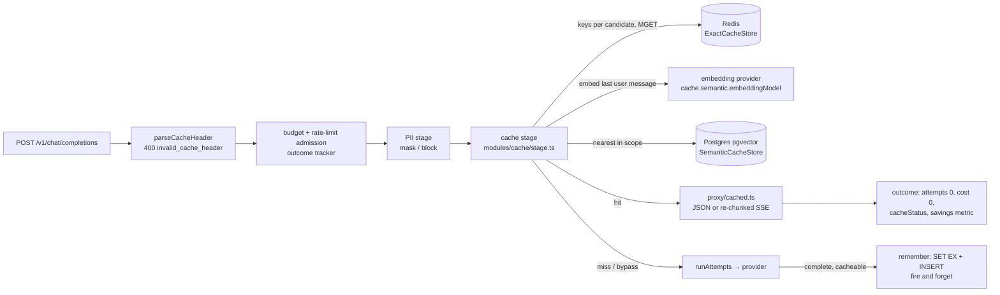
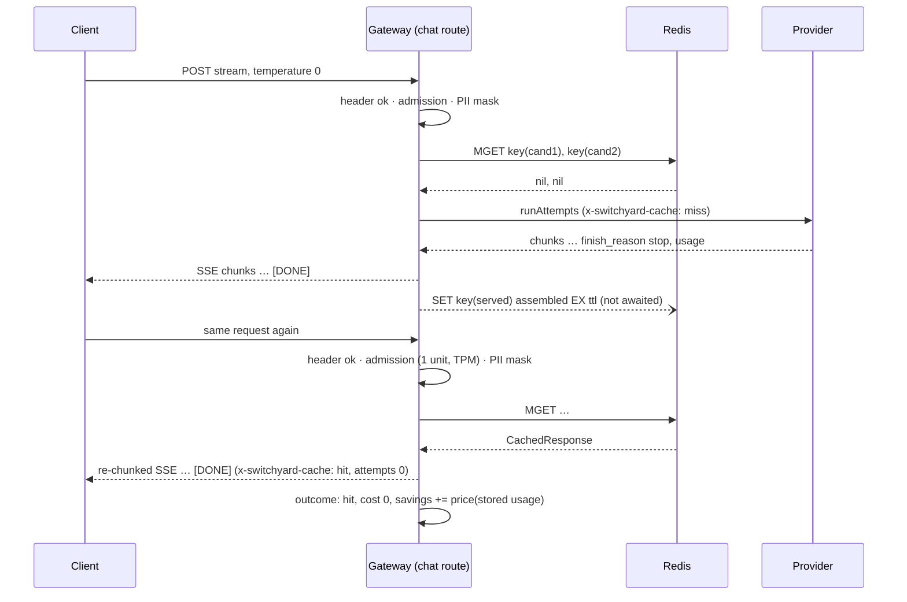

# Design 009: Exact and semantic response caching

- **Status:** Approved (2026-10-13, via `/ship` after spec approval)
- **Spec:** [spec.md](spec.md)
- **Related ADRs:** [0005](../../adr/0005-postgres-pgvector.md) (pgvector), [0006](../../adr/0006-redis-limits-and-counters.md) (Redis exact cache), [0008](../../adr/0008-no-retry-after-first-byte.md) (no retry after first byte), [0009](../../adr/0009-semantic-cache-scoping.md) (semantic scoping), [0010](../../adr/0010-no-prompt-persistence.md) (no content in telemetry), [0019](../../adr/0019-exact-cache-key-normalisation.md) (exact key normalisation)

Spec open questions resolved as proposed: a hit consumes TPM reconciled to the stored usage and always one request unit; budget and rate-limit admission run once, before the cache, so an over-budget team gets no hits; the exact cache is switched per deployment only; `finish_reason: "length"` is cached; `force` does not relax the semantic rules; the embedding call is charged to nobody; filtered HNSW searches use pgvector iterative index scans.

## 1. Overview



Only `/v1/chat/completions` uses the cache. `/v1/embeddings` is a non-goal; `/v1/messages` (spec 014) is out of scope for this spec and reports `cacheStatus: "bypass"` (§8).

## 2. Configuration

```yaml
cache:
  exact:
    enabled: true             # deployment-wide; temperature 0 or `x-switchyard-cache: force`
    ttlSeconds: 3600
  semantic:
    enabled: false            # AND api_keys.semantic_cache_enabled
    embeddingModel: ollama/nomic-embed-text   # must return 768 dims (ADR-0005)
    similarityThreshold: 0.95 # cosine similarity, 0 < t ≤ 1
    ttlSeconds: 86400
    maxTemperature: 0.3       # new: temperature must be present and ≤ this
    lookupTimeoutMs: 300      # new: embedding + search budget
```

The `cache` section is read from the request's config snapshot (spec 008), so a reload applies to new requests. Stores are bound at startup (`server.ts`).

## 3. Contracts

### 3.1 HTTP

| Request header `x-switchyard-cache` | Effect |
|---|---|
| absent | default rules (AC-2, AC-5) |
| `force` | exact cache eligible whatever the temperature (still `n ≤ 1`); semantic rules unchanged |
| `bypass` | no read, no write, status `bypass` |
| anything else | `400 invalid_cache_header` (`invalid_request_error`), checked right after body parsing, before admission: no rate-limit unit, no usage event |

Response headers on every chat completion that passed the PII stage:

| Header | Value |
|---|---|
| `x-switchyard-cache` | `hit` · `semantic-hit` · `miss` · `bypass` |
| `x-switchyard-provider`, `x-switchyard-model` | on hits, the candidate that originally served the stored response |
| `x-switchyard-attempts` | `0` on hits |

Hits get a new `id` (`chatcmpl-<uuid>`) and `created` (injected clock), everything else as stored. `x-switchyard-cost-usd: 0` follows from spec 007's `onSend` hook (non-streaming).

### 3.2 Admin

`POST /admin/keys` and `PATCH /admin/keys/:id` accept `semanticCacheEnabled: boolean`; key views include it (default `false`). PATCH invalidates the local auth cache; other instances see it within the 30 s auth-cache TTL (as spec 005, AC-2).

### 3.3 Usage event and principal

`cacheStatus` is always set by the chat route (`hit`, `semantic_hit`, `miss`, `bypass`); embeddings and messages set `bypass`. Hits: `attempts: 0`, `costUsd: "0"` (set explicitly, so it holds even without a price table), stored usage as `inputTokens`/`outputTokens`, `estimated` as stored, `cachedInputTokens: 0`, stored candidate as `provider`/`servedModel`. `Principal.semanticCacheEnabled: boolean` is filled by authentication.

### 3.4 Ports (`src/core/cache.ts`)

```ts
/** What both layers store: the upstream (masked) response and how it was produced. */
interface CachedResponse {
  v: 1;
  candidate: string;                      // provider/model that served it
  body: Record<string, unknown>;          // chat.completion, placeholders kept (AC-11)
  usage: { inputTokens: number; outputTokens: number; cachedInputTokens?: number };
  estimated: boolean;                     // usage was estimated (spec 003)
}
interface ExactCacheStore {
  getMany(keys: readonly string[]): Promise<(string | null)[]>;   // one round trip (MGET)
  set(key: string, value: string, ttlSeconds: number): Promise<void>;
}
interface SemanticScope { teamId: string; models: readonly string[]; paramsHash: string }
interface SemanticMatch { id: string; model: string; response: unknown; similarity: number }
interface SemanticCacheStore {
  nearest(scope: SemanticScope, embedding: readonly number[], now: Date): Promise<SemanticMatch | undefined>;
  insert(entry: SemanticScope & { model: string; embedding: readonly number[]; response: CachedResponse; createdAt: Date; expiresAt: Date }): Promise<void>;
  recordHit(id: string): Promise<void>;
  deleteExpired(now: Date): Promise<number>;
}
```

Values read back from either store are parsed with Zod (`cachedResponseSchema`); a value that does not parse counts as a lookup error for that layer.

Implementations: `infra/redis/exact-cache.ts` (`MGET`, `SET … EX`), `infra/db/semantic-cache.ts` (Drizzle + SQL), `infra/memory/exact-cache.ts` (bounded map with TTL on an injected clock; the `AppDeps` default) and `infra/memory/semantic-cache.ts` (exact cosine, for unit tests). Without a semantic store the semantic layer is off.

## 4. Components

| Module | Role | Pure |
|---|---|:---:|
| `modules/cache/key.ts` | ADR-0019 canonical JSON (code-unit key order, top-level and per-message `null` removal, denylist), `exactKey(team, candidate, request)` → `sy:cache:exact:v1:<team>:<candidate>:<sha256>`, `paramsHash(request)` (final user message removed, no team/model) | ✓ |
| `modules/cache/eligibility.ts` | `parseCacheHeader`, `exactEligible(request, mode)`, `semanticEligible(request, maxTemperature)`, `lastUserText(request)` | ✓ |
| `modules/cache/chunks.ts` | `cacheableBody(body)` (every `finish_reason` in stop/length/tool_calls), `assembleCompletion(chunks)` (streamed miss → `chat.completion`), `rechunk(body, usage)` (hit → `chat.completion.chunk[]`, last one usage-only) | ✓ |
| `modules/cache/stage.ts` | `createCacheStage(deps)`: `lookup()` → `{ status, hit? , remember?, tap? }`; candidates looked up in strategy order (`orderCandidates` with the same cost/latency inputs as `runAttempts`); semantic embedding with one attempt under `timers.deadline(lookupTimeoutMs)`; fire-and-forget writes; failures → skip layer | |
| `modules/cache/telemetry.ts` | counters, rate-limited warnings (once per minute per layer, injected clock), request-span attributes | |
| `modules/cache/cleanup.ts` | `runSemanticCleanup` (deletes `expires_at <= now`), scheduled hourly by `server.ts` | |
| `modules/proxy/cached.ts` | serves a hit: headers, outcome contributions, `settle` for JSON, SSE writer (`openAiEncoder`) for streams, savings metric, `switchyard_requests_total{cache}` | |
| `modules/proxy/routes.ts` | header parse before admission; `lookup` after the PII stage; `remember` after `settle` / via the stream `tap` | |
| `modules/proxy/stream.ts` | additive `tap?: { chunk(c); done(candidate, usage, estimated) }`, called only on a clean end | |

### 4.1 Lookup

1. `mode = parseCacheHeader(header)`; `bypass` → status `bypass`, nothing else.
2. Exact layer if `cache.exact.enabled`, a store exists and `exactEligible`: keys for every allowed candidate in strategy order, one `getMany`; the first parseable value wins → `hit`.
3. Semantic layer if not hit, `cache.semantic.enabled`, a store exists, `principal.semanticCacheEnabled` and `semanticEligible`: embed `lastUserText` through `snapshot.providers.get(embeddingProvider).embeddings(...)` (no `runAttempts`, no admission, no budget, no `switchyard.upstream` span: a `switchyard.cache.embed` span instead), check 768 finite numbers, `nearest` with the team, all candidate refs, `paramsHash` and `now`; `similarity ≥ similarityThreshold` → `semantic-hit` + `recordHit` (fire and forget). Embedding and search share one deadline.
4. Status: a hit, else `miss` if at least one layer was looked up (or failed), else `bypass`.

### 4.2 Write (miss)

`remember(candidate, body, usage, estimated)` is called after the response is final: non-streaming after `settle` succeeded; streaming from `tap.done` on the clean-end branch only (midstream failures and client disconnects never call it, ADR-0008). If `cacheableBody` holds, it builds one `CachedResponse` and, without awaiting, `SET`s the exact key of the serving candidate (TTL `exact.ttlSeconds`) when the exact layer was looked up, and inserts a semantic entry with the lookup's embedding, the serving candidate and `expires_at = now + semantic.ttlSeconds` when an embedding was computed. Rejections are caught and counted (`stage="write"`).

### 4.3 Serving a hit

Non-streaming: reconcile the TPM reservation to the stored usage and `outcome.succeed` with it (the same steps as `settle()`, done directly since no attempt runs), then `restoreChatResponse` with the request's own restore map (AC-11). Streaming: SSE with `rechunk()` through `openAiEncoder(include_usage)`, which drops the usage chunk when the client did not ask for it; placeholders stay, like any stream until spec 015 (`x-switchyard-pii: masked-unrestored` is already set by the PII stage). No upstream span: hits are counted with `countCachedRequest` on the shared `switchyard_requests_total` instrument.

## 5. Data (migration `0005_semantic_cache`, AC-1)

```sql
CREATE EXTENSION IF NOT EXISTS vector;            -- prepended by hand to the generated file
ALTER TABLE api_keys ADD COLUMN semantic_cache_enabled boolean DEFAULT false NOT NULL;
CREATE TABLE semantic_cache_entries (
  id uuid PRIMARY KEY DEFAULT gen_random_uuid(),
  team_id uuid NOT NULL, model text NOT NULL, params_hash char(64) NOT NULL,
  embedding vector(768) NOT NULL, response jsonb NOT NULL,
  created_at timestamptz NOT NULL DEFAULT now(), expires_at timestamptz NOT NULL,
  hits integer NOT NULL DEFAULT 0);
CREATE INDEX semantic_cache_entries_embedding_idx ON semantic_cache_entries USING hnsw (embedding vector_cosine_ops);
CREATE INDEX semantic_cache_entries_expires_at_idx ON semantic_cache_entries (expires_at);
CREATE INDEX semantic_cache_entries_scope_idx ON semantic_cache_entries (team_id, params_hash);
```

No foreign key on `team_id` (like `usage_events`): entries expire on their own. Search runs in a transaction with `SET LOCAL hnsw.iterative_scan = strict_order` (exact distance order, so `LIMIT 1` is the true nearest), filters `team_id`, `model = ANY(...)`, `params_hash`, `expires_at > $now` and orders by `embedding <=> $q` (similarity `1 - distance`), `LIMIT 1`. `$now` comes from the injected clock, never SQL `now()`.

## 6. Sequence (streamed request, exact miss then hit)



## 7. Failure modes (AC-12)

| Failure | Behaviour |
|---|---|
| Redis down / error / unparseable value | exact layer skipped, `miss`, `switchyard_cache_errors_total{layer="exact",stage="lookup"}`, warning ≤ 1/min |
| Postgres down / error | semantic layer skipped, same with `layer="semantic"` |
| Embedding provider error, unknown provider, timeout (`lookupTimeoutMs`), not 768 numbers | semantic layer skipped, `stage="lookup"`; no semantic write for that request |
| Write fails | response unaffected; `stage="write"` |
| Cleanup fails | warning; retried next hour |

## 8. Open decisions (recommendations taken; reversible)

1. **`/v1/messages` does not use the cache** in this spec: its responses are converted per route and it has its own native pass-through. It reports `cacheStatus: "bypass"`. A later spec can key on the canonical request.
2. **Streamed hits are not PII-restored**, like streamed misses until spec 015. Spec 015 (parallel) restores streams inside `streamChat`; the hit SSE writer in `proxy/cached.ts` is a second place it must cover (noted for the integrator).
3. **Metric label values use the usage-event spelling** (`semantic_hit`), the response header the spec's `semantic-hit`.
4. **Exact layer default store** is in memory per instance (`AppDeps.exactCache`); `server.ts` always wires Redis. Semantic layer has no default (off without Postgres).
5. **Cleanup runs in every gateway instance** hourly (and once at start); the `DELETE` is idempotent.
6. **Semantic entries have no FK to teams** (entries expire; teams are never deleted through the API).
7. **Last user message text**: a string, or an array of text parts only (joined with `\n`); any non-text part makes the request semantically ineligible.

## 9. Observability (AC-9, AC-13)

| Metric | Labels | Meaning |
|---|---|---|
| `switchyard_requests_total` | + `cache` (`hit`·`semantic_hit`·`miss`·`bypass`) | existing counter; hits counted at the hit, misses on the upstream span |
| `switchyard_cache_lookups_total` | `layer` (`exact`·`semantic`), `result` (`hit`·`miss`·`error`) | one per layer lookup |
| `switchyard_cache_errors_total` | `layer`, `stage` (`lookup`·`write`) | failures, timeouts, wrong dimensions |
| `switchyard_cache_savings_usd_total` (unit `{USD}`) | `layer`, `model` (stored `provider/model`), `team` | price of the stored usage at the current price table |
| `switchyard_cache_savings_unknown_total` | `layer`, `model`, `team` | hits whose price is unknown (nothing added) |

Request span attributes: `switchyard.cache.result` (status), `switchyard.cache.layer` (on hits), `switchyard.cache.similarity` (semantic hits). Never keys, hashes, embeddings or content (ADR-0010). `switchyard.cache.embed` span: `gen_ai.request.model`, `switchyard.cache.embedding_ms`.

## 10. AC → component and test

| AC | Component | Test |
|---|---|---|
| AC-1 | migration, schema, admin, auth, config | `test/integration/db.int.test.ts` › semantic cache opt-in and table with its indexes; `test/unit/admin/admin-cache.test.ts`; `test/unit/auth/authenticate.test.ts` › principal; `test/unit/config/schema.test.ts` › semantic defaults and bounds |
| AC-2 | eligibility, routes | `test/unit/cache/eligibility.test.ts`; `test/unit/proxy/cache-routes.test.ts` › temperature, n, force, bypass, invalid header |
| AC-3 | stage, cached | `cache-routes.test.ts` › miss then hit, strategy order (priority, lowest-cost), allowed models, other team |
| AC-4 | chunks, stage, stream tap | `test/unit/cache/chunks.test.ts`; `cache-routes.test.ts` › upstream error, finish reasons; `test/unit/proxy/cache-stream.test.ts` › streamed miss stored, mid-stream failure and client close not stored |
| AC-5 | stage, semantic store | `test/unit/proxy/semantic-cache.test.ts`; `test/integration/semantic-cache.int.test.ts` |
| AC-6 | stage, cleanup | `semantic-cache.test.ts` › stores the miss with its embedding; `test/unit/cache/cleanup.test.ts`; `semantic-cache.int.test.ts` › expiry and deleteExpired |
| AC-7 | chunks, cached | `chunks.test.ts` › rechunk round trip; `cache-stream.test.ts`; `test/contract/openai-sdk.contract.test.ts` › streamed cache hit; `test/contract/python/test_openai_sdk.py::test_streamed_cache_hit` |
| AC-8, AC-9 | cached, telemetry | `test/unit/proxy/cache-accounting.test.ts`; `test/unit/cache/telemetry.test.ts` |
| AC-10 | all | `test/integration/cache-isolation.int.test.ts`; `test/unit/cache/key.test.ts` |
| AC-11 | routes order, key | `test/unit/proxy/cache-pii.test.ts` |
| AC-12 | stage, telemetry | `test/unit/proxy/cache-failures.test.ts`; `semantic-cache.test.ts` › timeout, dimensions, errors; `cache-isolation.int.test.ts` › Redis down |
| AC-13 | telemetry, contract, smoke | `cache-accounting.test.ts` › request span; contract tests above; `scripts/compose-smoke.ts` › miss then hit |

## 11. Risks

- **Wrong hits** from a too-loose key: mitigated by ADR-0019's denylist approach and key tests per parameter.
- **Semantic near-misses** returning a wrong answer: per-key opt-in, conservative default threshold, temperature cap.
- **Write races**: two identical misses both write; last write wins, both valid.
- **Large responses in Redis**: bounded by TTL; Redis `maxmemory` policy is the operator's (README).
- **Merge with 015**: both touch `stream.ts`; edits are additive (`tap`).

## 12. Verification (2026-10-13)

| Check | Result |
|---|---|
| `pnpm verify` (lint, typecheck, unit tests with coverage, build) | ✅ 1297 passed, 1 skipped; lines 86.6 % |
| `pnpm test:int` | ✅ cache, semantic, db and usage-pipeline files re-run green after fixes; first full run had a Redpanda container start failure (`usage-pipeline`, unrelated, passed on re-run) |
| `pnpm test:contract` | ✅ 36 passed, 3 skipped (Ollama-only), incl. streamed cache hits (text, tool calls) |
| `pnpm test:contract:py` | ✅ OpenAI Python SDK file: 12 passed incl. `test_streamed_cache_hit` (scratch venv; the Anthropic Python file was skipped locally because its package install was broken on this machine, CI runs it) |
| Compose smoke (miss → hit step) | not run locally (owner rule); runs in CI |
