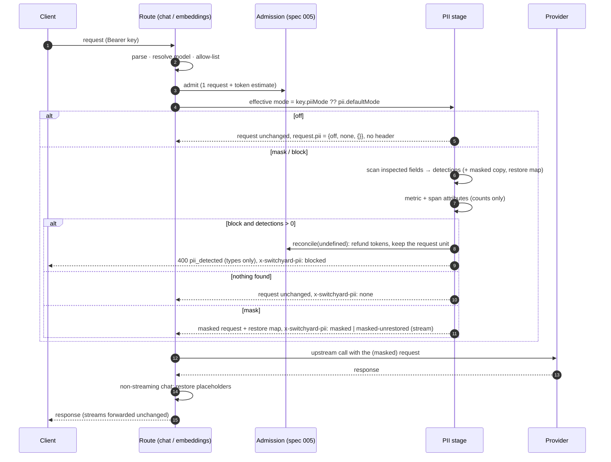

# Design 010: PII redaction (mask and block)

- **Status:** Approved (2026-10-13, via `/ship` after spec approval)
- **Spec:** [spec.md](spec.md)
- **Related ADRs:** [0015](../../adr/0015-pii-detection-and-reversible-placeholders.md) (detection and placeholders), 0010 (no prompt persistence), 0008 (no retry after first byte), 0011 (OpenTelemetry)

Spec open questions resolved as proposed: identity of a value is the exact matched string (`529.982.247-25` and `52998224725` get different placeholders); numbering skips `<TYPE_n>` strings the client already sent; the alphanumeric CNPJ is accepted; an `echo` model is added to the mock provider; the cache (spec 009) works on the masked request and restore runs per request; `/v1/messages` (spec 014) calls the same stage, wired by whichever merges second; token-array embeddings input is passed through with `switchyard.pii.uninspected=true`. Blocked requests are reported to spec 006's outcome hook as `outcome: "rejected"`.

## 1. Data and configuration

Migration `pii_mode` (reserved as `0003_pii_mode` in `waves.md`; generated as `0002_pii_mode` on this branch because 006's `0002_usage_events` is not merged yet, and renumbered on rebase): a Postgres enum `pii_mode` (`off`, `mask`, `block`) and a nullable `api_keys.pii_mode` column. `NULL` means "use `pii.defaultMode`".

```yaml
pii:                     # spec 010
  defaultMode: off       # off | mask | block, for keys without their own piiMode
  detectors: [email, phone, card, cpf, cnpj, ip, term]   # default: all
  denyList: []           # literal terms, case-insensitive, whole words
```

Zod: `defaultMode` enum (default `off`), `detectors` array of the detector enum (default all), `denyList` array of trimmed non-empty strings (default empty). Unknown modes or detector types fail validation at startup.

## 2. Types and ports

```ts
// src/core/pii.ts (core imports nothing)
export const PII_TYPES = ["card", "cnpj", "cpf", "email", "ip", "phone", "term"] as const; // canonical = alphabetical
export type PiiType = (typeof PII_TYPES)[number];
export const PII_MODES = ["off", "mask", "block"] as const;
export type PiiMode = (typeof PII_MODES)[number];
export type PiiAction = "none" | "masked" | "blocked";
export type PiiDetections = Partial<Record<PiiType, number>>;
/** What the request-outcome hook (spec 006) and telemetry read. Never values. */
export interface PiiRequestResult {
  mode: PiiMode;
  action: PiiAction;
  detections: PiiDetections;   // {} when off or nothing found
  uninspected?: boolean;       // token-array embeddings input
}

// src/core/auth.ts (extended)
ApiKeyRecord.piiMode: PiiMode | null
NewKey.piiMode?: PiiMode | null
Principal.piiMode?: PiiMode | null          // optional: other specs build principals in tests
KeyPatch = LimitsPatch & { piiMode?: PiiMode | null }
KeyStore.updateKeyLimits(id, patch: KeyPatch)  // name kept to keep the diff small
```

`request.pii?: PiiRequestResult` is declared on `FastifyRequest` (module augmentation in `src/modules/pii/stage.ts`, like `principal`). It is set for **every admitted** chat and embeddings request (`{ mode: "off", action: "none", detections: {} }` when off), before the upstream call and before a block error is thrown, so spec 006's hook can always read it. The restore map is **never** put on the request: it is a local variable of the route handler (ADR-0010).

`src/core/errors.ts` gains `piiDetected(types)` → `400 invalid_request_error / pii_detected`, message `Request blocked: personal data detected (cpf, email). Remove it, or ask the operator for PII mode "mask".` (types only).

## 3. Components

| Path | Responsibility |
|---|---|
| `src/core/pii.ts` | Types above |
| `src/modules/pii/validators.ts` | Pure: `luhn`, `isCpf`, `isCnpj` (numeric and alphanumeric), `isBrazilianDdd`, `isEmailDomain`, IP checks (`node:net` `isIPv4` / `isIPv6`, a real parser), repeated-digit check |
| `src/modules/pii/detectors.ts` | `PATTERN_DETECTORS`: one definition per pattern `{ type, pattern (global, bounded), accept(match) → accepted length or 0 }`; `findTerms(text, terms)` (literal, case-insensitive, `indexOf`, Unicode word boundaries) |
| `src/modules/pii/scan.ts` | `createScanner({ types, denyList })` → `(text) => Detection[]` (`{ type, start, end }`, sorted, non-overlapping) with overlap resolution |
| `src/modules/pii/mask.ts` | `createMasker` (per request: numbering, same string → same placeholder, counts, restore map); `maskChatRequest`, `maskEmbeddingsRequest` (visit inspected fields, build a new request, never mutate the parsed body) |
| `src/modules/pii/restore.ts` | `restoreText`, `restoreChatResponse(body: unknown, map)` (defensive, never throws, JSON-escapes inside `arguments`) |
| `src/modules/pii/stage.ts` | `createPiiStage(config.pii)`: effective mode, runs the scan, sets `request.pii`, header, metrics/span, refunds and throws on block; returns the (masked) request and the restore map |
| `src/modules/pii/telemetry.ts` | `switchyard_pii_detections_total{type}`; request-span attributes |
| `src/modules/proxy/routes.ts` | Calls the stage after `admit()`, before the stream branch; restores non-streaming chat bodies |
| `src/modules/admin/routes.ts`, `src/modules/docs.ts` | `piiMode` on create, PATCH and key views |
| `src/infra/db/*` | Enum, column, `toRecord`, `createKey`, `updateKeyLimits` |
| `src/modules/providers/mock.ts` | `echo` model: answers (and streams) the text of the last user message |

### 3.1 Detection (ADR-0015)

Every pattern is a global regex whose quantifiers are **all bounded** (`{m,n}`, never `+`, `*` or `{m,}`), anchored by look-behind/look-ahead on its own character class so that a candidate cannot start or end inside a longer run (e.g. CPF `(?<![0-9])\d{11}(?![0-9])`). A run longer than a type's maximum is therefore rejected, not windowed, which keeps scanning `O(n)` and avoids "CPF inside a longer number" false positives. A unit test parses every pattern's source and fails on any unbounded quantifier (AC-6); a second test scans 1 MiB adversarial inputs under 500 ms each.

| Type | Candidate | Validator |
|---|---|---|
| `email` | `[A-Za-z0-9._%+-]{1,64}@[A-Za-z0-9.-]{1,253}` (not preceded by a local-part char) | domain: trailing `.`/`-` trimmed, ≥ 2 labels of 1–63 chars without edge hyphens, alphabetic TLD of 2–24 |
| `phone` | BR: optional `+55`/`55`, DDD `(dd)` or `dd`, `9dddd` or `[2-5]ddd`, `dddd`, optional space/hyphen separators; E.164: `+` and 8–15 digits | BR: DDD in the ANATEL list (so `52998224726`, DDD 52, is not a phone); E.164: pattern only |
| `card` | 13–19 digits, optional single space/hyphen between digits | Luhn, not all one digit |
| `cpf` | `ddd.ddd.ddd-dd` or 11 digits | both check digits, not all one digit |
| `cnpj` | `dd.ddd.ddd/dddd-dd`, 14 digits, or the alphanumeric forms (`[0-9A-Z]` in the first 12 positions, uppercase) | check digits over `charCode − 48`, not all one digit |
| `ip` | IPv4 `(?:\d{1,3}\.){3}\d{1,3}`; IPv6 a run of 2–45 `[0-9A-Fa-f:.]` with ≥ 2 colons, not touching word chars | `isIPv4` / `isIPv6` (`12:30:45` fails), bare `::` rejected |
| `term` | each `denyList` entry, `indexOf` on a same-length lower-cased copy | neighbours must not be `\p{L}`, `\p{N}` or `_` |

**Overlaps (AC-5):** candidates are ranked by length (longest first), then validator-backed types (`cnpj`, `cpf`, `card`, in that order: check digits are more specific than Luhn), then canonical order, then position; they are accepted greedily if none of their characters is already taken (a `Uint8Array` occupancy map keeps this linear). `11987654321` fails the CPF check so it is only a phone; `52998224725` is both a phone-shaped and a CPF candidate of equal length, and `cpf` wins.

### 3.2 Masking

1. **Reserved placeholders:** the inspected fields are scanned once for `<TYPE_n>`; numbering for each type starts after the highest `n` the client already used, so restore never rewrites the client's own literal text.
2. **Visit** the inspected fields in order: `messages[i].content` (string, or `type: "text"` parts), then `messages[i].tool_calls[j].function.arguments`; embeddings `input` (string or array of strings). For `arguments`, if the string parses as JSON, string values (not keys) are masked recursively and the JSON re-serialised only when something changed; otherwise the raw string is masked (avoids splitting an escape like `\n` from the value).
3. **Masker:** for each detection, key = `type + exact value`; first sight → next `<TYPE_n>`; counts every occurrence. Returns the masked text; the restore map is `placeholder → original`.

In `block` mode the same scan runs; only the counts are used.

### 3.3 Restore (AC-8)

`restoreChatResponse` copies the body and, for every choice, replaces known placeholders in `message.content` (string) and in each `message.tool_calls[].function.arguments` (value inserted as `JSON.stringify(v).slice(1, -1)`). Unknown (`<CPF_9>`) or altered (`<cpf_1>`, `CPF_1`) placeholders are left as they are. Anything not shaped as expected is returned untouched; restore never throws.

## 4. Request flow



## 5. Headers

| Situation | `x-switchyard-pii` |
|---|---|
| mode `off` | absent (no scan) |
| `mask`/`block`, nothing detected (also token-array embeddings) | `none` |
| `mask`, non-streaming chat or embeddings | `masked` |
| `mask`, streaming chat | `masked-unrestored` (spec 015 lifts this) |
| `block`, something detected | `blocked` (on the 400; an addition to the spec's values, see §9) |

## 6. Failure modes

| Failure | Behaviour |
|---|---|
| Provider body not shaped as expected | returned unrestored, never a 500 |
| Model paraphrases a placeholder | left as-is (best effort, ADR-0015) |
| Upstream fails after masking | normal error path; the restore map is discarded with the request |
| Block on a streaming request | JSON 400 before any stream header, like any pre-stream error |
| Huge or adversarial input | bounded patterns, linear scan, body already capped by `server.bodyLimitBytes` |

## 7. Observability

- Metric `switchyard_pii_detections_total{type}`: incremented by the occurrences per type of every scanned request (mask and block).
- Request span (the `@fastify/otel` request span, as in spec 004): `switchyard.pii.mode`, `switchyard.pii.action` (`none` / `masked` / `blocked`), `switchyard.pii.detections` (total), and `switchyard.pii.uninspected=true` for token-array embeddings.
- Logs: none with values. A `debug` line records only mode, action and counts by type.
- `UsageEvent.piiDetections` and `outcome: "rejected"` for blocked requests: through spec 006's outcome hook (last task, blocked until 006 merges), reading `request.pii`.

## 8. AC → test

| AC | Test |
|---|---|
| AC-1 | `test/unit/config/schema.test.ts` › `pii` defaults and validation; `db.int.test.ts` › `pii_mode` column |
| AC-2 | `test/unit/admin/admin.test.ts` › `piiMode` on create/PATCH/list, `null`, `400`, cache invalidation; `db.int.test.ts` › stored and updated |
| AC-3, AC-4 | `test/unit/pii/validators.test.ts`, `test/unit/pii/scan.test.ts` › true/false-positive vectors, disabled detectors |
| AC-5 | `scan.test.ts` › longest match, validator tie-break, no double replacement |
| AC-6 | `test/unit/pii/linear.test.ts` › bounded quantifiers only; 1 MiB adversarial inputs < 500 ms |
| AC-7 | `test/unit/pii/mask.test.ts` › numbering, same string same placeholder, reserved placeholders, every role and part; `test/unit/proxy/pii-routes.test.ts` › provider receives `<CPF_1>` |
| AC-8 | `test/unit/pii/restore.test.ts`; `pii-routes.test.ts` › restored body, `x-switchyard-pii: masked` |
| AC-9 | `pii-routes.test.ts` › stream keeps placeholders, `masked-unrestored`; README and `docs/pii.md` |
| AC-10 | `pii-routes.test.ts` › `none` / absent header, off never scans |
| AC-11 | `pii-routes.test.ts` › 400 for chat, stream and embeddings, provider not called, tokens refunded, request unit kept |
| AC-12 | `test/unit/pii/privacy.test.ts` › trace-level logs, spans and metric points contain no vector |
| AC-13 | `test/unit/pii/telemetry.test.ts` › metric and span attributes, `request.pii` shape; usage event part: last task (blocked until 006) |
| AC-14 | `openai-sdk.contract.test.ts` › `BadRequestError` `pii_detected`; `scripts/compose-smoke.ts` › block 400, mask 200 + `masked` + restored echo |

## 9. Open decisions

| Decision | Options | Chosen (reversible) |
|---|---|---|
| "Canonical order" of types in the error message | Concepts list order (`email, phone, …`) / alphabetical | **Alphabetical**: it is the only order consistent with the spec's own example (`cpf, email`); `PII_TYPES` is defined in that order |
| Header on a blocked request | none / `x-switchyard-pii: blocked` | **`blocked`**: every scanned request then carries the header; the error code already says why |
| Tie between two validator-backed types (a 14-digit CNPJ that also passes Luhn) | canonical order / most specific | **`cnpj` > `cpf` > `card`**: two check digits beat Luhn's one |
| BR phone false positives (`52998224726`) | pattern only / validate DDD | **Validate the DDD** against the ANATEL list, which AC-4 needs |
| Tool-call arguments | mask raw text / parse JSON | **Parse when valid JSON**, raw otherwise (keeps escapes intact) |
| `KeyStore` method for key settings | new `updateKey` / widen `updateKeyLimits` | **Widen** the patch type (smallest diff; 007/009 will add fields the same way) |
| Repeated-digit card numbers (`0000 0000 0000 0000`) | allowed by Luhn / rejected | **Rejected**, like CPF/CNPJ |

## 10. Risks

| Risk | Mitigation |
|---|---|
| Operators over-trust `mask` (names and addresses are not detected) | README and `docs/pii.md` say so plainly (ADR-0015) |
| Phone pattern matches order ids shaped like BR numbers | DDD validation; detector can be disabled via `pii.detectors` |
| Model reformats placeholders | Best effort; `x-switchyard-pii` tells the client masking happened |
| Original values leaking through a new log line later | AC-12 privacy test runs at `trace` level over logs, spans and metric points |
| Rebase with 006/014 | Additive edits in hotspots; `request.pii` gives the hook a single read point |
