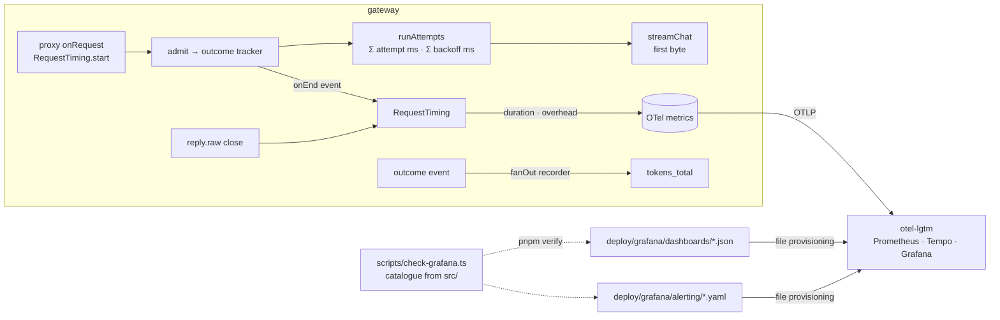
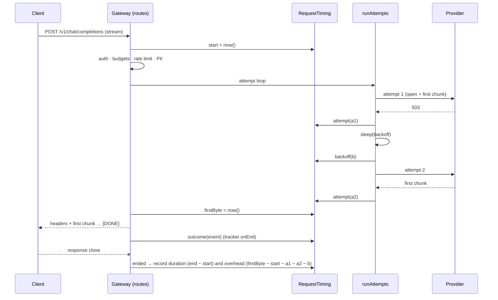

# Design 011: Observability (dashboards, alerts and GenAI conventions as code)

- **Status:** Approved (2026-10-13, via `/ship` after spec approval)
- **Spec:** [spec.md](spec.md)
- **Related ADRs:** [0010](../../adr/0010-no-prompt-persistence.md) (no content in telemetry), [0011](../../adr/0011-opentelemetry.md) (OpenTelemetry), [0020](../../adr/0020-dashboards-and-alerts-as-code.md) (dashboards and alerts as code, Accepted)

Spec open questions resolved as proposed: an optional `genAiProviderName` per provider in config (default `anthropic` for `type: anthropic`, the config name otherwise; the config name always goes in `switchyard.provider.name`); the upstream span is renamed to `{gen_ai.operation.name} {gen_ai.request.model}` and keeps `switchyard.stage: "upstream"`; no dual emission of `gen_ai.system`; `team` stays a label on `switchyard_requests_total`; screenshots are captured by hand following the checklist in `docs/observability.md`.

GenAI conventions checked on 2026-10-13 against the registry, which has moved to [open-telemetry/semantic-conventions-genai](https://github.com/open-telemetry/semantic-conventions-genai) (`docs/gen-ai/client-inference.md`, `gen-ai-spans.md`, `docs/registry/attributes/gen-ai.md`; status Development). Span name `{gen_ai.operation.name} {gen_ai.request.model}`, kind `CLIENT`. Required: `gen_ai.operation.name` (well-known `chat`, `embeddings`), `gen_ai.provider.name` (well-known values include `anthropic`, `openai`; a custom value MAY be used otherwise). Conditionally required: `gen_ai.request.model`, `error.type` on failure. Recommended: `gen_ai.response.model`, `gen_ai.usage.input_tokens`, `gen_ai.usage.output_tokens`. `gen_ai.system` is no longer in the registry (replaced by `gen_ai.provider.name`). The content attributes are `gen_ai.input.messages`, `gen_ai.output.messages`, `gen_ai.system_instructions` and `gen_ai.tool.definitions`.

## 1. Overview



## 2. Configuration

One optional key per provider entry (all three provider types), additive to `src/config/schema.ts`:

```yaml
providers:
  groq:
    type: openai-compatible
    baseUrl: https://api.groq.com/openai/v1
    apiKeyEnv: GROQ_API_KEY
    genAiProviderName: groq        # optional; value of gen_ai.provider.name on upstream spans
```

`genAiProviderName` is a string matching `^[a-z0-9][a-z0-9._-]*$` (the registry uses dotted values such as `gcp.gemini`). Default: `anthropic` for `type: anthropic`, the config name otherwise. The example config sets `gcp.gemini` for `gemini` and `groq` for `groq`, both well-known values.

No other config. Dashboards and alerts are files, not config.

## 3. Contracts

### 3.1 Metrics (added)

| Metric | Type | Labels | Unit / buckets |
|---|---|---|---|
| `switchyard_request_duration_seconds` | histogram | `operation` (`chat`·`embeddings`·`messages`), `stream` (`true`·`false`), `status` (class `2xx`·`4xx`·`5xx`) | s; `0.005 … 120` |
| `switchyard_gateway_overhead_seconds` | histogram | same | s; `0.0001 … 1` |
| `switchyard_tokens_total` | counter | `direction` (`input`·`output`), `provider`, `model` (served model; `none` when no upstream) | tokens |

`cache` is added to the two histograms by spec 009 when it lands (the integrator adds it on rebase; a label is not part of the AC-8 catalogue). Neither histogram carries team, key or model.

Explicit bucket boundaries are set through the instrument `advice` (the SDK default buckets `0 … 10000` are meant for milliseconds and put every second-valued sample in the first bucket). The existing `switchyard_upstream_duration_seconds` and `switchyard_ttfb_seconds` get the duration buckets too, so the Providers and Overview percentiles mean something. Changing buckets does not change metric names.

Duration buckets (s): `0.005, 0.01, 0.025, 0.05, 0.1, 0.25, 0.5, 1, 2.5, 5, 10, 30, 60, 120`.
Overhead buckets (s): `0.0001, 0.00025, 0.0005, 0.001, 0.0025, 0.005, 0.01, 0.025, 0.05, 0.1, 0.25, 0.5, 1`.

### 3.2 Metric names in Prometheus (the catalogue)

`otel-lgtm` 0.36.0 runs Prometheus v3.15 with the OTLP receiver and the default translation strategy `UnderscoreEscapingWithSuffixes` (`prometheus/otlptranslator`): the unit is appended unless its Prometheus word is already a token of the name (case-sensitive), counters end in `_total`, gauges with unit `1` end in `_ratio`, and histograms become `_bucket`/`_sum`/`_count`. Units written in braces (`{tokens}`) are annotations and add nothing.

Consequence: `switchyard_cost_usd_total` is registered with unit `USD` (spec 007), which Prometheus exposes as `switchyard_cost_usd_USD_total`, not the name fixed in [waves](../waves.md). This spec changes that unit to `{USD}` (one token in `budgets/telemetry.ts`; no code reads the unit) so the fixed name is what Grafana sees. Spec 009's `switchyard_cache_savings_usd_total` must do the same; the check of AC-8 catches it if not (see §8 item 1).

The catalogue is built by `scripts/lib/metric-catalogue.ts`: it scans `src/**/*.ts` for `create{Counter,Histogram,UpDownCounter,Gauge,ObservableCounter,ObservableUpDownCounter,ObservableGauge}("name", { … unit: "…" })`, and translates each with a TypeScript port of the parts of `normalizeName` that apply (unit map, `_total`, `_ratio`, histogram series).

### 3.3 Upstream span (AC-4)

Name `chat llama3.2` / `embeddings nomic-embed-text` (operation and the candidate's model), kind `CLIENT`.

| Attribute | When | Value |
|---|---|---|
| `gen_ai.operation.name` | always | `chat` or `embeddings` (`/v1/messages` is `chat`) |
| `gen_ai.provider.name` | always | `genAiProviderName` (§2) |
| `gen_ai.request.model` | always | candidate model |
| `gen_ai.response.model` | when known | provider-reported model |
| `gen_ai.usage.input_tokens` / `output_tokens` | when known | reported or estimated (`switchyard.usage.estimated: true` when estimated) |
| `error.type` | on failure | `GatewayError.code` (`upstream_timeout`, `upstream_error`, …; `internal_error` otherwise) |
| `switchyard.stage` | always | `upstream` |
| `switchyard.provider.name` | always | config provider name |
| existing `switchyard.*` | as before | `provider.type`, `stream`, `team_id`, `key_id`, `candidate`, `attempt`, `backoff_ms`, `attempt.outcome`, `ttfb_ms`, … |

`gen_ai.system` is removed.

### 3.4 Grafana provisioning

| Repo path | Mounted at (read-only) | Purpose |
|---|---|---|
| `deploy/grafana/provisioning/dashboards/switchyard.yaml` | `/otel-lgtm/grafana/conf/provisioning/dashboards/switchyard.yaml` | dashboard provider `Switchyard` → folder `Switchyard`, path below, `allowUiUpdates: false` |
| `deploy/grafana/dashboards/` | `/otel-lgtm/switchyard/dashboards` | `overview.json`, `cost.json`, `providers.json`, `cache.json` |
| `deploy/grafana/alerting/` | `/otel-lgtm/grafana/conf/provisioning/alerting` | `switchyard-alerts.yaml` (rule group) |

Grafana in `otel-lgtm` runs from `/otel-lgtm/grafana` with the default provisioning path, which already holds lgtm's own datasource and dashboard descriptors; the single-file mount adds ours next to them. Everything lives outside `/data` (the `lgtm-data` volume), so fresh and existing volumes behave the same, and a restart re-reads the files. Datasource uids provisioned by `otel-lgtm` (stable, from its `grafana-datasources.yaml`): `prometheus`, `tempo`, `loki`, `pyroscope`. Dashboards use `prometheus` only; alert rules use `prometheus` plus Grafana's expression pseudo-datasource `__expr__`.

Dashboard uids: `switchyard-overview`, `switchyard-cost`, `switchyard-providers`, `switchyard-cache`. No contact point or notification policy is provisioned: rules go to Grafana's default policy, and `docs/observability.md` explains how to add one locally without committing credentials.

## 4. Components

| Component | Change |
|---|---|
| `src/modules/proxy/timing.ts` (new) | `RequestTiming`: start, `attempt(ms)`, `backoff(ms)`, `firstByte()`, `ended()`, `outcome(event)`; records the two histograms once both the response has closed and the outcome event exists. Pure `gatewayOverheadMs()` |
| `src/modules/proxy/telemetry.ts` | span rename and GenAI attributes (§3.3); histograms and tokens counter; bucket advice |
| `src/modules/proxy/attempts.ts` | reports each attempt's duration (start of the call to its end, or to the first chunk for streams) and each backoff wait, both on `timers.now()` |
| `src/modules/proxy/routes.ts` | starts the timing in the existing `onRequest` hook; passes it to the attempt loop; `onEnd` on the tracker |
| `src/modules/proxy/stream.ts` | marks the first byte when the first chunk is in hand, right before the headers are sent |
| `src/modules/usage/outcome.ts` | optional `onEnd(event)` in `OutcomeInit` (called once with the recorded event) |
| `src/modules/usage/token-metrics.ts` (new) | `tokenMetricsRecorder`: an `OutcomeRecorder` added to the `fanOut` in `app.ts` |
| `src/modules/usage/telemetry.ts` | zero-initialises `switchyard_usage_events_dropped_total` for every reason, so the series exists before the first drop (AC-9) |
| `src/modules/budgets/telemetry.ts` | cost counter unit `{USD}` (§3.2) |
| `src/modules/routing/timers.ts` | `systemTimers.now()` becomes `performance.timeOrigin + performance.now()` (sub-millisecond, monotonic; still epoch milliseconds) |
| `src/config/schema.ts`, `src/modules/routing/*` | `genAiProviderName`, read per candidate from the request's config snapshot |
| `deploy/grafana/**` (new) | dashboards, alert rules, provisioning descriptor |
| `docker-compose.yml` | three read-only mounts on `lgtm` |
| `scripts/lib/metric-catalogue.ts`, `scripts/lib/grafana-check.ts`, `scripts/check-grafana.ts` (new) | AC-8 check; `pnpm check:grafana`, part of `pnpm verify` |
| `scripts/compose-smoke.ts` | AC-9 step |
| `scripts/demo-traffic.ts`, `scripts/lib/traffic-plan.ts` (new) | `pnpm demo:traffic` |
| `docs/observability.md` (new), README, `docs/architecture.md` | AC-11 text, AC-12 |

### 4.1 Timing (AC-1, AC-2)

All terms read one clock, `routing.timers.now()` (injected in tests, `manualTimers` advances it by hand):

- **start**: the proxy's first `onRequest` hook (before authentication).
- **attempt time**: in `runAttempts`, `timers.now()` before `args.call` and after it resolves or rejects. For streams the attempt call opens the stream and reads the first chunk, so this is the upstream time to the first chunk.
- **backoff**: `timers.now()` around `timers.sleep` (also when the sleep is cut short).
- **first byte (streams)**: in `streamChat`, when the served attempt resolves, immediately before the headers and the first chunk are handed to Fastify. A stream that fails before its first chunk sends a JSON error instead; its overhead uses the non-streaming formula.
- **end**: `reply.raw` `close` (emitted after the last byte, and on client disconnect; also by `light-my-request`).

Overhead: `max(0, (firstByte ?? end) − start − Σattempt − Σbackoff)`, where `firstByte` is used only for streams. A cache hit (spec 009) has no attempts, so its overhead is its whole duration (stream: up to the first byte). The histograms are recorded when both `end` and the outcome event exist (client disconnects can close the response before the stream generator records the outcome); requests without an outcome tracker (rejected before admission) are never recorded.

### 4.2 Tokens (AC-3)

`tokenMetricsRecorder.record(event)` adds `event.inputTokens` / `event.outputTokens` with `direction`, `provider` (`event.provider ?? "none"`) and `model` (`event.servedModel ?? "none"`) when non-zero. Being a recorder in the same `fanOut` as the publisher, it sees exactly the events that become usage events, so `sum(switchyard_tokens_total)` matches `SUM(input_tokens + output_tokens)` for the same requests by construction. None of the AC-1/AC-3 names existed before (checked with grep), so nothing is reused.

### 4.3 Dashboards

All panels query the `prometheus` datasource with `$__rate_interval`. Variables: none besides time range (keeps AC-8 parsing simple and queries copy-pasteable).

- **Overview**: request rate by status class; 5xx error ratio; request duration p50/p95/p99; gateway overhead p50/p95/p99; TTFB p50/p95; token throughput by direction; rate-limit rejections by scope; auth failures by reason; usage events dropped by reason.
- **Cost**: cost by team (from requests × cost is not joinable, so cost by provider/model from `switchyard_cost_usd_total`, and request share by team from `switchyard_requests_total{team}`); cost by model; unknown-cost requests by model; budget rejections by scope; soft-limit requests; budget used ratio (top 10).
- **Providers**: requests and error ratio by provider; attempts by candidate and outcome; upstream duration p95 by provider; circuit state by candidate (state timeline); TTFB p95 by provider.
- **Cache**: skeleton (title, uid, a text panel naming the spec 009 metrics) until 009 lands; panels for hit ratio by status and USD saved come in the blocked task T14.

Note: "cost by team" from AC-6 cannot be a Prometheus query because `switchyard_cost_usd_total` has no `team` label (spec 007 chose `provider`, `model`) — see §8 item 3.

### 4.4 Alert rules (AC-7)

One group `switchyard` in folder `Switchyard`, interval `1m`. Each rule: query `A` (PromQL, instant) → `B` reduce `last` → `C` threshold; `noDataState: OK`, `execErrState: Error`; annotations `summary` and `description` (what to check); label `severity`. Thresholds are examples.

| uid | Query (A) | Fires when | for |
|---|---|---|---|
| `switchyard-high-error-rate` | `sum(rate(switchyard_requests_total{status=~"5..\|upstream_error_midstream"}[5m])) / clamp_min(sum(rate(switchyard_requests_total[5m])), 1e-9)` | `> 0.05` | 5m |
| `switchyard-circuit-open` | `max(switchyard_circuit_state)` | `>= 2` | 1m |
| `switchyard-budget-near-limit` | `max(switchyard_budget_used_ratio)` | `> 0.9` | 5m |
| `switchyard-usage-events-dropped` | `sum(increase(switchyard_usage_events_dropped_total[5m]))` | `> 0` | 0m |

### 4.5 Catalogue check (AC-8)

`checkGrafana({ dashboards, alerts, catalogue, allowlist, datasources })` is a pure function returning `{ file, location, message }[]`:

1. every dashboard file parses as JSON, every alert file as YAML;
2. dashboard `uid`s are unique;
3. every `datasource.uid` in panels, targets and rule `data[]` is one of `prometheus`, `tempo`, `loki`, `pyroscope` (dashboards) or also `__expr__` (rules);
4. every metric name in a PromQL expression (panel targets, nested row panels, `templating.list[].query`, rule `data[].model.expr`) is in the catalogue or in `deploy/grafana/metrics-allowlist.json` (`up`, `target_info`).

Metric extraction: drop string literals, label matchers `{…}`, range/offset brackets `[…]`, `by (…)`/`without (…)` groupings and `$variables`; the remaining identifiers that are not PromQL functions, aggregators or keywords are metric names. The message is `<file> › <panel title | rule uid>: unknown metric "<name>"`. `scripts/check-grafana.ts` prints the list and exits 1; `pnpm verify` runs it after `typecheck`.

## 5. Sequence (streaming request with one retry)



## 6. Failure modes

| Failure | Behaviour |
|---|---|
| Clock goes backwards / rounding | overhead clamped at 0 (AC-2: never negative) |
| Outcome never ends (bug) | spec 006 fallback ends it at `onResponse`; if the response closes without one, nothing is recorded (no fabricated sample) |
| Metric renamed in code | `pnpm check:grafana` fails with file, panel and name |
| `otel-lgtm` changes its datasource uids or paths on upgrade | the AC-9 smoke step fails (dashboards missing or no series) |
| Grafana rejects a provisioned file | Grafana logs it; the smoke step sees the dashboard/rule missing |
| `pnpm demo:traffic` pointed at a real provider | it only uses `mock/*` model refs and refuses to start if `GET /v1/models` lacks the mock provider |

## 7. Observability

This spec is the observability: §3.1 metrics, §3.3 spans. No new logs. No content anywhere (AC-5): the upstream span keeps only metadata, and a unit test sends a sentinel string through chat, stream and embeddings and asserts that no span attribute, span event or log line contains it, with `OTEL_INSTRUMENTATION_GENAI_CAPTURE_MESSAGE_CONTENT=true` set.

## 8. Open decisions (recommendations taken; reversible)

1. **Cost counter unit `USD` → `{USD}`.** Keeps the Prometheus name equal to the fixed `switchyard_cost_usd_total`; the alternative (querying `switchyard_cost_usd_USD_total`) leaks a translation artefact into every dashboard and breaks again if Grafana Cloud (spec 013) uses another strategy. Spec 009 should register `switchyard_cache_savings_usd_total` with `{USD}` too.
2. **One clock for timing.** `systemTimers.now()` moves from `Date.now()` (1 ms resolution, would round most overheads to 0 or 1 ms) to `performance.timeOrigin + performance.now()`. Breakers, EWMA and the health snapshot keep working: it is still epoch milliseconds, only finer and monotonic.
3. **"Cost by team" on the Cost dashboard.** `switchyard_cost_usd_total` is labelled by `provider` and `model` only (spec 007). Adding `team` would grow cardinality on a second counter; the dashboard shows request share by team (from `switchyard_requests_total{team}`) and points to `GET /admin/usage?groupBy=team` / `usage_daily` for exact per-team spend. Revisit with spec 007's owner if exact per-team cost in Grafana is wanted.
4. **Zero-initialised dropped counter.** `switchyard_usage_events_dropped_total{reason}` is added with 0 for each reason when the instruments are created, so the series exists in a healthy stack (Prometheus best practice; needed by AC-9's "every Overview metric has a series"). Other Overview metrics appear with the demo traffic the smoke step sends (rate-limit and auth rejections included).
5. **Status label as a class** (`2xx`/`4xx`/`5xx`) from the usage event's `status` (a mid-stream failure is `2xx`, as the client saw 200; the error ratio panel adds `upstream_error_midstream` from `switchyard_requests_total`).
6. **Smoke test queries Prometheus through Grafana** (`/api/datasources/proxy/uid/prometheus/api/v1/query`), so no new port is published; it retries for up to 60 s (the export interval is 15 s).

## 9. AC → component → test

| AC | Component | Test |
|---|---|---|
| AC-1 | `timing.ts`, `proxy/telemetry.ts`, routes | `test/unit/proxy/request-metrics.test.ts` › labels are operation/stream/status only; recorded for admitted requests only |
| AC-2 | `timing.ts`, `attempts.ts`, `stream.ts` | `test/unit/proxy/timing.test.ts` › overhead formula, clamp; `request-metrics.test.ts` › non-streaming, streaming, one retry (manual clock, exact) |
| AC-3 | `usage/token-metrics.ts`, `app.ts` | `test/unit/usage/token-metrics.test.ts` › totals equal the usage events' sums |
| AC-4 | `proxy/telemetry.ts`, schema | `test/unit/proxy/telemetry.test.ts` › GenAI attributes, span name, error.type, no gen_ai.system; `test/unit/config/schema.test.ts` › genAiProviderName |
| AC-5 | `proxy/telemetry.ts` | `test/unit/proxy/no-content-telemetry.test.ts` › sentinel absent from spans, events and logs |
| AC-6 | `deploy/grafana`, compose | `test/unit/scripts/grafana-files.test.ts` › four dashboards, uids, required panels; smoke step (CI) |
| AC-7 | `deploy/grafana/alerting` | `grafana-files.test.ts` › four rules with summary/description, no contact points |
| AC-8 | `scripts/lib/*` | `test/unit/scripts/grafana-check.test.ts` › invalid JSON/YAML, duplicate uid, unknown datasource, unknown metric (message names file, panel, metric), translation rules; `test/unit/scripts/metric-catalogue.test.ts`; `pnpm check:grafana` in verify |
| AC-9 | `compose-smoke.ts` | smoke step "Grafana provisions the dashboards and alert rules; Overview metrics have series" (CI) |
| AC-10 | `demo-traffic.ts`, `traffic-plan.ts` | `test/unit/scripts/traffic-plan.test.ts` › mix proportions, mock-only refs, burst |
| AC-11 | README | manual (blocked task T13: screenshots) |
| AC-12 | `docs/observability.md` | review |

## 10. Risks

| Risk | Mitigation |
|---|---|
| PromQL parsing in the check misses or invents names | Pure function with unit tests over real dashboard expressions; allowlist for non-Switchyard series |
| Translation rules drift with a newer Prometheus | Image pinned (`otel-lgtm:0.36.0`); the smoke step queries the real names |
| Timing hooks add overhead themselves | A handful of `now()` calls per request; measured by spec 012 |
| Dashboards look empty on a fresh stack | `pnpm demo:traffic`; dropped counter zero-initialised |
| Flaky timing tests | Manual clock; no wall-clock assertions |
