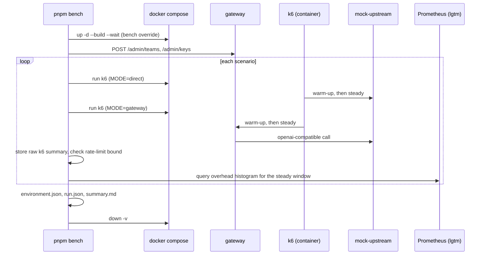

# Design 012: Benchmarks (k6, measured overhead, published honestly)

- **Spec:** [spec.md](spec.md) · **Tasks:** [tasks.md](tasks.md)
- **Related ADRs:** [0021](../../adr/0021-benchmark-methodology.md) (methodology; amended with the scenario parameters), [0008](../../adr/0008-no-retry-after-first-byte.md), [0011](../../adr/0011-opentelemetry.md)

## Overview
Everything benchmark-only lives under `bench/` and never ships in the gateway image:

```
bench/
├─ bench.config.json        scenario parameters (full and smoke profiles), k6 image, targets
├─ compose.bench.yml        Compose override: bench gateway config, cache gateway, mock upstreams, k6
├─ config/                  gateway configs used by the bench stack (cache off / exact cache on)
├─ mock-upstream/           HTTP server around src/modules/providers/mock.ts (+ Dockerfile)
├─ k6/                      one k6 script per scenario + shared checks (validate.js is pure)
├─ lib/                     pure TypeScript helpers (args, config, k6 summaries, metrics, report)
├─ run.ts                   `pnpm bench` orchestrator
├─ report.ts                `pnpm bench:report` generator (and `--check`)
├─ target-issues.json       AC-9 links: run id → issue per missed target
└─ results/<run-id>/        committed raw results of clean, full runs (local/ is git-ignored)
```

`bench/run.ts` and `bench/report.ts` use only Node built-ins and their own `bench/lib/*.ts` modules (`.ts` imports, run by Node's type stripping like `scripts/compose-smoke.ts`), so they do not depend on `src/`. The mock upstream imports `src/` and is compiled with `tsc` inside its own image.

## Components

### Mock upstream (AC-1)
- `bench/mock-upstream/server.ts`: `createMockUpstream(config, options)` returns a `node:http` server that wraps `createMockProvider` (same knobs and model names: `latencyMs`, `chunkDelayMs`, `errorRate`, `error-<status>`, `error-midstream`, `echo`). Routes: `POST /v1/chat/completions` (JSON, or SSE `data: …` events ending in `data: [DONE]`), `POST /v1/embeddings`, `GET /v1/models`, `GET /healthz`. `options.random` is passed through so the error-rate test is deterministic. `parseMockConfig(env, argv)` reads `MOCK_LATENCY_MS`, `MOCK_CHUNK_DELAY_MS`, `MOCK_ERROR_RATE`, `PORT` and the equivalent `--latency-ms`, `--chunk-delay-ms`, `--error-rate`, `--port` flags (flags win).
- Failures use the OpenAI error shape. A random failure (`errorRate`) answers `503`; `error-<status>` answers that exact status; `error-midstream` destroys the socket after the first chunks. It sends no `x-switchyard-*` header (it plays the provider, not the gateway).
- `keepAliveTimeout` is raised above undici's 30 s client keep-alive so the gateway never reuses a socket the mock is closing (that race would show up as spurious `502`s).
- `bench/mock-upstream/main.ts` starts it; `bench/mock-upstream/Dockerfile` (build context: repo root) compiles `main.ts` and the files it imports with `bench/mock-upstream/tsconfig.json` and runs plain `node` on the output. Its first stages repeat the gateway `Dockerfile` stages so BuildKit reuses the install layer.

### Bench stack (AC-2)
`bench/run.ts` runs `docker compose -p switchyard-bench -f docker-compose.yml -f bench/compose.bench.yml …`. A separate project name gives the run its own volumes, deleted with `down -v` at the end; the host ports are the dev stack's, so the dev stack must be stopped first (the command says so when Compose fails).

The override:
- `gateway`: `SWITCHYARD_CONFIG=/app/bench-config/gateway.yaml` (mounted from `bench/config`), `LOG_LEVEL=warn`, telemetry left on (ADR-0011), depends on the mocks.
- `gateway-cache`: the same image with `bench/config/gateway-cache.yaml` (identical except `cache.exact.enabled: true`), `MIGRATE_ON_BOOT=false`, `OTEL_SERVICE_NAME=switchyard-gateway-cache`, no host port. It shares Postgres, Redis and the key pepper, so the same API keys work on both.
- `mock-upstream` (healthy) and `mock-flaky` (`MOCK_ERROR_RATE` from the config, 0.3) from the mock image; latency and chunk delay come from `bench.config.json` through environment interpolation.
- `lgtm` additionally publishes Prometheus on `127.0.0.1:${BENCH_PROMETHEUS_PORT:-9090}` for the server-side collector.
- `k6` (profile `tools`): the pinned image from `bench.config.json` (`K6_IMAGE`, tag and digest), scripts mounted read-only at `/scripts`. It runs on the Compose network, so it reaches `gateway:8080`, `gateway-cache:8080` and `mock-upstream:9100` directly.

Gateway configs: providers `upstream` and `flaky` (`openai-compatible`, `baseUrl` to the mocks), alias `bench-chaos` (`priority`: `flaky/bench`, then `upstream/bench`), **no `limits.defaults`** (keys carry their own limits), PII off, both caches off in `gateway.yaml`, `semantic.embeddingModel` pointing at the mock so the file validates without Ollama. A unit test parses both with the gateway's `parseConfig`.

### k6 scenarios (AC-3, AC-4)
Each script (`bench/k6/<scenario>.js`) has two `constant-arrival-rate` scenarios: `warmup` then `steady` (`startTime` = warm-up length). Rate, durations and VU pools come from environment variables set by `run.ts` from `bench.config.json`. Custom metrics are added only in `steady` (`bench_latency`, `bench_ttfb`, `bench_requests`, `bench_ok`, `bench_failed`, `bench_rejected`, `bench_reject_latency`, `bench_cache_hit|miss|unlabelled`); `correctness_errors` and the rate-limit totals (`bench_admitted_total`, `bench_rejected_total`) count in both phases. `handleSummary` prints the raw k6 summary JSON between markers on stdout; `run.ts` stores it untouched.

| Scenario | Target(s) | Request | Allowed statuses | Extra checks |
|---|---|---|---|---|
| `no-cache` | direct, then gateway | chat, no `temperature` | 200 | body is a `chat.completion` with the mock content |
| `streaming` | direct, then gateway | chat, `stream: true` | 200 | SSE: every `data:` line parses as a chunk, ends with `[DONE]`, content reassembles; `x-switchyard-ttfb-ms`; TTFB = `timings.waiting` |
| `exact-cache` | gateway-cache | identical chat, `temperature: 0` | 200 | `x-switchyard-cache` is `hit` or `miss`; when absent the response is counted `unlabelled` (a correctness error once `requireCacheHeader` is on, after spec 009) |
| `rate-limited` | gateway | chat with a low-`rpm` key, above its rate | 200, 429 | every 429 has `retry-after ≥ 1` and the error shape; after the run, admitted ≤ `rpm × (1 + seconds/60)` and at least one 429 |
| `chaos` | gateway | chat on `bench-chaos` | 200; 502/503/504 with the error shape | client-visible success rate |

`bench/k6/validate.js` holds the pure checks (body, SSE, error body, headers) without k6 imports, so Vitest tests them directly (`validate.d.ts` types them). Gateway responses must carry `x-switchyard-request-id`, and successful ones also `-provider`, `-model`, `-attempts` (`-ttfb-ms` for streams). Direct-baseline responses skip header checks.

A correctness error increments `correctness_errors`, whose threshold `count==0` makes k6 exit `99`; `run.ts` maps exit `99` to a correctness failure and any other non-zero exit to a harness error. The rate-limit bound is checked in Node after the run (`checkRateLimit`), from the k6 totals.

### Orchestrator `pnpm bench` (AC-2, AC-5)
1. Parse `--scenario <name>` (repeatable or comma-separated), `--smoke`, `--keep`; a bare `--` is ignored (`pnpm bench -- --smoke`).
2. Capture the environment that does not need the stack: git commit and dirty flag (`git status --porcelain`), OS, CPU model and cores, RAM, Node.
3. `compose up -d --build --wait`; capture Docker version and resources (`docker info`), gateway and mock image ids, k6 image digest and version.
4. Create a team and keys through the admin API: `main` (high `rpm`/`tpm`, a large monthly budget so the budget path runs), `limited` (the scenario's `rpm`).
5. For each scenario: run the direct pass (when it has a baseline), then the gateway pass; save `k6/<scenario>.<target>.json`; record the steady window; after the gateway pass, wait `serverMetrics.lagSeconds` (the gateway exports metrics every 15 s) and collect the server-side metrics.
6. Write `run.json` (scenario outcomes, windows, exit codes, harness errors), `server-metrics.json`, `environment.json`, a copy of `bench.config.json`, and `summary.md`; print the folder.
7. `compose down -v` in `finally` (unless `--keep`); on failure print the gateway logs first. Exit non-zero on any correctness failure or harness error.

Run id: `<UTC yyyymmddThhmmssZ>-<short sha>`. Clean full runs go to `bench/results/<run-id>/`; smoke runs and dirty-tree runs go to `bench/results/local/<run-id>-smoke|-dirty/` (git-ignored) and their `environment.json` says why they are not publishable. The config hash is SHA-256 over `bench.config.json`, `bench/config/*.yaml` and `compose.bench.yml`.

### Server-side metrics (AC-7, blocked on spec 011)
`bench/lib/metrics.ts` builds PromQL from `bench.config.json` (`serverMetrics.metric`, per-scenario label selectors) and queries Prometheus (`/api/v1/query`) at the end of the window: `histogram_quantile(q, sum by (le) (increase(<metric>_bucket{…}[range])))` for p50/p95/p99 and `sum(increase(<metric>_count{…}[range]))`. An empty result is stored as `null` with the reason `"metric not exported"`, never as zero, and the report says "not available".

### Report `pnpm bench:report` (AC-6..AC-9)
- `bench/lib/runs.ts` loads run folders. From `bench/results/` it reads every top-level folder except `local/`; a folder whose `environment.json` is a fixture, a smoke run or a dirty-tree run is **excluded and listed with the reason**, never published. Fixture folders load only from an explicit directory (tests).
- `bench/lib/evaluate.ts` turns raw k6 summaries into per-scenario statistics (p50/p95/p99 in ms, achieved rate = steady requests ÷ steady seconds, counts), client-side overhead (gateway percentile − direct percentile), success rate, cache hit ratio, and the targets: **T1** `no-cache` client p95 overhead `< 15 ms`, **T2** `chaos` success `≥ 99 %`; each is `met`, `missed` or `not evaluated` (missing data). It also flags `dropped_iterations > 0` (load generator saturated: not a valid measurement per ADR-0021) and a material disagreement (> 5 ms at p95) between client- and server-side overhead.
- `bench/lib/render.ts` renders the docs section, the README section and a run's `summary.md` from the same data. Runs are grouped in batches (same commit, config hash and CPU model); the README shows the latest batch's median run (by T1 value); the docs show every run of every batch, median marked, and a note when a batch has fewer than the three runs ADR-0021 asks for. A missed target shows its issue from `bench/target-issues.json`, or "missed, issue required (AC-9)" when none is linked yet.
- `bench/report.ts` replaces the text between `<!-- bench:results:start -->`/`end` in `docs/benchmarks.md` and `<!-- bench:readme:start -->`/`end` in `README.md`; `--check` exits 1 when either differs. A unit test runs the same comparison, so `pnpm verify` fails on drift (AC-6). With no committed run, both sections state "No published run yet", with no numbers.

### CI (AC-10)
New workflow `.github/workflows/bench-smoke.yml`, job `bench-smoke` ("Benchmark smoke (correctness only)"), on `pull_request` with `paths: [bench/**, src/**, Dockerfile, docker-compose.yml, .github/workflows/bench-smoke.yml]`. A separate workflow because `paths` filters a whole workflow, and the main CI must keep running on every PR. Steps: checkout, Node from `.nvmrc`, `corepack enable`, `pnpm install --frozen-lockfile`, `pnpm bench -- --smoke`. Smoke output goes to `bench/results/local/` and the job log only.

## Contracts
- **CLI:** `pnpm bench [-- --scenario <name>[,<name>]] [--smoke] [--keep]`; `pnpm bench:report [--check]`.
- **Environment:** `BENCH_GATEWAY_URL` (default `http://127.0.0.1:8080`), `BENCH_PROMETHEUS_PORT` (9090), `ADMIN_TOKEN` (Compose default).
- **Run folder:** `environment.json` (`schema`, `runId`, `kind` `full|smoke`, `startedAt`, `finishedAt`, `host` {cpuModel, cpuCores, ramBytes, os}, `docker` {clientVersion, serverVersion, operatingSystem, ncpu, memTotalBytes}, `node`, `k6` {image, digest, version}, `images` {gateway, mockUpstream}, `git` {commit, dirty}, `configHash`, `publishable` + `notPublishableReasons`), `run.json`, `k6/<scenario>.<direct|gateway>.json`, `server-metrics.json`, `bench.config.json`, `summary.md`.
- **No new gateway HTTP contract, metric or span**: the harness consumes existing headers and spec 011's `switchyard_gateway_overhead_seconds`.

## Sequence



## Failure modes
- Docker missing or a host port in use: harness error before any scenario, with the Compose output.
- k6 exit 99: correctness failure of that scenario; the run continues with the next scenario and the command exits 1.
- k6 other exit or missing summary markers: harness error.
- Prometheus unreachable or metric absent: `null` with a reason; never fails the run (the cross-check is not a correctness rule).
- Dropped iterations: recorded and reported; the summary marks the run as not a valid measurement.

## Metrics and spans
None added. The harness reads `switchyard_gateway_overhead_seconds` (spec 011).

## AC → component

| AC | Component | Test |
|---|---|---|
| AC-1 | `bench/mock-upstream/server.ts` | `test/unit/bench/mock-upstream.test.ts` |
| AC-2 | `bench/run.ts`, `bench/compose.bench.yml`, `bench/lib/args.ts`, `bench/config/*` | `args.test.ts`, `bench-config.test.ts`, `run-plan.test.ts`; CI `bench-smoke` |
| AC-3 | `bench/k6/*.js`, `bench/bench.config.json` | `bench-config.test.ts`; CI `bench-smoke` |
| AC-4 | `bench/k6/validate.js`, `bench/lib/evaluate.ts` (`checkRateLimit`) | `validate.test.ts`, `evaluate.test.ts` |
| AC-5 | `bench/lib/environment.ts`, `bench/run.ts` | `environment.test.ts` |
| AC-6 | `bench/report.ts`, `bench/lib/render.ts` | `published-tables.test.ts`, `render.test.ts` |
| AC-7 | `bench/lib/evaluate.ts`, `bench/lib/metrics.ts`, `render.ts` | `evaluate.test.ts`, `metrics.test.ts`, `render.test.ts` |
| AC-8, AC-9 | `evaluate.ts`, `render.ts`, `bench/target-issues.json` | `render.test.ts` (fixtures under `test/fixtures/bench/`) |
| AC-10 | `.github/workflows/bench-smoke.yml` | CI |
| AC-11 | `docs/benchmarks.md`, README | `published-tables.test.ts` (generated parts) |

All tests are under `test/unit/bench/`.

## Risks
- Same-host load generation and Docker Desktop's shared VM add noise (ADR-0021); the paired baseline and the server-side histogram are the mitigations, and the docs state it next to every table.
- Server-side window precision: metrics are exported every 15 s, so the Prometheus window can include up to one export interval of warm-up, and histogram buckets make low-millisecond quantiles coarse. Published as a cross-check with that caveat; the target uses the client-side measure.
- Until spec 009 lands, `exact-cache` measures only latency (no hit ratio) and runs with `requireCacheHeader` off.

## Open decisions (proceeding with the recommended option; reversible)
1. **Cache on/off between scenarios: second gateway vs hot reload.** Options: (a) a second gateway service with a cache-enabled config; (b) one gateway, flip `cache.exact.enabled` and `POST /admin/config/reload`; (c) restart the gateway between scenarios. Chosen (a): no runtime mutation, both configs are committed files covered by the config hash, and it does not depend on whether spec 009's cache honours hot reload. Cost: one more container (~100 MB) during the run.
2. **`chaos` failures are not correctness errors.** AC-4 lists any non-200 as unexpected, but T2 must be able to report a miss. A well-formed `502/503/504` with the OpenAI error shape and `x-switchyard-request-id` counts as a failed request for the success rate; anything else (other statuses, malformed bodies, missing headers) is a correctness error.
3. **Publication set = every committed clean full run.** No selection file: anything committed under `bench/results/` is published (AC-9 forbids selecting a subset). Smoke and dirty runs are written to the git-ignored `bench/results/local/` and are refused by the generator if copied in.
4. **A missed target without a linked issue does not fail `--check`.** The issue needs the run id, so it is opened after the run; until it is linked the tables say "missed, issue required (AC-9)".
5. **k6 image `grafana/k6:1.8.1` (pinned by digest).** The 2.x line is newer, but 1.8.1 is a maintained release older than two weeks whose scripting API matches this design; moving to 2.x is a methodology change (ADR-0021).
6. **Initial scenario parameters** (rates, warm-up 30 s, steady 120 s, mock latency 50 ms, chunk delay 20 ms) are configuration, not results. They are recorded in ADR-0021; if the first reference run shows the direct baseline saturating (dropped iterations), the rate is lowered by amending ADR-0021 before any run is published.
7. **Server-side query selectors live in `bench.config.json`.** Spec 011 fixes the metric name but its label set is not merged yet; the selectors are config so the integrator can align them without code changes.
