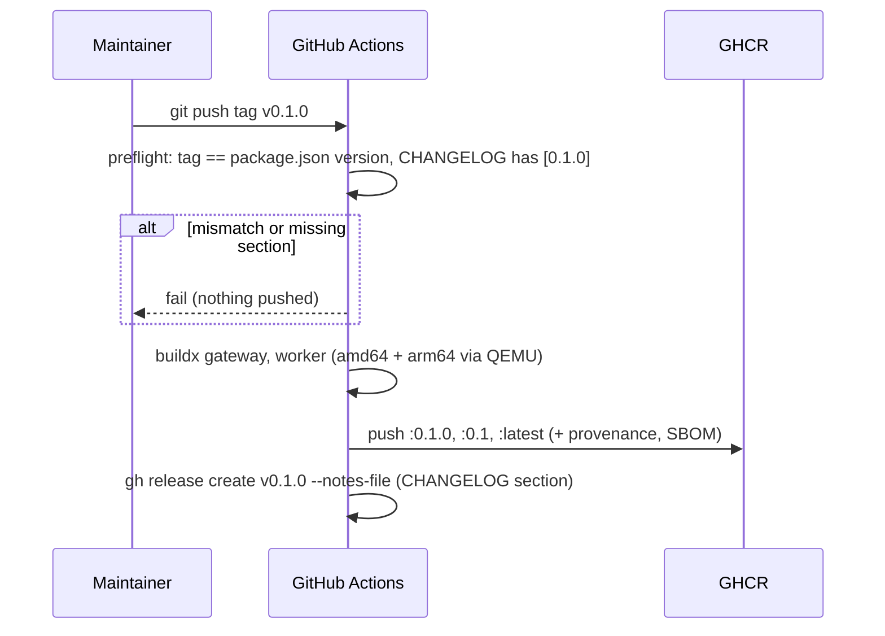

# Design 013: Deploy

- **Spec:** [spec.md](spec.md) (Approved 2026-10-13)
- **Related ADRs:** 0006, 0010, 0012 (Oracle Always Free + Terraform), 0020. No new ADR: every
  non-trivial choice below was approved as a "Proposed:" answer in the spec (Caddy, sslip.io,
  two images from one Dockerfile, env file over SSH, QEMU) or is a reversible, low-risk detail
  recorded under [Open decisions](#open-decisions).

## Overview

Nothing in this spec runs against a cloud account. Everything is proven locally (unit tests) or
in CI (Docker, Terraform with a mocked provider, `cloud-init schema`). Actually provisioning the
VM is the runbook in `docs/deploy.md`.

```
Dockerfile ──► targets gateway, worker ──► release.yml (tag vX.Y.Z) ──► ghcr.io/thisanches07/switchyard-{gateway,worker}
                                      └──► deploy.yml (PR) ──► multi-arch build (no push) + amd64 Compose checks
deploy/compose/   compose.yml + Caddyfile + config/ + switchyard.env.example   (production profile)
deploy/terraform/ VCN, IGW, route table, subnet, security list, A1 VM, cloud-init template, tests/
scripts/          demo-key.ts, release-check.ts, check-tracked-secrets.ts, render-cloud-init.ts, deploy-smoke.ts
```

## Components

### 1. Images (AC-1, AC-2)
- `Dockerfile` gains two final targets sharing every layer up to `runtime`:
  - `worker`: `CMD node --import ./dist/infra/telemetry/register-worker.js dist/worker.js`, no
    `HEALTHCHECK` (the worker has no HTTP server; its readiness signal is spec 006's: both usage
    topics exist and the log line `usage worker started`).
  - `gateway` (last stage, so `docker build .` still yields the gateway): `EXPOSE 8080`,
    `HEALTHCHECK` on `/healthz` with Node's `fetch` (no curl in the slim image).
- The TypeScript `build` stage runs on `--platform=$BUILDPLATFORM`: `dist/` is platform
  independent, so the arm64 build only runs `pnpm install --prod` under QEMU, not `tsc`.
- `@confluentinc/kafka-javascript@1.11.0` publishes `node-v137-linux-glibc-arm64` prebuilds
  (Node 24 ABI 137), so the arm64 `prod-deps` stage downloads a binary instead of compiling.
- OCI labels (`org.opencontainers.image.source|revision|version|…`) come from
  `docker/metadata-action` as both labels and index/manifest annotations.
- `docker-compose.yml` (dev) builds each service with its `target` and names the images
  `${SWITCHYARD_GATEWAY_IMAGE:-switchyard-gateway:dev}` / `${SWITCHYARD_WORKER_IMAGE:-switchyard-worker:dev}`.
  `scripts/compose-smoke.ts` accepts `SMOKE_NO_BUILD=1` (`up --no-build`), so CI runs the
  existing smoke test against preloaded amd64 images (AC-2: `/healthz`, `/readyz`, worker topics,
  usage counted end to end).

### 2. Release workflow (AC-1, AC-3) — `.github/workflows/release.yml`
- Triggers: `push` of tags `v*`, and `workflow_dispatch` (dry run: builds, never pushes or
  releases; it is the way to exercise the workflow before the first tag exists).
- `preflight` job: `node scripts/release-check.ts --tag <tag> --notes <file>`.
  - Tag must match `^v\d+\.\d+\.\d+(-[0-9A-Za-z.-]+)?$` and equal `v` + `package.json#version`.
  - `CHANGELOG.md` must contain a `## [X.Y.Z…]` section (date ignored); its body becomes the notes
    (artifact). Failure stops the run before any image is pushed.
  - Outputs `version` and `prerelease`.
- `images` job (matrix `gateway`, `worker`; `packages: write`): QEMU + Buildx, GHCR login with
  `GITHUB_TOKEN`, `metadata-action` tags `type=semver,pattern={{version}}` and
  `{{major}}.{{minor}}` with `latest=auto` (both skipped for pre-releases), `build-push-action`
  for `linux/amd64,linux/arm64`, `push` only on tag pushes, `provenance: mode=max`, `sbom: true`.
- `release` job (`contents: write`, tag pushes only): `gh release create <tag> --verify-tag
  --notes-file notes.md` plus `--prerelease` when the tag has a suffix.
- `package.json#version` becomes `0.1.0`; `CHANGELOG.md` has `## [Unreleased]` and a planned
  `## [0.1.0] - Unreleased` section that the owner dates when tagging.

### 3. Production Compose (AC-4, AC-5) — `deploy/compose/`
- `compose.yml`: `caddy` (`caddy:2.11.7-alpine`, the only service with `ports`: `80:80`,
  `443:443`), `gateway` and `usage-worker`
  (`ghcr.io/thisanches07/switchyard-{gateway,worker}:${SWITCHYARD_VERSION:?…}`, no `build:`),
  `postgres`, `redis`, `redpanda`, `lgtm`, and `ollama` behind the `ollama` profile. Named
  volumes, `restart: unless-stopped`, bounded json-file logs.
- Secrets: `${ADMIN_TOKEN:?…}`, `${KEY_PEPPER:?…}`, `${POSTGRES_PASSWORD:?…}`,
  `${SWITCHYARD_HOSTNAME:?…}` and optional provider keys, all read from the operator's env file
  (`--env-file /etc/switchyard/switchyard.env` on the VM; `switchyard.env.example` is committed
  with placeholders). Unset values make `docker compose` refuse to start.
- **Refusing dev defaults**: a new gateway env flag `SWITCHYARD_REQUIRE_SECRETS=true` (set by the
  production file only) makes the gateway exit with a configuration error when `ADMIN_TOKEN` is
  missing or starts with `dev-only`, `KEY_PEPPER` starts with `dev-only`, or `DATABASE_URL` uses
  the dev password `switchyard`. Pure function `findDevSecrets(env)` in `src/config/secrets.ts`;
  the worker depends on a healthy gateway, so the whole stack stays down.
- `Caddyfile`: site `{$SWITCHYARD_HOSTNAME}`; HTTP/1.1 and HTTP/2 only (no UDP port); automatic
  HTTPS (Let's Encrypt for a public name such as `<ip>.sslip.io`, Caddy's internal CA for
  `localhost`, which is how CI runs it); automatic `80 → 443` redirect; `/admin*` answers `404`
  in the OpenAI error shape; `reverse_proxy gateway:8080` with `flush_interval -1` (SSE).
- Admin API and Grafana are reached through an SSH tunnel to fixed container addresses on the
  compose network (`172.30.0.0/24`: gateway `172.30.0.10`, lgtm `172.30.0.20`), so no host port
  is published for them.
- `config/switchyard.yaml` (demo): `trustProxy: true`, providers `mock` and `ollama`
  (`http://ollama:11434/v1`), alias `demo → [mock/demo]` (the runbook switches it to a small
  Ollama model once the `ollama` profile is on), strict default limits.
  `config/pricing.yaml`: `mock/*` synthetic price, Ollama models at `0`.

### 4. Demo key (AC-6) — `pnpm demo:key`
- `scripts/demo-key.ts` (runs on plain Node 24, no tsx) with logic in `scripts/lib/demo-key.ts`.
- Env: `SWITCHYARD_ADMIN_URL` (default `http://localhost:8080`, the SSH tunnel), `ADMIN_TOKEN`.
  Flags: `--team demo`, `--name demo`, `--alias demo`, `--rpm 10`, `--tpm 20000`,
  `--budget-usd 1`, `--rotate`.
- Idempotency: the team is found by name (created when missing, with the same monthly budget);
  an active key with the given name in that team is reused: its `rpm`/`tpm`/`monthlyBudgetUsd`
  are PATCHed to the requested values and nothing secret is printed. A key is created (and its
  plaintext printed once, on stdout) only when none exists, or with `--rotate` (old key revoked).
  Budgets are hard limits per spec 007 (`budget_exceeded`, `429`).
- CI test (`scripts/deploy-smoke.ts`, job `prod-compose`): a test-only override
  (`test/deploy/compose.test.yml`) mounts `test/deploy/pricing.test.yaml`, which prices `mock/*`
  high enough that a `$1` budget is spent in a few requests. Proves: rate-limited key `200 ×3`
  then `429 rate_limit_exceeded`; a second run creates no key; budgeted key reaches `429
  budget_exceeded`; another model gets `403 model_not_allowed`.

### 5. Terraform (AC-7, AC-8, AC-10) — `deploy/terraform/`
- `required_version = ">= 1.16.5, < 1.17.0"`; provider `oracle/oci` `= 9.8.0`;
  `.terraform.lock.hcl` with `linux_amd64`, `linux_arm64`, `darwin_amd64`, `darwin_arm64`,
  `windows_amd64` hashes (`terraform providers lock`).
- Provider auth from the operator's `~/.oci/config` profile (`oci_config_profile`), never variables.
- Resources: `oci_core_vcn`, `oci_core_internet_gateway`, `oci_core_route_table`,
  `oci_core_security_list` (ingress TCP 80/443 from `0.0.0.0/0`, TCP 22 from `operator_cidr`;
  egress all), `oci_core_subnet` (public), `oci_core_instance` (`VM.Standard.A1.Flex`, latest
  Canonical Ubuntu 24.04 aarch64 image unless `image_ocid` is set).
- Always Free (Oracle docs, checked 2026-10-13: "1,500 OCPU hours and 9,000 GB hours per month …
  equivalent to 2 OCPUs and 12 GB of memory"; 200 GB block storage, default boot volume 50 GB):
  defaults `ocpus = 2`, `memory_in_gbs = 12`, `boot_volume_size_in_gbs = 50`, with validations
  capping them at 2 / 12 / 200.
- `operator_cidr`: must be a valid IPv4 CIDR with a prefix length ≥ 1 (rejects `0.0.0.0/0`).
- Instance metadata: `ssh_authorized_keys` (public key) and `user_data` (cloud-init) only.
- Outputs: `public_ip`, `ssh_command`, `demo_hostname` (`<a-b-c-d>.sslip.io`).
- `tests/deploy.tftest.hcl` (`terraform test` with `mock_provider "oci"`, plan only, no
  credentials, no cloud calls): defaults within Always Free, ingress rules exactly 22/80/443,
  metadata keys, user-data under the 32,000-byte metadata limit, and `expect_failures` for
  `0.0.0.0/0`, too many OCPUs and too much memory.
- `.gitignore`: `.terraform/`, state, `*.tfvars` (except `*.tfvars.example`), crash logs, prod
  env files. `scripts/check-tracked-secrets.ts` (pure `findTrackedSecrets(paths)`) runs on
  `git ls-files` in CI's `verify` job.

### 6. cloud-init (AC-9) — `deploy/terraform/cloud-init.yaml.tftpl`
- Only one template variable (`switchyard_version`), so a tiny Node renderer
  (`scripts/render-cloud-init.ts`, refuses unknown `${…}`) produces the same file in CI for
  `cloud-init schema --config-file`.
- Docker's apt repository + `docker-ce`, `docker-ce-cli`, `containerd.io`,
  `docker-compose-plugin`, `unattended-upgrades` (enabled through `20auto-upgrades`),
  `ssh_pwauth: false`, `disable_root: true`, an `sshd_config.d` drop-in (no passwords, no root,
  no keyboard-interactive), host firewall rules for 80/443 (Oracle's Ubuntu images ship
  restrictive iptables rules).
- `/usr/local/bin/switchyard-fetch <version>` downloads `deploy/compose/` from the repository at
  tag `v<version>` into `/opt/switchyard` (keeping an existing `config/`), used at first boot and
  for upgrades.
- `switchyard.path` (`PathExists=/etc/switchyard/switchyard.env`) starts `switchyard.service`
  (`docker compose … up -d --wait`, `ConditionPathExists` on the env file): the stack starts as
  soon as the operator copies the env file over SSH. No secret travels through Terraform
  variables, state or metadata.

### 7. Docs (AC-11, AC-12)
`docs/deploy.md` (runbook, untested steps marked "Not yet run against a real account"),
README "Run the published images" + link, `CHANGELOG.md`, threat-model rows for the public demo.

## Sequence: release



## Sequence: first boot of the demo VM

```mermaid
sequenceDiagram
  participant O as Operator
  participant TF as Terraform
  participant VM as VM (cloud-init)
  O->>TF: terraform apply (operator_cidr, ssh key)
  TF->>VM: VCN, firewall, A1 instance, user_data
  VM->>VM: install Docker, unattended-upgrades, sshd hardening, switchyard-fetch 0.1.0
  VM->>VM: switchyard.path waits for /etc/switchyard/switchyard.env
  O->>VM: scp env file (ssh, operator_cidr only)
  VM->>VM: docker compose up -d --wait (Caddy gets a certificate for <ip>.sslip.io)
  O->>VM: ssh -L 8080:172.30.0.10:8080 ; pnpm demo:key
```

## CI (contracts)

| Workflow / job | Trigger | Proves |
|---|---|---|
| `ci.yml` › verify (+ `check-tracked-secrets`) | every PR, main | AC-10 tracked files, unit tests for AC-1/3/4/6/9/10 logic |
| `deploy.yml` › `images-multiarch` | PR/main touching `Dockerfile`, `deploy/**`, release/deploy workflows, … | AC-2 both platforms build (no push) |
| `deploy.yml` › `images-compose` | same | AC-2 amd64 images in the dev stack: `/healthz`, `/readyz`, worker topics |
| `deploy.yml` › `prod-compose` | same | AC-4/AC-5 HTTPS, redirect, closed ports, dev defaults refused; AC-6 demo key |
| `deploy.yml` › `terraform` | same | AC-7/AC-8 fmt, init `-backend=false`, validate, `terraform test` |
| `deploy.yml` › `cloud-init` | same | AC-9 `cloud-init schema` on the rendered file |
| `deploy.yml` › `release-preflight` | same | AC-1/AC-3 a `v<package version>` tag would pass (version + changelog) |
| `release.yml` | tag `v*`, manual dry run | AC-1/AC-3 publish + GitHub Release |

## Failure modes
- Tag ≠ version or changelog section missing → `preflight` fails, nothing pushed.
- arm64 prebuild missing for a future dependency → `images-multiarch` fails on the PR, not at release.
- Env file missing → systemd path unit never fires; compose interpolation refuses unset secrets;
  dev values → gateway exits with a configuration error.
- ACME failure (DNS, port 80 blocked) → Caddy keeps retrying; runbook troubleshooting.
- Always Free ARM capacity unavailable → `terraform apply` fails with "Out of host capacity";
  runbook: retry, other AD, fallback ADR-0022.

## Observability
No new runtime behaviour beyond the startup refusal (a configuration error on stderr, like other
config errors). The production stack ships `otel-lgtm` with spec 011's dashboards, reached through
the SSH tunnel. No new metrics or spans.

## Risks
- QEMU arm64 builds are slow (mostly `pnpm install --prod`); mitigated by the `$BUILDPLATFORM`
  build stage and the GHA cache.
- Oracle's Always Free terms change (they did: 4 → 2 OCPUs); validations cite the date checked.
- Docker's apt key via keyserver and Oracle's iptables defaults are only exercised on a real VM:
  marked untested in the runbook.

## AC → component

| AC | Component | Test |
|---|---|---|
| AC-1 | Dockerfile targets, `release.yml`, `scripts/lib/release.ts` | `test/unit/scripts/release.test.ts`; `deploy.yml` images-multiarch, release-preflight; first tag (post-merge) |
| AC-2 | `deploy.yml`, `compose-smoke.ts` `SMOKE_NO_BUILD` | `deploy.yml` images-multiarch, images-compose |
| AC-3 | `release.yml`, `CHANGELOG.md` | `test/unit/scripts/release.test.ts`; release-preflight |
| AC-4 | `deploy/compose/*`, `src/config/secrets.ts` | `test/unit/deploy/compose.test.ts`, `test/unit/config/secrets.test.ts`; prod-compose |
| AC-5 | Caddyfile, `deploy-smoke.ts` | prod-compose |
| AC-6 | `scripts/demo-key.ts` | `test/unit/scripts/demo-key.test.ts`; prod-compose |
| AC-7 | `deploy/terraform/*` | `deploy/terraform/tests/deploy.tftest.hcl`; terraform job |
| AC-8 | `deploy.yml` terraform job | terraform job |
| AC-9 | cloud-init template, renderer | `test/unit/deploy/cloud-init.test.ts`; cloud-init job |
| AC-10 | `.gitignore`, `check-tracked-secrets.ts` | `test/unit/scripts/tracked-secrets.test.ts`; ci verify |
| AC-11 | `docs/deploy.md` | `test/unit/repo/files.test.ts` (sections present) |
| AC-12 | README, CHANGELOG | `test/unit/repo/files.test.ts` |

## Open decisions
1. **Worker health check:** none in the image; readiness = spec 006 topics + log line (no new
   worker endpoint). Revisit if the worker gets an HTTP port.
2. **Refusing dev defaults:** in the gateway behind `SWITCHYARD_REQUIRE_SECRETS` rather than a
   separate preflight container (simpler, unit-testable; the worker follows the gateway).
3. **Admin API exposure:** blocked at Caddy; operators use an SSH tunnel to the gateway's fixed
   address. Keeps the admin surface off the internet without another published port.
4. **Demo models:** `demo → mock/demo` by default; switching to a small Ollama model is a
   runbook step (`--profile ollama`, `ollama pull`, edit alias, hot reload). Keeps CI and a
   fresh VM deterministic.
5. **Test-only pricing:** `config/pricing.yaml` already prices `mock/*` for tests, but the CI
   test still mounts its own file with a high price so a small budget is spent in a few requests.
6. **`terraform test` with a mocked provider** is used to prove the variable validations; it is a
   plan against a mock, not the cloud, so AC-8's "no plan/apply in CI" holds in spirit. `tflint`
   is not adopted.
7. **ICMP:** the security list allows only the three TCP ports the spec lists (no ICMP type 3
   code 4); path-MTU problems are unlikely on a single public subnet and the runbook mentions it.
8. **Version:** first tag `v0.1.0` (README says v0.1 is the current milestone). The spec's
   "Release: v0.3" label is the roadmap milestone, not the first tag.
