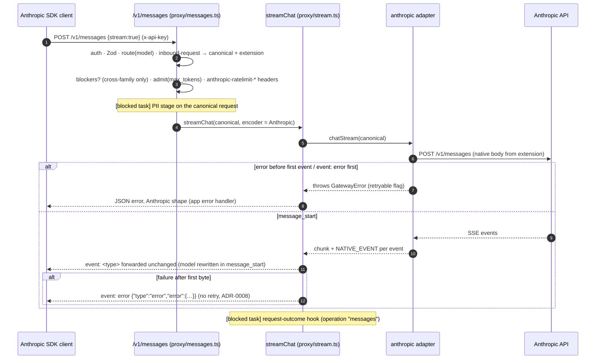

# Design 014: Anthropic provider adapter and Messages API

- **Status:** Approved (2026-10-13, via `/ship` after spec approval)
- **Spec:** [spec.md](spec.md)
- **Related ADRs:** 0003, 0004, 0008, 0010, 0011, 0014, [0016](../../adr/0016-anthropic-messages-compatibility.md)

Spec open questions resolved as proposed (they were approved with the spec): thinking is dropped from OpenAI responses and documented as a limitation; consecutive same-role messages are merged; the gateway `code` goes in `error.details.error_code`; upstream `529` becomes `503 upstream_overloaded` on both routes; `defaultMaxTokens` defaults to `4096`; `x-api-key` is accepted on every `/v1` route; `anthropic-beta` is forwarded on the same-family path only; image URLs are passed through, never fetched.

The live check of the thinking question (a multi-turn tool loop on a mandatory-thinking model through `/v1/chat/completions`) needs a paid key and is **not** run here; it stays an open item for the owner (opt-in live test, §9).

API details below were checked against the current Anthropic docs (streaming events, errors, rate-limit headers) and the official TypeScript SDK `0.129.0` (`MessageStream` accumulator, error classes).

## 1. Components and files

| Path | Responsibility |
|---|---|
| `src/core/anthropic.ts` (new) | The opaque Anthropic extension carried by a canonical request (§3) and the native-event key carried by chunks; accessors |
| `src/core/chat.ts` | `Usage.cachedInputTokens?` (provider-reported prompt-cache reads) |
| `src/core/provider.ts` | `ChatResult.native?` (raw provider body for same-family routes); optional `headers` on `HttpResponse`/`HttpStreamResponse` |
| `src/core/errors.ts` | `GatewayError` gets an optional `retryable` flag; new factories (`embeddingsNotSupported`, `unsupportedParameter`, `invalidToolArguments`, `upstreamAuthError`, `upstreamRateLimited`, `upstreamOverloaded`) |
| `src/infra/http/undici-client.ts` | Returns response headers (lower-cased, first value) |
| `src/config/schema.ts` | `defaultMaxTokens` on `anthropic` providers (default 4096) |
| `src/modules/anthropic/outbound-request.ts` | **Pure**: canonical request → Anthropic body (AC-2, AC-3) |
| `src/modules/anthropic/outbound-response.ts` | **Pure**: Anthropic message → `chat.completion`; `stop_reason` → `finish_reason`; usage (AC-3, AC-4) |
| `src/modules/anthropic/outbound-stream.ts` | **Pure, stateful**: Anthropic SSE events → `chat.completion.chunk`s (AC-10, AC-12) |
| `src/modules/anthropic/upstream-errors.ts` | **Pure**: HTTP status / `error` event → `GatewayError` with retryable flag (AC-13) |
| `src/modules/anthropic/inbound-request.ts` | **Pure**: Anthropic request → canonical request + extension + cross-family blockers (AC-7, AC-8) |
| `src/modules/anthropic/native.ts` | **Pure**: rebuilds the same-family upstream body from the extension, writing canonical text back (AC-7, ADR-0016) |
| `src/modules/anthropic/inbound-response.ts` | **Pure**: `chat.completion` → Anthropic `message`; `finish_reason` → `stop_reason` (AC-8) |
| `src/modules/anthropic/inbound-stream.ts` | Stream encoder: canonical chunks → Anthropic SSE, or native events forwarded (AC-11, AC-12) |
| `src/modules/anthropic/inbound-errors.ts` | **Pure**: `GatewayError` → Anthropic error body; `anthropic-ratelimit-*` headers (AC-9, AC-14) |
| `src/modules/anthropic/schema.ts` | Zod schema of the `/v1/messages` body (AC-6) |
| `src/modules/providers/anthropic.ts` | The `anthropic` `ChatProvider` (HTTP, headers, span attributes) |
| `src/modules/providers/registry.ts` | Builds it; `503 provider_not_configured` when the key is unset; placeholder removed |
| `src/modules/providers/mock.ts` | Deterministic tool calls (needed by the SDK tool round trip, AC-16) |
| `src/modules/auth/{keys,authenticate}.ts` | `x-api-key` or `Authorization: Bearer` (AC-6) |
| `src/modules/proxy/stream.ts` | Pluggable `StreamEncoder` (default: today's OpenAI SSE); nothing else changes |
| `src/modules/proxy/messages.ts` (new) | `POST /v1/messages` handler, reusing `route`/`admit`/`settle`/`streamChat` from `routes.ts` |
| `src/modules/proxy/routes.ts` | Registers the messages route with its helpers (a few additive lines) |
| `src/app.ts` | Error handler picks the Anthropic shape for routes with `config.api === "anthropic"` |
| `src/modules/docs.ts` | OpenAPI: `/v1/messages`, `x-api-key` security scheme, "Anthropic-compatible" tag |
| `test/helpers/fake-anthropic.ts` (new) | In-process fake Anthropic HTTP server (scripted by model name, records requests) |
| `test/fixtures/anthropic/*` (new) | Responses and SSE streams in the documented shapes |

Architecture rules hold: `src/core` gains types only; the translation modules are pure and import only `src/core`; the adapter depends on the `HttpClient` port.

## 2. Public contracts

### Config
```yaml
providers:
  claude:
    type: anthropic
    apiKeyEnv: ANTHROPIC_API_KEY
    baseUrl: https://api.anthropic.com   # optional (default)
    defaultMaxTokens: 4096               # optional; used when an OpenAI request sets no max tokens
```

### Outbound (adapter → Anthropic)
`POST {baseUrl}/v1/messages`, headers `x-api-key`, `anthropic-version: 2023-06-01`, `content-type: application/json`, plus `anthropic-beta` on the same-family path when the client sent one. `stream: true` for streams.

### Inbound `POST /v1/messages`
- Auth: `x-api-key: sk-sy-…` or `Authorization: Bearer sk-sy-…` (both present and different → 401). `anthropic-version` accepted, never required.
- Body (Zod, unknown fields kept): `model` (string), `max_tokens` (int ≥ 1), `messages` (non-empty, `role` `user`/`assistant`, `content` string or blocks with a `type`), `system` (string or text blocks), `stop_sequences`, `temperature`, `top_p`, `top_k`, `tools`, `tool_choice`, `metadata`, `stream`.
- Response: Anthropic `message` (or SSE), headers `x-switchyard-*`, `x-ratelimit-*`, `anthropic-ratelimit-{requests,tokens}-{limit,remaining,reset}` (reset in RFC 3339), `request-id` (= `x-switchyard-request-id`).
- Errors: `{"type":"error","error":{"type","message","details":{"error_code"}},"request_id"}`; `error.type` by status (AC-14 table).

## 3. Carrying Anthropic-only data (ADR-0016 option 3)

**Open decision 1 (recommended and taken): symbol-keyed extension, raw response in a separate field.**

Request side: `inbound-request.ts` returns a clean OpenAI-shaped canonical request and attaches
```ts
// src/core/anthropic.ts
export const ANTHROPIC_EXTENSION = Symbol.for("switchyard.anthropic");
interface AnthropicExtension {
  body: Record<string, unknown>;        // the client's Anthropic body as received
  slots: readonly TextSlot[];           // where each canonical text came from in `body`
  beta?: string;                        // anthropic-beta request header
}
interface TextSlot { canonical: Path; native: Path; kind: "text" | "json"; original: string }
```
under a **symbol** key. Options considered:
- *string field (e.g. `anthropic`) stripped by `openai-compatible`*: visible to naive cache hashing, but a client could send that field on `/v1/chat/completions` and inject raw Anthropic blocks that bypass PII redaction, and every non-Anthropic adapter must remember to strip it;
- *symbol key* (chosen): JSON cannot produce it (no injection from clients), `JSON.stringify` never sends it to a non-Anthropic upstream (no change to `openai-compatible.ts` or the mock), and object spread (`{ ...request, model }`) keeps it. Cost: `structuredClone` drops it, so features that copy the request must spread; spec 009 must add it to its cache key explicitly (ADR-0016 already says so). Both are documented for the wiring task.

Same-family rebuild (`native.ts`): deep-copy `extension.body`, set `model` (resolved) and `stream`, then for every slot read the current canonical value at `slot.canonical`: unchanged → keep the original bytes; changed (PII masking) → write it back at `slot.native` (`kind: "json"` = tool-call arguments, parsed back into `tool_use.input`). With PII off nothing changes, so the upstream body equals the client body except `model` (AC-7 fixture test). Thinking, `redacted_thinking`, `document`, `cache_control`, `top_k`, `metadata`, server tools and any future field are never in the canonical request, so they are re-emitted untouched and never scanned (ADR-0016 consequence for spec 010). Features must not add, remove or reorder canonical messages of a `/v1/messages` request (slots are index paths); masking text in place is the supported change.

Response side: the adapter always returns canonical data. When the request carries the extension it also returns the raw upstream data: `ChatResult.native` (the Anthropic `message`) and, for streams, one chunk per upstream event with the raw `{type, data}` under the symbol `NATIVE_EVENT`. `/v1/chat/completions` never reads either: it returns `result.body`, and the OpenAI encoder serialises chunks with `JSON.stringify`, which skips symbol keys (a unit test asserts nothing leaks).

## 4. Translation tables

### Outbound request (canonical → Anthropic), AC-2/AC-3
| Canonical | Anthropic |
|---|---|
| `system`/`developer` messages (string or text parts) | joined in order with `"\n\n"` into top-level `system` |
| `user` content string / parts | string / blocks: `text` → `text`; `image_url` `data:<mt>;base64,<d>` → `image` `base64` source; `http(s)` URL → `image` `url` source; other part types → 400 `unsupported_parameter` |
| `assistant` `content` + `tool_calls` | `text` block (omitted when empty) then `tool_use` blocks (`arguments` parsed; `""` → `{}`; invalid JSON or not an object → 400 `invalid_tool_arguments`) |
| consecutive `tool` messages | one `user` turn of `tool_result {tool_use_id, content}` |
| consecutive same-role turns | merged (content blocks concatenated) |
| `max_completion_tokens` → `max_tokens` → `defaultMaxTokens` | `max_tokens` |
| `stop` (string/array) | `stop_sequences` |
| `temperature`, `top_p` | same |
| `user` | `metadata.user_id` |
| `tools[].function` | `{name, description, input_schema}` (`parameters` absent → empty object schema); non-function tools → 400 |
| `tool_choice` `auto`/`none`/`required`/`{function:{name}}` | `{type:auto}`/`{type:none}`/`{type:any}`/`{type:tool,name}` |
| `parallel_tool_calls: false` | `disable_parallel_tool_use: true` on `tool_choice` (`auto` when none given) |
| `n > 1`, `logprobs: true`, `top_logprobs`, `response_format` ≠ `text` | 400 `unsupported_parameter` naming it |
| `presence_penalty`, `frequency_penalty`, `seed`, `logit_bias` and any other unknown non-null field | dropped; names in span attribute `switchyard.dropped_params` |
| `stream`, `stream_options`, `model`, `messages` | handled by the adapter |

### Outbound response, AC-3/AC-4
`text` blocks concatenated into `message.content` (`null` when only tool calls); `tool_use` → `tool_calls` (`arguments` = `JSON.stringify(input)`); thinking, `redacted_thinking` and server-tool blocks dropped. `stop_reason`: `end_turn`/`stop_sequence`/`pause_turn` → `stop`; `max_tokens`/`model_context_window_exceeded` → `length`; `tool_use` → `tool_calls`; `refusal` → `content_filter`; other → `stop`. Usage: `prompt_tokens = input + cache_creation + cache_read`, `completion_tokens = output`, `prompt_tokens_details.cached_tokens = cache_read`; canonical `Usage` the same plus `cachedInputTokens`.

### Inbound request (Anthropic → canonical), AC-8
`system` → one `system` message per text block (string → one message); text blocks → `text` parts (a single text block collapses to a string); `image` blocks → `image_url` parts (`base64` → data URI, `url` → URL); assistant `tool_use` → `tool_calls`; `tool_result` → `role: "tool"` messages (string or text content; placed before the rest of that user turn); `thinking`/`redacted_thinking` and `cache_control` → not in canonical (dropped cross-family); `max_tokens`, `stop_sequences` → `stop`, `temperature`, `top_p`, `top_k` (passed through), custom `tools` → function tools, `tool_choice` reverse of the table above, `metadata.user_id` → `user`, `stream` (+ `stream_options.include_usage: true`, so the synthesised `message_delta` has real usage). **Blockers** (400 `invalid_request_error` naming the field, only when the resolved provider is not `anthropic`): `document` blocks, server tools (`type` other than `custom`), images or documents inside `tool_result`. Same-family requests are never blocked.

### Inbound response (canonical → Anthropic), AC-8
`id` = `msg_` + 24 random hex chars; `content`: text block (if non-empty) then `tool_use` blocks (`input` = parsed arguments; invalid JSON → 502 `upstream_error`, open decision 3); `finish_reason` `stop` → `end_turn` (or `stop_sequence` when the choice's non-standard `stop_reason` names a requested sequence, as vLLM reports), `length` → `max_tokens`, `tool_calls`/`function_call` → `tool_use`, `content_filter` → `refusal`; `usage` `{input_tokens, output_tokens, cache_creation_input_tokens: 0, cache_read_input_tokens: 0}`; `model` = the name the client sent.

## 5. Streaming



`streamChat` gains `encoder?: StreamEncoder` (`{ chunk(c): string[]; end(usage): string[]; error(e): string }`); the default reproduces today's OpenAI behaviour byte for byte (existing tests unchanged). The first-chunk/abort/reconcile skeleton, and therefore spec 006's hook, stays in one place.

**First client-visible byte (AC-12).** `/v1/chat/completions` → `anthropic`: the stream translator does not emit the `message_start` role chunk on its own; it emits it together with the first text delta or `tool_use` start (or `message_delta` for an empty message). Thinking blocks and pings produce nothing, so a long thinking phase or an `event: error` during it still fails before headers are sent (pre-first-byte, retry-safe for spec 008). The spec's "`message_start` → role chunk" holds; only its timing is deferred to the first visible output, which is what AC-12 requires. `/v1/messages` same-family: `message_start` itself is client-visible, so it is the first byte; an `error` event after it is mid-stream.

Translator state (AC-10): Anthropic block index → OpenAI tool-call index (counting only `tool_use` blocks); `text_delta` → `delta.content`; `tool_use` start → `tool_calls[{index,id,type,function:{name,arguments:""}}]`; `input_json_delta` → `arguments` fragment; `message_delta` → finish chunk (first one only), usage remembered (cumulative, combined with `message_start`; both may omit `usage`); `message_stop` → usage chunk `{choices:[], usage}` and end; `ping`, `thinking_delta`, `signature_delta`, unknown events → nothing; `error` → throws; stream ends without `message_stop` → `upstream_error`.

Cross-family encoder: `message_start` (full message: `content: []`, `stop_reason: null`, `usage: {input_tokens: 0, output_tokens: 0}`, which the SDK accumulator requires), text deltas as a `text` block, each tool call as a `tool_use` block with `input_json_delta`, blocks closed in order, then `message_delta` (`stop_reason`, `usage.input_tokens` and cumulative `output_tokens`) and `message_stop`; no `[DONE]`.

## 6. Errors (AC-13, AC-14)

| Upstream | `GatewayError` | retryable |
|---|---|---|
| 400, 403, 404, 413, 422 (other 4xx alike) | same status, upstream message and type, `code: upstream_<status>` | no |
| 401 | 502 `upstream_auth_error` | no |
| 429 | 429 `upstream_rate_limited`, upstream `retry-after` kept | yes |
| 529 / `overloaded_error` | 503 `upstream_overloaded` | yes |
| 500, other 5xx | 502 `upstream_error` (body never forwarded) | yes |
| 504 / `timeout_error`, gateway timeouts | 504 `upstream_timeout` | yes |
| network errors | 502 `upstream_error` | yes |

`event: error` maps its `error.type` to the status above (`invalid_request_error` 400, `authentication_error` 401, `permission_error` 403, `not_found_error` 404, `request_too_large` 413, `rate_limit_error` 429, `api_error` 500, `timeout_error` 504, `overloaded_error` 529, unknown → 500). The upstream `request-id` header goes into span attribute `switchyard.upstream.request_id`; error bodies are never recorded.

**Open decision 2 (taken): explicit `retryable` flag.** Spec 008 classifies by status (408, 429, 5xx), but AC-13 makes upstream 401 (surfaced as 502) non-retryable, which status alone cannot express. `GatewayError` gets an optional `retryable?: boolean` (constructor options argument, additive). Spec 008 should use `error.retryable ?? statusRule(error.status)`.

Inbound shape: `app.setErrorHandler` checks `request.routeOptions.config.api === "anthropic"`; if so it sends `toAnthropicErrorBody(error, request.id)` with header `request-id`, and adds `anthropic-ratelimit-*` derived from the error's `x-ratelimit-*` headers. Auth runs in `onRequest`, after route matching, so auth failures on `/v1/messages` get the Anthropic shape too.

`anthropic-ratelimit-*-reset` needs an absolute time: `anthropicRateLimitHeaders(xRateLimitHeaders, now)` parses the `x-ratelimit-*` values the admission already produces (durations like `6m0s`) and returns `limit`, `remaining` and `reset = now + duration` in RFC 3339. This keeps `admission.ts` untouched and works for both the success path and the 429 thrown inside `admit()`.

## 7. Metrics and spans
- Upstream span (existing `switchyard.upstream`): `switchyard.dropped_params` (comma-separated names, outbound only), `switchyard.upstream.request_id`. No content.
- Request span on `/v1/messages`: `gen_ai.operation.name=chat`, `switchyard.api=anthropic`.
- Metrics: no new names; `switchyard_requests_total` and the duration/TTFB histograms are recorded by the shared upstream span exactly as for chat.

## 8. AC → component → test

| AC | Component | Test |
|---|---|---|
| AC-1 | `providers/anthropic.ts`, `registry.ts` | `test/unit/providers/anthropic.test.ts` › URL and headers; `registry.test.ts` › 503 without key |
| AC-2 | `anthropic/outbound-request.ts` | `test/unit/anthropic/outbound-request.test.ts` (table-driven); `anthropic.test.ts` › dropped params span |
| AC-3 | `outbound-request.ts`, `outbound-response.ts` | `outbound-request.test.ts` › tools; `outbound-response.test.ts` › tool_use, text, thinking dropped |
| AC-4 | `outbound-response.ts` | `outbound-response.test.ts` › each stop_reason, usage with cache fields |
| AC-5 | `providers/anthropic.ts` | `anthropic.test.ts` › embeddings 400, no call |
| AC-6 | `anthropic/schema.ts`, auth, `proxy/messages.ts`, `docs.ts` | `test/unit/proxy/messages.test.ts`; `test/unit/auth/authenticate.test.ts` › x-api-key; `openapi.test.ts` |
| AC-7 | `inbound-request.ts`, `native.ts`, adapter | `test/unit/anthropic/native.test.ts` › byte-for-byte fixture; `messages.test.ts` › same-family response; `anthropic.int.test.ts` |
| AC-8 | `inbound-request.ts`, `inbound-response.ts` | `inbound-request.test.ts`, `inbound-response.test.ts` (table-driven); `messages.test.ts` › blockers |
| AC-9 | `messages.ts`, `inbound-errors.ts` | `messages.test.ts` › headers on success and 429, admission with max_tokens, span attributes; outcome hook → blocked task |
| AC-10 | `outbound-stream.ts` | `test/unit/anthropic/outbound-stream.test.ts` (SSE fixtures) |
| AC-11 | `inbound-stream.ts`, `stream.ts` | `test/unit/anthropic/inbound-stream.test.ts`; `messages.test.ts` › stream on both paths |
| AC-12 | `outbound-stream.ts`, `stream.ts` | `outbound-stream.test.ts` › thinking/error before content; `messages.test.ts` › mid-stream error event |
| AC-13 | `upstream-errors.ts`, adapter | `test/unit/anthropic/upstream-errors.test.ts`; `anthropic.int.test.ts` › 429/529/500 |
| AC-14 | `inbound-errors.ts`, `app.ts` | `inbound-errors.test.ts`; `messages.test.ts` › every error class in Anthropic shape; chat errors unchanged |
| AC-15 | fixtures, fake server | `test/integration/anthropic.int.test.ts`; `test/contract/anthropic-live.contract.test.ts` (opt-in) |
| AC-16 | contract suites | `test/contract/anthropic-sdk.contract.test.ts`, `test/contract/python/test_anthropic_sdk.py`, `openai-sdk.contract.test.ts` › fake Anthropic cases |

## 9. Failure modes and risks

| Risk | Mitigation |
|---|---|
| Lossy translation surprises clients | Fixed tables (ADR-0016), 400s name the field, dropped params on the span, README limitations |
| Extension lost by a feature that clones requests | Documented constraint (spread, not `structuredClone`); the blocked wiring task re-runs the AC-7 fixture test after PII is wired |
| Mandatory-thinking models reject OpenAI-surface tool loops | Documented per ADR-0016; opt-in live test; the `switchyard_thinking` fallback is left to an ADR-0016 amendment if the live check fails |
| Too-low `defaultMaxTokens` truncates answers | `finish_reason: "length"` makes it visible; documented |
| SDK accumulators reject synthesised SSE | Contract tests with `finalMessage()`/`get_final_message()` in both SDKs |
| Fake server drifts from the real API | Fixtures follow the documented shapes; optional live test |

## 10. Open decisions (recommendations taken; reversible)
1. Symbol-keyed request extension and `ChatResult.native` / `NATIVE_EVENT` for raw responses (§3).
2. Optional `retryable` flag on `GatewayError` (§6).
3. Invalid tool-call JSON from a non-Anthropic provider on non-streaming `/v1/messages` → `502 upstream_error`; streams forward `partial_json` fragments as received.
4. `tool_result.is_error` has no OpenAI equivalent and is dropped on the cross-family path.
5. `anthropic-ratelimit-*` derived by parsing the `x-ratelimit-*` headers rather than changing `Admission` (§6).

## 11. Wiring with specs 006 and 010 (done after both merged, T18)
- `proxy/messages.ts` calls the same request-outcome hook as chat with `operation: "messages"`; `cachedInputTokens` comes from `Usage.cachedInputTokens` (set by the adapter from `cache_read_input_tokens`; for streams from the canonical usage chunk's `prompt_tokens_details.cached_tokens`).
- The PII stage runs on the canonical request right after admission, exactly where chat calls it; `native.ts` already writes masked text back.
- Non-streaming answers are restored after translation: `restoreChatResponse` on the canonical body (cross-family) or `restoreAnthropicMessage` on the native message (`text` blocks and `tool_use` inputs; thinking untouched). PII `block` ends the tracker with `reject()` (one `rejected` event).
