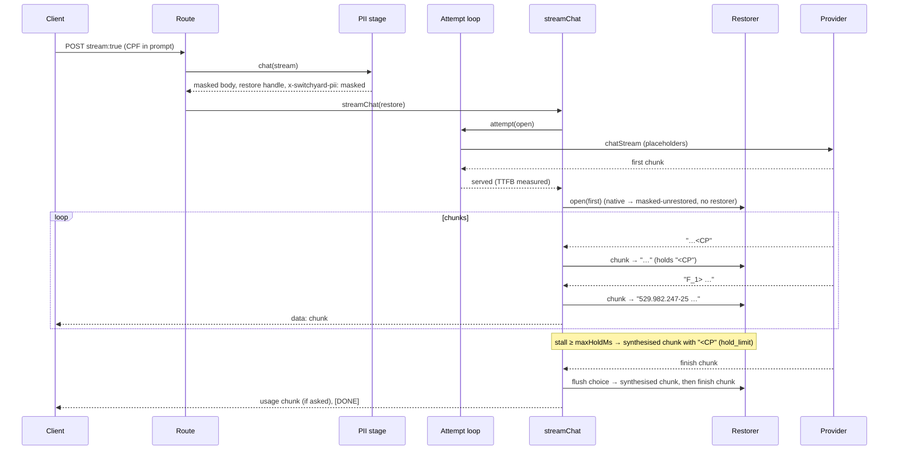

# Design 015: PII restore in streaming responses

- **Status:** Approved (2026-10-13, via `/ship` after spec approval)
- **Spec:** [spec.md](spec.md)
- **Related ADRs:** [0015](../../adr/0015-pii-detection-and-reversible-placeholders.md) (placeholders, best-effort exact restore), [0008](../../adr/0008-no-retry-after-first-byte.md) (no retry after first byte), [0010](../../adr/0010-no-prompt-persistence.md) (no prompt persistence)

Spec open questions resolved as proposed: `maxHoldMs` defaults to 250 (revisited with spec 012's numbers); a held fragment is released as soon as the next character rules it out (the normal path; limits only cover stalls and long fragments); restore failures are not signalled to the client (metrics and span attributes only). No new ADR: bounded holding is an approved spec decision.

Built on top of spec 008 (attempt loop): the restorer runs on the chunks of the **serving** candidate, after the attempt loop has returned the first chunk, so retries and fallbacks never see it and TTFB still measures the first upstream chunk.

## 1. Configuration

```yaml
pii:
  streamRestore:          # spec 015
    maxHoldMs: 250        # longest a fragment is held before it is released unrestored
    # maxHoldChars:       # default: length of the longest placeholder of the request
```

Zod: `streamRestore` strict object, `prefault({})`; `maxHoldMs` positive int (default 250); `maxHoldChars` optional positive int. The effective char limit is `maxHoldChars ?? longest placeholder in the restore map`. A held fragment is always a proper prefix of a placeholder, so with the default the char limit never fires; it exists for operators who want less holding.

## 2. Components

| Path | Responsibility |
|---|---|
| `src/modules/pii/stream-restore.ts` (new) | Pure, clock-free state machines (`now` is a parameter): `createTextRestorer` (one per text slot) and `createChunkRestorer` (slots per choice and tool call, synthesised chunks). `restoreSteps`: async generator that interleaves upstream chunks with hold expiries, given an injected `HoldClock` |
| `src/modules/pii/telemetry.ts` | `switchyard_pii_stream_hold_seconds`, `switchyard_pii_stream_restore_failures_total{reason}`, hold counts on the serving attempt's upstream span |
| `src/modules/pii/stage.ts` | Masked streams now get `x-switchyard-pii: masked` and a `stream` handle (`StreamRestore`) in the stage result; `open(first)` returns a restore session, or switches the header to `masked-unrestored` when the stream cannot be restored (native same-family `/v1/messages` events) |
| `src/config/schema.ts` | `pii.streamRestore` |
| `src/modules/proxy/stream.ts` | Optional `restore` arg; the chunk loop consumes steps (upstream chunk + chunks to send); held text flushed before the SSE error event |
| `src/modules/proxy/routes.ts`, `messages.ts` | Pass `masked.stream` to `streamChat` (one line each) |

`src/core` is unchanged. The pii module imports `nativeEventOf` from `src/core/anthropic.ts` (core, allowed).

### 2.1 Text restorer (one slot)

Keys of the restore map are `<TYPE_n>`: exactly one `<` (first) and one `>` (last), so no key is a prefix of another. At build time the stream index precomputes the set of **proper prefixes** of every key and the longest key length. `push(text, now)` scans `held + text`:

- copy text up to the next `<`;
- at a `<`: if the next `>` closes a known key → emit the value (JSON-escaped in argument slots, same escaping as `restoreText`); else if the rest of the buffer is a proper prefix of a key → **hold** it (stop); else emit `<` and continue after it (ruled out: unknown, altered, lone `<`).

Hold bookkeeping: the hold starts at the first held character (`heldSince`), and is **not** refreshed while the fragment grows (one character per chunk cannot hold forever). When a hold ends it reports `{ heldMs, outcome }` with outcome `restored`, `ruled_out`, `hold_limit` or `end`. `push` releases unrestored (`hold_limit`) a fragment longer than `maxHoldChars` or held for `maxHoldMs` or more; `expire(now)` releases it when `now ≥ heldSince + maxHoldMs`; `flush(now)` releases whatever is held (`end`); `deadline()` is `heldSince + maxHoldMs` or `undefined`.

Text without `<` is returned unchanged, so a stream with no `<` keeps its chunk boundaries (AC-4).

### 2.2 Chunk restorer

Slots keyed `content:<choice>` and `args:<choice>:<tool index>`, created lazily. It remembers `id`, `object`, `created`, `model` of the last upstream chunk for synthesised chunks.

- `chunk(c, now)`: a chunk with no `choices` (usage chunk) first flushes every slot into synthesised chunks, then passes through. Otherwise each choice's `delta.content` and `delta.tool_calls[].function.arguments` go through their slots (other fields untouched; a fully held text becomes `""`, the chunk is still sent so `role`, ids and names are not delayed). When a choice carries `finish_reason`, its slots are flushed: text of a slot the finish chunk itself carries is appended there; any other slot's text goes in a synthesised chunk **before** the finish chunk (AC-6).
- `expire(now)` / `flush(now)`: synthesised chunks, one per choice: `{ id, object, created, model, choices: [{ index, delta: { content?, tool_calls?: [{ index, function: { arguments } }] }, finish_reason: null }] }` (tool calls keep their `index`, so the Anthropic encoder appends to the right `tool_use` block).

### 2.3 Pacing (`restoreSteps`)

```ts
interface HoldClock { now(): number; sleep(ms: number, signal: AbortSignal): Promise<void> }
interface StreamStep { upstream?: ChatChunk; out: ChatChunk[] }
restoreSteps(first, iterator, restorer, clock): AsyncGenerator<StreamStep>
```

For each upstream chunk: yield `{ upstream, out: restorer.chunk(...) }`, then call `iterator.next()` **once** and, while the restorer has a deadline, race that same promise against `clock.sleep(deadline − now)`; when the sleep wins, yield `{ out: restorer.expire(now) }` (synthesised chunks) and race again; the sleep is aborted whenever the upstream wins. At upstream end, yield `{ out: restorer.flush(now) }`. Upstream errors propagate unchanged. `HoldClock` is the shape of spec 008's `Timers` subset; the default is the system clock, tests drive a manual one.

### 2.4 Wiring in `streamChat`

```ts
const session = restore?.open(first.done ? undefined : first.value);
const steps = session ? session.steps(first, iterator) : upstreamSteps(first, iterator);
for await (const step of steps) {
  if (step.upstream) { usage…; outputChars += deltaText(step.upstream).length; }  // AC-6: upstream text
  for (const chunk of step.out) yield* encoder.chunk(chunk);
}
// catch (not client-closed): for (const c of session?.flush() ?? []) yield* encoder.chunk(c); then the error event
```

Usage and token estimates read the upstream chunk, never the restored one. Everything before the first chunk (attempt loop, retries, fallback, TTFB, headers) is unchanged.

## 3. Request flow



## 4. `/v1/messages` (spec 014)

Cross-family streams (OpenAI-compatible or mock candidates) are canonical chunks encoded by the Anthropic encoder, so restoring before `encoder.chunk` restores them for free (`text_delta` and `input_json_delta`), with `x-switchyard-pii: masked`. Same-family streams forward the raw upstream event bytes (`NATIVE_EVENT`); restoring canonical fields there is a no-op, so `open(first)` sees a native first chunk, returns no session and sets `masked-unrestored` (spec non-goal; documented). The candidate (and so the family) is only known after the attempt loop, which is why the decision is taken at `open(first)` and not in the stage.

## 5. Headers

| Situation | `x-switchyard-pii` |
|---|---|
| `mask`, streaming chat, cross-family `/v1/messages` stream | `masked` (was `masked-unrestored`) |
| `mask`, same-family (native) `/v1/messages` stream | `masked-unrestored` |
| everything else | unchanged (spec 010) |

## 6. Failure modes

| Failure | Behaviour |
|---|---|
| Model writes a literal `<` or `<CPF_9>` | released as soon as the next character rules it out (no wait) |
| Upstream stalls with a fragment held | released unrestored in a synthesised chunk at `maxHoldMs`; `hold_limit` counted |
| Upstream fails mid-stream | held text released as-is, then the SSE error event; no retry (ADR-0008) |
| Client disconnects | nothing more is written; the restorer is dropped with the request |
| Chunk not shaped as expected | fields that are not strings are left alone; never throws |
| Stream ends without `finish_reason` | final flush before `[DONE]` / `message_stop` |

## 7. Observability

- `switchyard_pii_stream_hold_seconds` (histogram, `s`, no labels): duration of every hold, whatever its outcome.
- `switchyard_pii_stream_restore_failures_total{reason}` (counter): `reason="hold_limit"` for fragments released unrestored because a limit was reached. Text is never a label.
- Upstream span of the serving attempt (via spec 008's `UpstreamSpan.annotate`): `switchyard.pii.stream_holds` and `switchyard.pii.stream_restore_failures` (counts, set as they change). Not the request span: `@fastify/otel` ends it in `onSend`, before a stream body flows.
- No log line carries text; the restore map stays a local of the request (ADR-0010).

## 8. AC → component → test

| AC | Component | Test |
|---|---|---|
| AC-1 | chunk restorer, stage, routes | `test/unit/pii/stream-restore.test.ts` › per-choice and per-tool-call slots, JSON escaping; `test/unit/proxy/pii-stream-routes.test.ts` › one char per chunk restored in content and arguments + `masked`; `pii-routes.test.ts` › echo stream restored |
| AC-2 | text restorer | `stream-restore.test.ts` › every two-chunk split (table), one char per chunk, three chunks, no partial placeholder emitted |
| AC-3 | text restorer | `stream-restore.test.ts` › `<CPF_9>`, `<cpf_1>`, `< CPF_1 >`, lone `<` forwarded, released at the ruling-out character |
| AC-4 | text restorer, `restoreSteps` | `stream-restore.test.ts` › no-`<` chunk boundaries unchanged, char limit, ms limit; stalled upstream observed exactly at `maxHoldMs` with a manual clock |
| AC-5 | telemetry | `test/unit/pii/stream-telemetry.test.ts` › histogram and `hold_limit` counter, span counts |
| AC-6 | chunk restorer, `streamChat` | `stream-restore.test.ts` › flush before finish chunk, usage chunk; `pii-stream-routes.test.ts` › order finish → usage → `[DONE]`, usage from upstream text |
| AC-7 | `streamChat` | `pii-stream-routes.test.ts` › mid-stream failure: held text then error event, provider called once, TTFB header |
| AC-8 | everything | `test/unit/pii/stream-privacy.test.ts` › trace logs, spans and metric points of a split streamed `mask` request contain no original; the body does |
| §4 | stage, messages route | `test/unit/proxy/messages-usage.test.ts` › cross-family stream restored + `masked`; same-family stays `masked-unrestored` |

## 9. Open decisions (recommendations taken; reversible)

| Decision | Options | Chosen |
|---|---|---|
| Fragment still held at stream end | count as failure / not | **Not a failure** (`end` outcome, hold time recorded): it can no longer become a placeholder; only `hold_limit` is a restore failure as the spec names |
| Text held when the finish chunk itself carries text for that slot | split the finish chunk / append to it | **Append** to the finish chunk's own field (no text arrives after it); other slots get a synthesised chunk before it |
| Fully held delta | drop the chunk / send `""` | **Send `""`**: keeps `role`, tool ids and names on time and the chunk count stable |
| Same-family `/v1/messages` streams | rewrite native SSE JSON / leave | **Leave** (spec non-goal); `masked-unrestored` |
| Clock | `vi` fake timers / injected | **Injected `HoldClock`** in `restoreSteps` (owner rule: no wall-clock tolerances) |

## 10. Risks

| Risk | Mitigation |
|---|---|
| Added latency on `<`-heavy text (HTML, XML answers) | released at the first ruling-out character; bounded by `maxHoldMs`; hold histogram |
| Rebase with specs that touch `stream.ts` | one optional arg and the loop body only; pure logic lives in `src/modules/pii` |
| Original values leaking through telemetry | AC-8 privacy test at `trace` level; metrics have no text labels |
